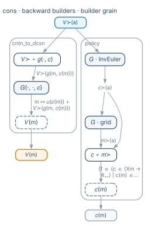

# cons[^digests]

```
STAGE cons / BACKWARD BUILDER cntn → dcsn (cntn_to_dcsn)
━━━━━━━━━━━━━━━━━━━━━━━━━━━━━━━━━━━━━━━━━━━━━━━━━━━━━━━━━━━━━━━━━━━━━━━━━━━━━━
Signature
  in   𝑉≻  : Xa → ℝ
       ───────────────────────────────────────────────────
  out  𝑉   : Xm → ℝ
       𝑑𝑉  : Xm → ℝ₊₊

At
  𝑐  : Xm → ℝ₊₊,  𝑐(m_d) ∈ Γ(m_d)

Operations
  1  Pullback
     in: 𝑉≻                             out: 𝑉≻ ∘ 𝑔≻(·, 𝑐)
     ─────────────────────────────────────────────────────
     rule: (𝑉≻ ∘ 𝑔≻(·, 𝑐))(m_d) = 𝑉≻(𝑔≻(m_d, 𝑐(m_d)))

  2  Aggregation
     in: (1)                            out: 𝑉, 𝑑𝑉
     ─────────────────────────────────────────────────────
     rule: 𝑉(m_d) = 𝑢(𝑐(m_d)) + 𝑉≻(𝑔≻(m_d, 𝑐(m_d)))
           𝑑𝑉(m_d) = 𝑑𝑢(𝑐(m_d))

  3  Evaluation
     in: 𝑉, 𝑑𝑉                          out: 𝑉, 𝑑𝑉
     ─────────────────────────────────────────────────────
     rule: 𝑉 : Xm → ℝ
           𝑑𝑉 : Xm → ℝ₊₊

Conditions
  Aggregation   𝑉(m_d) ∈ ℝ
  Aggregation   𝑑𝑉(m_d) ∈ ℝ₊₊
  cntn_to_dcsn  marginal-reading: the marginal value each line of the marginal
                  block writes is the derivative of the value the builder
                  writes, as the author reads the line; at a policy the
                  reading rests on the envelope conditions   [required]

Method
  !marginals   block cons_egm.bl                       cntn_to_dcsn:Evaluation

Method
  !Cartesian   handler                                 cntn_to_dcsn:Evaluation

Options
  orders = {'m_d': 64000}
  bounds = {'m_d': (0.01, 2000.0)}
──────────────────────────────────────────────────────────────────────────────
Source  cons.bl
  15  V = 𝑢(c) + V[>]

Source  cons_egm.bl
  12  dV = 𝑑𝑢(c)  :: [id=envelope]

Definitions referenced
  Xm    cons:set:Xm
  Xa    cons:set:Xa
  𝑢     cons:function:𝑢
  Γ     cons:correspondence:Γ
  𝑔≻    cons:g:dcsn_to_cntn
  𝑑𝑢    cons:function:𝑑𝑢  cons_egm.bl:2
━━━━━━━━━━━━━━━━━━━━━━━━━━━━━━━━━━━━━━━━━━━━━━━━━━━━━━━━━━━━━━━━━━━━━━━━━━━━━━
```

```
STAGE cons / BACKWARD BUILDER dcsn → arvl (dcsn_to_arvl)
━━━━━━━━━━━━━━━━━━━━━━━━━━━━━━━━━━━━━━━━━━━━━━━━━━━━━━━━━━━━━━━━━━━━━━━━━━━━━━
Signature
  in   𝑉    : Xm → ℝ
       𝑑𝑉   : Xm → ℝ₊₊
       ─────────────────────────────────────────────────────
  out  𝑉≺   : Xm → ℝ
       𝑑𝑉≺  : Xm → ℝ₊₊

Operations
  1  Pullback
     in: 𝑉, 𝑑𝑉                          out: 𝑉 ∘ 𝑔≺, 𝑑𝑉 ∘ 𝑔≺
     ───────────────────────────────────────────────────────
     rule: (𝑉 ∘ 𝑔≺)(m) = 𝑉(𝑔≺(m))
           (𝑑𝑉 ∘ 𝑔≺)(m) = 𝑑𝑉(𝑔≺(m))

  2  Aggregation
     in: (1)                            out: 𝑉≺, 𝑑𝑉≺
     ───────────────────────────────────────────────────────
     rule: 𝑉≺(m) = 𝑉(𝑔≺(m))
           𝑑𝑉≺(m) = 𝑑𝑉(𝑔≺(m))

  3  Evaluation
     in: 𝑉≺, 𝑑𝑉≺                        out: 𝑉≺, 𝑑𝑉≺
     ───────────────────────────────────────────────────────
     rule: 𝑉≺ : Xm → ℝ
           𝑑𝑉≺ : Xm → ℝ₊₊

Conditions
  Aggregation   𝑉≺(m) ∈ ℝ
  Aggregation   𝑑𝑉≺(m) ∈ ℝ₊₊
  dcsn_to_arvl  marginal-reading: the marginal value each line of the marginal
                  block writes is the derivative of the value the builder
                  writes, as the author reads the line; at a policy the
                  reading rests on the envelope conditions   [required]

Method
  !marginals   block cons_egm.bl                       dcsn_to_arvl:Evaluation
──────────────────────────────────────────────────────────────────────────────
Source  cons.bl
  18  V[<] = V

Source  cons_egm.bl
  16  dV[<] = dV  :: [id=marginal]

Definitions referenced
  Xm    cons:set:Xm
  𝑔≺    cons:g:arvl_to_dcsn
━━━━━━━━━━━━━━━━━━━━━━━━━━━━━━━━━━━━━━━━━━━━━━━━━━━━━━━━━━━━━━━━━━━━━━━━━━━━━━
```

```
STAGE cons / POLICY BUILDER policy
━━━━━━━━━━━━━━━━━━━━━━━━━━━━━━━━━━━━━━━━━━━━━━━━━━━━━━━━━━━━━━━━━━━━━━━━━━━━━━
Signature
  in   𝑉≻   : Xa → ℝ
       𝑑𝑉≻  : Xa → ℝ₊₊
       ──────────────────────────────────────────
  out  𝑐    : Xm → ℝ₊₊,  𝑐(m_d) ∈ Γ(m_d)

Declared
  𝑐(m_d) ∈ argmax_{cp ∈ Γ(m_d)} [𝑢(cp) + 𝑉≻(𝑔≻(m_d, cp))]

Operations
  1  InvEuler:Aggregation
     in: 𝑑𝑉≻                            out: 𝑐≻
     ────────────────────────────────────────────
     rule: 𝑐≻(a) ≤ 𝑑𝑢𝑖𝑛𝑣(𝑑𝑉≻(a)) ⟂ a ≥ 0

  2  grid:Aggregation
     in: 𝑐≻                             out: 𝑚_d≻
     ────────────────────────────────────────────
     rule: 𝑚_d≻(a) = a + 𝑐≻(a)

  3  identification:Pullback
     in: 𝑐≻, 𝑚_d≻                       out: 𝑐
     ────────────────────────────────────────────
     rule: 𝑐(𝑚_d≻(a)) = 𝑐≻(a)                                      on 𝑚_d≻(Xa)

  4  Evaluation
     in: 𝑐                              out: 𝑐
     ────────────────────────────────────────────
     rule: 𝑐 : Xm → ℝ₊₊,  𝑐(m_d) ∈ Γ(m_d)

Conditions
  grid:Aggregation  𝑚_d≻(a) ∈ Xm
  policy            egm-eligibility: the construction satisfies the declared
                      line where the continuation value 𝑉≻ is concave and
                      continuously differentiable on (0, ∞) with a finite
                      positive right derivative at 0   [required]

Method
  !egm   cons-port:egm   block cons_egm.bl                              policy
──────────────────────────────────────────────────────────────────────────────
Source  cons.bl
  21  c = argmax_{cp : Γ(m_d)}(𝑢(cp) + V[>])  :: [id=optimality]

Source  cons_egm.bl
  6   c[>]   <= 𝑑𝑢𝑖𝑛𝑣(dV[>]) ⟂ a >= 0         :: [id=InvEuler]
  7   m_d[>] = a + c[>]                       :: [id=grid]
  8   c      = c[>]                           :: [id=identification]

Definitions referenced
  Xm     cons:set:Xm
  Xa     cons:set:Xa
  𝑢      cons:function:𝑢
  Γ      cons:correspondence:Γ
  𝑔≻     cons:g:dcsn_to_cntn
  𝑑𝑢𝑖𝑛𝑣  cons:function:𝑑𝑢𝑖𝑛𝑣  cons_egm.bl:3
━━━━━━━━━━━━━━━━━━━━━━━━━━━━━━━━━━━━━━━━━━━━━━━━━━━━━━━━━━━━━━━━━━━━━━━━━━━━━━
```

```
STAGE cons / FORWARD BUILDER arvl → dcsn (arvl_to_dcsn)
━━━━━━━━━━━━━━━━━━━━━━━━━━━━━━━━━━━━━━━━━━━━━━━━━━━━━━━━━━━━━━━━━━━━━━━━━━━━━━
Signature
  in   μ≺  : finite measure on Xm
       ───────────────────────────────────────
  out  μ   : finite measure on Xm

Operations
  1  Pushforward
     in: μ≺                             out: μ
     ─────────────────────────────────────────
     rule: μ(B) = μ≺({m≺ ∈ Xm | 𝑔≺(m≺) ∈ B})
──────────────────────────────────────────────────────────────────────────────
Source  cons.bl
  9  m_d = m

Definitions referenced
  Xm    cons:set:Xm
  𝑔≺    cons:g:arvl_to_dcsn
━━━━━━━━━━━━━━━━━━━━━━━━━━━━━━━━━━━━━━━━━━━━━━━━━━━━━━━━━━━━━━━━━━━━━━━━━━━━━━
```

```
STAGE cons / FORWARD BUILDER dcsn → cntn (dcsn_to_cntn)
━━━━━━━━━━━━━━━━━━━━━━━━━━━━━━━━━━━━━━━━━━━━━━━━━━━━━━━━━━━━━━━━━━━━━━━━━━━━━━
Signature
  in   μ   : finite measure on Xm
       ────────────────────────────────────────
  out  μ≻  : finite measure on Xa

At
  𝑐  : Xm → ℝ₊₊,  𝑐(m_d) ∈ Γ(m_d)

Operations
  1  Pushforward
     in: μ                              out: μ≻
     ──────────────────────────────────────────
     rule: μ≻(B) = μ({m_d ∈ Xm | 𝑔≻(m_d, 𝑐(m_d)) ∈ B})
──────────────────────────────────────────────────────────────────────────────
Source  cons.bl
  12  a = m_d - c

Definitions referenced
  Xm    cons:set:Xm
  Xa    cons:set:Xa
  Γ     cons:correspondence:Γ
  𝑔≻    cons:g:dcsn_to_cntn
━━━━━━━━━━━━━━━━━━━━━━━━━━━━━━━━━━━━━━━━━━━━━━━━━━━━━━━━━━━━━━━━━━━━━━━━━━━━━━
```



[^digests]: SHA-256 digests of the stage file and the files it is bound from: `declaration/stages/cons/cons.bl` `079783e4b18f918a6a23726ae1f39e13046312c5a8b8cbda5c6ef7f39342fbed`; `declaration/spec.cons-port.yml` `709cd156da91bcf6064de17d44958fda0c67269abd65af32a7c51c647627be98`; `declaration/trellis.cons-port.yml` `c5ff6d720340956c89c09c8a1b01a62d82f859c50283338d32fa507ed660f310`; `declaration/calibration/portfolio.yml` `d421723bd384db56370d97de077f7d7d79c783e432ba6a382b5f21f44ca5f1bb`; `declaration/settings/cons_wide.yml` `8c248564cfbb3b7af5f6749db61c62eea70f8d173cd97ede495666e86bce4e52`; `declaration/methods/cons.yml` `47a8889842046b7222ba05109097a8b7e46c9270f302d4c44809d5785a2f01ed`.
