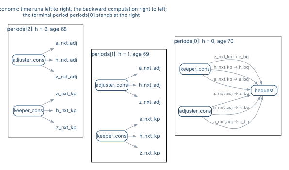
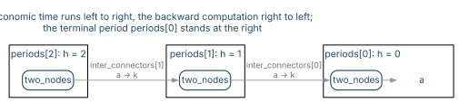

# The Bellman factory

> [!summary]
> The **Bellman factory** is the part of the package that takes a model from its files to a trellis whose every stage holds its values, methods and settings. The preceding page explains how a trellis is loaded as it is written; this page is the recipe route in full. A **recipe** names the trellis file and, for each stage, the stage's file and the ordered files from which its parameter values, its numerical settings and its methods are read, every path written from the recipe's own folder; it leaves places, the slots, for values supplied at the call; and it writes the values that differ by period. The calls of this page give back, in turn, the model as written, a dictionary of records read from those files; the same dictionary with a constructed stage at every position and no value in any of them; and that dictionary with every stage bound to its values, its methods and its settings. One call runs the whole route, and nothing on this page solves a model.

> [!info]- Relationship with other documents
> **Builds on** — [Trellises](07-trellis.md): the three files, the two shapes of a period, the period index and the dictionary a trellis is; [Periods](06-period.md): the joins between the stages of a period; [Methodization](04-methodization.md): the methods files a recipe names.
> **Formal account** — [Periods and the trellis](../bellman-calculus/08-periods-and-trellis.md): composition through compatible fields; [Appendix G](../bellman-calculus/APPX-G-FUNCTIONAL-PROGRAMMING.md) §7: the three binding verbs as maps from stage versions to stage versions.
> **Used by** — [Factory API](API/factory/index.md): the reference of the fourteen functions named here; [Model directory layout](reference/model-directory-layout.md): where the files of a registry are kept.

> [!note]- Key terminology
> | Term | Meaning |
> |---|---|
> | **Bellman factory** | The part of the package that takes a model from its files to the specified trellis: load, elaborate, the three bindings, accrete, and the registry and the recipe ([wiki](../wiki/spec_factory.md)). |
> | **Specification factory** | The part of the Bellman factory that merges the sources a recipe names: the registry and the recipe read together, the route of §3, whose recipe is `spec.yml` ([wiki](../wiki/spec_factory.md)). |
> | **Syntactic trellis** | The model as written, the dictionary of records that `load_trellis` and `load_recipe` return and in which every adjustment is made ([wiki](../wiki/trellis.md)). |
> | **Record** | The entry of the syntactic trellis at one stage key: the stage's text and origin, its three mappings as data and its provenance. |
> | **Elaborated trellis** | The same dictionary with an `ElaboratedStage` at every key, symbolic when nothing is bound and specified when every stage occurrence carries its three bindings ([wiki](../wiki/trellis.md)). |
> | **Stage occurrence** | One use of a stage file at one position of one period, an object of its own ([Periods](06-period.md) §1). |
> | **Symbolic** | Said of a stage occurrence, or a trellis, that holds no binding ([wiki](../wiki/symbolic_stage.md)). |
> | **Specified** | Said of a stage occurrence that holds its calibration, its methods and its settings, bound in that order, or of a trellis whose every stage occurrence does ([wiki](../wiki/specified_stage.md)). |
> | **Binding** | One of the three mappings once a stage holds it: its [calibration](../wiki/calibration.md), its [methods](../wiki/methodization.md) or its [settings](../wiki/settings.md); the verb that writes it, with its mapping held fixed, is a **binding map** from stage versions to stage versions ([Appendix G](../bellman-calculus/APPX-G-FUNCTIONAL-PROGRAMMING.md) §7). |
> | **Trellis verbs** | `calibrate_trellis`, `methodize_trellis` and `configure_trellis`, which apply the stage's own verbs to every stage occurrence of a trellis. |
> | **Accrete** | To append one period, the one earlier in time, with the inter-period connector that joins it to the period appended before it; the horizon is the number of periods built ([Trellises](07-trellis.md) §6; [wiki](../wiki/accretion-modules.md)). |
> | **Registry** | The folder the recipe stands in, from which every path the recipe writes is read, and nothing else ([wiki](../wiki/spec_factory.md)). |
> | **Recipe** | The file `spec.yml` naming the trellis file, each stage's file and, for each stage and each kind, an ordered source list ([wiki](../wiki/spec_factory.md)). |
> | **Source** | A file of assignments of one kind: values to parameters, values to settings, or methods attached to targets; under the `registry` block, assignments to registry-level names that no stage declares ([wiki](../wiki/spec_factory.md)). |
> | **Source list** | The ordered list a recipe names for one stage, one period and one kind, slots included ([wiki](../wiki/spec_factory.md)). |
> | **Slot** | A `$name` in a source list, bound by the keyword of `load_recipe` of the same name ([wiki](../wiki/spec_factory.md)). |
> | **Fill** | The dictionary bound to a slot ([wiki](../wiki/spec_factory.md)). |
> | **Method choice** | A methods mapping bound to a methods slot ([wiki](../wiki/spec_factory.md)). |
> | **Sweep** | A family of fills, one expression over them ([wiki](../wiki/spec_factory.md)). |
> | **Join** | A selected continuation-to-arrival state-field pair between stage occurrences; an authored connector has precedence, and an unclaimed equal-name pair is inferred only when it is the unique compatible choice in a consistent selection ([Periods](06-period.md) §3). |

The listings on this page use the durables model of Dobrescu and Shanker (2026), a household that keeps or adjusts its housing stock over fifty-one ages, written as the registry `applications/durables/declaration/` of the repository, the directory that holds a model's files: four stage files (the tenure stage, which chooses between keeping and adjusting; the keeper's and the adjuster's consumption stages; the bequest), three methods files, two calibration files, one settings file, a period template, a trellis file and a recipe, with a second route beside them. The listings are run from the repository root.

## 1 The two dictionaries and the stage object

The factory works on two dictionaries of one shape and on one stage class, and it introduces nothing else.

The **syntactic trellis** is the model as written. It is the dictionary `{"periods": [...], "inter_connectors": [...]}`, whose `periods` list holds one dictionary per period, `{"stages": {key: record}, "connectors": [...]}`, and whose `inter_connectors` list holds the connectors that join adjacent periods. At each stage key stands a **record**: the stage's source, its text and its origin, together with the three mappings the stage is to be bound with, held as data. The **calibration** gives a value to each parameter the stage declares, the **settings** give the numerical options that the methods read, and the **methods** name the numerical method attached at each target of the stage, a place in the stage's equations that receives a method ([Methodization](04-methodization.md)); a **binding** is one of these mappings once a stage holds it. The record also carries a provenance naming the files each mapping came from. Every adjustment to a model is made in this dictionary before anything is constructed: a fill of parameter values, a value that differs by period, a method choice.

```text
{"periods": [{"stages": {key: record, ...}, "connectors": [...]}, ...],
 "inter_connectors": [...]}
```

The **elaborated trellis** is the same dictionary with an `ElaboratedStage` at every key in place of the record. It is **symbolic** when no stage occurrence is bound and **specified** when every stage occurrence carries its three bindings. `ElaboratedStage` is the only stage object; a syntactic stage is nothing more than its record. A **stage occurrence** is one use of a stage file at one position of one period, with local fields, methods and settings. A parameter name declared by more than one stage of that period denotes one period parameter, with a reconciled declaration and value ([Periods](06-period.md) §1); each verb of §2 returns a new **version** of a stage occurrence and leaves the earlier version unchanged.

`periods[0]` is the terminal period and `periods[h]` the period that lies `h` periods before it; `inter_connectors[h]` joins the continuation fields that leave `periods[h + 1]` to the arrival fields of `periods[h]` ([Trellises](07-trellis.md) §1.1). The adjuster's stage occurrence of the terminal period is therefore `model["periods"][0]["stages"]["adjuster_cons"]`, a record in the syntactic trellis and a stage in the elaborated one. A drawing of a period or of the trellis is made from the dictionary when it is asked for and stored nowhere (§7).

## 2 The calls

The factory has five verbs, each with one meaning. To *load* is to read files and return a record or the syntactic trellis. To *elaborate* is to turn a record's source into an `ElaboratedStage` with its [semgraph](../wiki/semgraph.md), the semantic graph that holds its equations: `elaborate_trellis` makes no binding, and `elaborate_stage` binds the sources a record supplies unless it is given `bind=False` ([The stage](API/stage/01-the-stage.md) §1). To *bind* is to `calibrate_trellis`, `methodize_trellis` or `configure_trellis`, the three **trellis verbs**: each reads the mapping of its kind from the syntactic trellis it is given and returns a new version. To *accrete* is to append one period. To *assemble* is to run the whole route, from the files with `assemble_trellis` or from a syntactic trellis with `specify_trellis`. Two further calls make drawings, and one counts what a verb changed.

| Call | Returns | What it reads and does |
|---|---|---|
| `bellman.stage.load_stage(path)` | the record of one stage file: its text and origin under `stage`, the three mappings empty, the origin and the digest of the text under `provenance` | reads one stage file; elaborates nothing |
| `bellman.trellis.load_trellis(file)` | the syntactic trellis | reads one trellis file whose `periods` list writes each period out, its stages with their three mappings inline or as paths to files, or gives `{template: <period file>, repeat: n}` for a run of equal periods, and whose `inter_connectors` holds one connector per adjacent pair or one connector standing for every pair; reads each stage file for its text and digest ([Trellises](07-trellis.md) §3) |
| `bellman.trellis.load_recipe(directory, recipe, **fills)` | the syntactic trellis | reads the recipe, the trellis file and the stage files at the paths it writes, the period templates and every source file the recipe names, each once; expands each `{template, repeat}` entry and repeats a single inter-period connector for each adjacent pair; puts each fill in its slot; merges each source list; writes one record per stage and period with its provenance (§3) |
| `bellman.stage.elaborate_stage(record, bind=True)` | an `ElaboratedStage`, symbolic where the record supplies no source | constructs the record's text at its origin, binds the calibration, the methods and the settings the record supplies, in that order, unless given `bind=False`, and reads no file; given a path string, or a dictionary that is not a record, refuses under `record-shape` and says to write `elaborate_stage(load_stage(path))` |
| `bellman.trellis.elaborate_trellis(syntactic, previous=None)` | the elaborated trellis, symbolic | constructs each distinct stage text once and places a full copy at each of its positions; copies a position that already holds a stage; given `previous`, copies from it every position whose record has the same digest and constructs the others, which is how a changed stage file alone is constructed again (§6); derives the joins and the order of each period (§7); binds nothing |
| `bellman.trellis.calibrate_trellis(elaborated, syntactic)`, `bellman.trellis.methodize_trellis(elaborated, syntactic)`, `bellman.trellis.configure_trellis(elaborated, syntactic)` | a new elaborated trellis | each reads its own kind at each key of the syntactic trellis, `syntactic["periods"][h]["stages"][key]["calibration"]` for `calibrate_trellis`, and binds the stage occurrence at the same key where the mapping differs from what it holds: for calibration in a value at a name the stage declares, the one value the period supplies standing for a parameter two of its stages declare ([The trellis factory](API/factory/trellis-factory.md) §4), for settings in any value, for methods in the digest of the mapping; a stage occurrence whose mapping is unchanged is copied (§6), as is one at a key where the syntactic trellis itself holds a stage object, a period built by hand |
| `bellman.trellis.accrete(trellis, period, inter_connector=None)` | the trellis with the period appended | appends a period dictionary at the end of `periods`, the period earlier in time, and writes the inter-period connector that joins it to the period appended before it at `inter_connectors[len(periods) - 2]`; the terminal period, appended first, takes no connector; rewrites no existing record; the period may hold records, stage objects or both; when every stage of the period is an `ElaboratedStage`, derives the period's joins and checks the connector against the fields of the two periods it joins ([Trellises](07-trellis.md) §6) |
| `bellman.trellis.specify_trellis(syntactic, previous=None, kinds=KINDS)` | the specified trellis | returns the trellis that `elaborate_trellis(syntactic, previous)` and the trellis verbs of `kinds` make, `kinds` naming any of `"calibration"`, `"methods"` and `"settings"`, the three kinds of `KINDS`, all three by default, the verbs applied in the order calibrate, methodize, configure whatever order `kinds` writes; constructs each distinct stage text once, or takes its stage occurrences from `previous` as `elaborate_trellis` does, and copies each stage occurrence once, where that route copies it once more for each verb; refuses what that route refuses, a refusal of a binding naming the stage occurrence and the kind in its notes, `Stage occurrence: <address>` and `Binding kind: <kind>` |
| `bellman.trellis.assemble_trellis(directory, recipe, **fills)` | the specified trellis | is `specify_trellis(load_recipe(directory, recipe, **fills))`, which returns the trellis that `load_recipe`, `elaborate_trellis`, `calibrate_trellis`, `methodize_trellis` and `configure_trellis` make, in that order, copying each stage occurrence once |
| `bellman.period.diagram_period(trellis, h)` | a drawing, of the kind a graph's `diagram()` returns | shows the stages of `periods[h]` as boxes joined by their joins (§7); stores nothing |
| `bellman.trellis.diagram_trellis(trellis, periods=None)` | a drawing | shows the periods of an elaborated trellis, all of them or those whose indices `periods` lists, each as `diagram_period` shows it, and every inter-period connector between two of those periods as wires from the continuation fields that leave `periods[h + 1]` to the arrival fields of `periods[h]`, labeled with its index and its field pairs (§7); stores nothing |
| `bellman.trellis.changed_positions(before, after)` | the list of positions `(h, key)` | the positions whose stage occurrence in `after` is a new version of the one in `before`, read from the provenance of the two trellises; its length is the count of what a verb bound, a copy of a binding among them, since it is a new version of its position (§6) |

The stage's own verbs are unchanged: `stage.calibrate(values or path)`, `stage.methodize(methods or path)` and `stage.configure(settings or path)` each return a new version of one stage ([The binding verbs](API/stage/09-binding-verbs.md)), and the trellis verbs apply them once for each distinct stage occurrence and mapping, copying the result to the other positions of that pair (§6).

## 3 The registry and the recipe

The **registry** is the folder the recipe stands in, and nothing else: every path the recipe writes is read from it. In a model folder the registry is the subfolder `declaration/`, which holds every file the language reads ([Model directory layout](reference/model-directory-layout.md)). The durables registry holds the recipe, the trellis file and the period template at its top, with the three files of a second route beside them (§3.6); the calibration and settings files under `calibration/` and `settings/`; under `stages/` one folder for each stage, holding its stage file and, where the stage has them, its methods file `methods.yml` and its note; and under `methods/` the block files the methods files name, which hold the endogenous grid lines of the two consumption stages and the derivative lines of the value builders. A file is read whether it is spelled `.yml` or `.yaml`, and a calibration, settings or methods file is told apart by its top key, not by its extension.

```text
applications/durables/declaration/
  stages/          tenure/         tenure.bl  methods.yml  tenure.md
                   keeper_cons/    keeper_cons.bl  methods.yml  keeper_cons.md
                   adjuster_cons/  adjuster_cons.bl  methods.yml  adjuster_cons.md
                   bequest/        bequest.bl  methods.yml
  methods/         keeper_cons_egm.bl  adjuster_cons_egm.bl  marginals_<stage>.bl, one for each stage that states a derivative
  calibration/     durables.yml (the parameters the stages declare)  wage_schedule.yml (the schedule and the ages)
  settings/        durables.yml
  period.yml       the three stages of a period before the terminal one and the connector that joins tenure's branches to the decision states of the consumption stages; the order is derived from the fields, not from the list
  trellis.yml      the terminal period written out with the bequest and its connector, then {template: period.yml, repeat: 50};
                   one inter-period connector standing for every adjacent pair
  spec.yml         the recipe
  spec.two-stages.yml  trellis.two-stages.yml  period.two-stages.yml   the route without the tenure stage (§3.6)
```

### 3.1 What a recipe is and what it binds

A **recipe** names every file a model is read from, and it binds nothing itself. At its top, `trellis:` names the trellis file, whose periods list the stage keys of the model ([Trellises](07-trellis.md) §§1, 3). Under `stages:`, one entry per stage key names the stage's file under `stage:` and, for each of the three kinds of binding, an ordered **source list** of the files whose values the stage receives, with **slots** among them, the entries written `$fill` and `$tenure_method` below, for values supplied at the call (§3.3). Every path is written from the recipe's own folder: `trellis: trellis.yml`, `stage: stages/tenure/tenure.bl`, and in a source list `calibration/durables`, a source file named without its extension. `trellis:` and `stage:` are both required, so that nothing is read in place of a path the recipe does not write; a recipe without `trellis:` is refused with the sentence "the recipe names no trellis file; write `trellis: trellis.yml`, the path from this folder", an entry without `stage:` with "the entry `stages.tenure` names no stage file; write `stage: stages/tenure/tenure.bl`, the path from this folder", both under the rule `recipe-shape`, and a `stage:` that names no `.bl` file is refused as `load_stage` refuses it ([Refusals](reference/refusals.md)). A source name written absolute or with `..` is refused under `recipe-source`. The recipe of the durables model, printed from the registry's file with its comment lines left out:

```python
from pathlib import Path

from bellman.refusals import FactoryError
from bellman.stage import load_stage
from bellman.trellis import (assemble_trellis, calibrate_trellis, changed_positions, configure_trellis,
                             elaborate_trellis, load_recipe, methodize_trellis)

registry = "applications/durables/declaration"

def without_comments(path):
    """The text of a YAML file with its comment lines left out."""
    return "".join(line for line in Path(path).read_text(encoding="utf-8").splitlines(keepends=True)
                   if not line.lstrip().startswith("#"))

print(without_comments(f"{registry}/spec.yml"), end="")
```

```text
trellis: trellis.yml
stages:
  tenure:        {stage: stages/tenure/tenure.bl,               calibration: {all: [calibration/durables, $fill]}, settings: {all: [settings/durables, $fill]}, methods: {all: [stages/tenure/methods, $tenure_method]}}
  keeper_cons:   {stage: stages/keeper_cons/keeper_cons.bl,     calibration: {all: [calibration/durables, $fill]}, settings: {all: [settings/durables, $fill]}, methods: {all: [stages/keeper_cons/methods, $keeper_method]}}
  adjuster_cons: {stage: stages/adjuster_cons/adjuster_cons.bl, calibration: {all: [calibration/durables, $fill]}, settings: {all: [settings/durables, $fill]}, methods: {all: [stages/adjuster_cons/methods, $adjuster_method]}}
  bequest:       {stage: stages/bequest/bequest.bl,             calibration: {all: [calibration/durables, $fill]}, methods: {all: [stages/bequest/methods]}, periods: [0, 0]}
registry:
  calibration: [calibration/wage_schedule]
```

What the recipe determines is the three mappings of every stage occurrence. `bellman.trellis.load_recipe("applications/durables/declaration", "spec.yml")` reads the recipe, the trellis file and the stage files at the paths it writes, the period templates and every source file it names, each once, and writes one record per stage and period, holding the stage's text and digest, the three mappings merged from the lists that apply at that period, and the ordered sources that produced them; it constructs no stage, and it reads a stage file's declarations only to check the names a fill gives. The binding is the work of the trellis verbs, which read those mappings from the records (§4). A recipe cannot stand alone: without the trellis file it names there is no list of periods to write records for, and a stage the recipe names that no period holds, or a stage a period holds that the recipe does not name, is refused under `recipe-template-agreement` with both files named.

### 3.2 The source lists and the merge

A **source** is a file of assignments of one kind: `calibration:` values to parameters, `settings:` values to numerical settings, or `methods:` a list of entries, each attaching a method to the target its `on` key names. For one stage, one kind and one period, the sources that apply are read in the order the list writes them and merged into one mapping, and where two sources assign the same name the later one stands. The merge is key by key: a mapping is merged into a mapping recursively, so that a later source changes the keys it names and keeps the rest; a methods list is merged entry by entry, matched by `on`, an entry of `!marginals` matched only by another of `!marginals`, since a marginal block and another method may stand on one builder, a later entry changing the keys of the matched entry and keeping its others, an unmatched entry appended, and where an entry of either list carries no `on`, the later list replacing the earlier whole, since nothing can be matched; any other value, a number, a string or an ordinary list, is replaced by the later one. A source file may name a `parent:` source it extends, which is read first and merged beneath it in the same way, a chain of at most ten files that may not return to itself; the keys `parent`, `description`, `version` and `__comment__` are about the file and assign nothing. Each file is read once per call, and a file whose top key is of another kind than the list it stands in is refused under `recipe-source`. [Recipe functions](API/factory/spec-factory.md) §2 tabulates the rules.

The durables lists are short, each a file followed by a slot, so the merge is seen best in the provenance a record carries: under `provenance["source_lists"]`, for each kind, the ordered sources that produced its mapping, each file with its path and digest and each slot with its name, whether a fill was bound to it and the fill's names the stage took (§5). A longer list is read the same way: `calibration: {all: [calibration/main, calibration/fine, $fill]}` gives every value of `main`, then the values of `fine` where it assigns a name `main` also assigns, then the fill's.

### 3.3 Slots and fills

A **slot** is a `$name` in a source list, a place for values supplied at the call. It is bound by the keyword of `load_recipe` or `assemble_trellis` that spells the same name without the `$`: `fill=` binds `$fill`, `adjuster_method=` binds `$adjuster_method`. The names are the author's and mean nothing by themselves; a slot name is a Python identifier, since a keyword binds it; a keyword that names no slot of the recipe is refused under `recipe-slot-unknown` with the slots the recipe declares. A slot's position in its list is its precedence, so that `$fill` written after `calibration/durables` stands over the file's values, and a slot bound by no keyword contributes nothing. The same slot may stand in the lists of several stages and kinds, as `$fill` stands in the calibration and the settings lists of all four durables stages, and one fill is then read wherever the slot stands.

A **fill** is the dictionary bound to a slot, and it takes one of three shapes. A fill keyed by kind, `fill={"calibration": {"β": 0.93}, "settings": {"n_a": 500}}`, is split, each list taking the part of its kind. A flat fill, `fill={"β": 0.93}`, is read against the declarations of the stages whose lists name the slot: a name a receiving stage declares as a parameter goes to the calibration lists, a name a receiving stage's settings files or methods files use goes to the settings lists, and a flat fill that names both parameters and settings is refused under `fill-mixes-kinds`, since one flat mapping cannot say which name is which. A **method choice** is a methods mapping bound to a methods slot, `adjuster_method={"methods": [{"on": "cntn_to_dcsn", "method": "!vfi", ...}]}`, merged into the methods list by `on`, an entry of `!marginals` matched only by another of `!marginals`, so that it states the keys in which the chosen method differs from the file's entry and keeps the rest; each durables stage has a methods slot of its own, `$tenure_method`, `$keeper_method` and `$adjuster_method`, because one slot named by the methods lists of two stages would attach one stage's [handler](../wiki/handler.md), the numerical routine named for a method, to the other. A fill that is no mapping is refused under `slot-value-not-a-mapping`, and a fill key that no receiving stage declares and no `registry` block admits (§3.5) under `fill-names-nothing`, the refusal naming the receiving stages with the names they declare and what may be written (§5).

A fill given to `load_recipe` produces a fresh syntactic trellis from the registry with the fill in its slot; nothing is constructed. The record's provenance marks the slot's entry bound and lists the fill's names the stage took, and the trellis verbs then bind the stage occurrences whose mapping changed and copy the rest (§5). A **sweep** is a family of fills, one expression over them, `[bellman.trellis.calibrate_trellis(model, bellman.trellis.load_recipe(registry, "spec.yml", fill={"β": beta})) for beta in betas]`; an estimation is the same expression inside its criterion function (§6.1).

### 3.4 Values that differ by period

The sources common to every period stand in a stage's `all` list. The sources of some periods stand in a **range list** beside it, keyed by the periods it covers, written `"lo-hi"` and counted as the trellis counts them, the terminal period being `0` ([Trellises](07-trellis.md) §1.1). For a period inside the range, the range list is read after the `all` list, so that its sources stand over the common ones and over the fill; the ranges of one stage and one kind must not overlap, and a key that is not written `lo-hi` is refused under `recipe-shape`. The within-life model of Benhabib, Bisin and Luo (2019), `applications/benhabib-2019/`, gives its one decision stage a wage profile constant within each of six age brackets of six years, one range list per bracket:

```yaml
trellis: trellis.yml
stages:
  benhabib_bellman:
    stage: stages/benhabib_bellman/benhabib_bellman.bl
    calibration:
      all:     [calibration/main, $fill]
      "1-6":   [calibration/wage/bracket_6]
      "7-12":  [calibration/wage/bracket_5]
      "13-18": [calibration/wage/bracket_4]
      "19-24": [calibration/wage/bracket_3]
      "25-30": [calibration/wage/bracket_2]
      "31-36": [calibration/wage/bracket_1]
    settings: {all: [settings/default, $fill]}
    methods:  {all: [stages/benhabib_bellman/methods, $bellman_method]}
    periods: [1, 36]
  bequest: {stage: stages/bequest/bequest.bl, calibration: {all: [calibration/main, $fill]}, methods: {all: [stages/bequest/methods]}, periods: [0, 0]}
registry:
  calibration: [calibration/horizon]
```

At `periods[1]` to `periods[6]`, ages 60 to 55, the record's calibration holds the wage function of the sixth bracket, read after `calibration/main` and the fill; at `periods[7]` it holds the fifth bracket's, and at `periods[36]`, age 25, the first bracket's.

A stage **active in some periods only** writes `periods: [lo, hi]` on its entry, the bounds counted the same way, and the stage is then absent from the records of every other period, even where the template lists it. The benhabib template lists both stages in every one of its thirty-seven periods, and the recipe places the bequest in `periods[0]` alone and the decision stage in `periods[1]` to `periods[36]`; a stage restricted to periods that no template holds is refused under `recipe-template-agreement`. A range list changes what a stage receives at some periods, and `periods:` changes where the stage occurs; the interval stands in the record's provenance under `active`.

**The bequest is a stage.** The file `bequest.bl` declares its parameters, arrives at the savings, the housing and the income state that the consumption stages continue to, under names of its own, `a_bq`, `h_bq` and `z_bq`, so that no arrival field of the terminal period is declared by two stages, values the wealth left behind, and reads a continuation value `V[>]` whose value is zero, the boundary data of the terminal period; its methods file, `stages/bequest/methods.yml`, binds the marginal blocks that state the derivatives of its value, which the consumption stages' method blocks read. There is no separate terminal object of any kind: the bequest stands last in the terminal period, is active there alone through `periods: [0, 0]`, and receives a fill of θ as any stage receives a fill of a parameter it declares.

A value that varies with every period, such as the wage schedule's income level `Y` and retirement income `y_R` of the tenure stage, has no key of the recipe and no class: the application writes each period's values into the syntactic trellis before the trellis verbs bind, from the names the `registry` block carries (§3.5), or calibrates each period with its own values as it accretes.

### 3.5 The registry block

The recipe's `registry` block names sources whose assignments no stage declares, here the eight names of `calibration/wage_schedule.yml`, so that a fill of one of them is not refused. They stand under the trellis's own `registry` key, `{kind: {name: value}}`, with their sources under the trellis's `provenance`, are bound to no stage and are copied unread by `elaborate_trellis` and the trellis verbs; a fill of such a name changes the `registry` mapping and nothing else. They are data for the application's own functions. The durables function `write_wage_schedule`, in `applications/durables/code/wage_schedule.py`, computes `Y` and `y_R` for each age from the schedule's coefficients and writes them into that period's `tenure` record, appending to the record's source list an entry that names the function, so that a record's provenance names every writer. It runs after every `load_recipe`, since a fill produces a fresh syntactic trellis, and before the trellis verbs:

```python
import sys

sys.path.insert(0, "applications/durables/code")
from wage_schedule import write_wage_schedule

full = write_wage_schedule(load_recipe(registry, "spec.yml"))
last_age = full["registry"]["calibration"]["last_age"]
for h in (0, 10, 50):
    tenure = full["periods"][h]["stages"]["tenure"]["calibration"]
    print(f"periods[{h}], age {last_age - h}: Y {tenure['Y']:.4f}, y_R {tenure['y_R']}")
```

```text
periods[0], age 70: Y 0.0000, y_R 0.1
periods[10], age 60: Y 0.8986, y_R 0.0
periods[50], age 20: Y 0.3193, y_R 0.0
```

The tenure stage chooses between keeping and adjusting. It is a [branching stage](05-branching.md); the full recipe constructs it in each of the fifty-one periods, and the whole trellis then holds one hundred and fifty-four stage occurrences.

### 3.6 Variants side by side

A second route through the same stages is a second set of the three files beside the first, `spec.<name>.yml`, `trellis.<name>.yml` and `period.<name>.yml`, the name chosen by the author ([Trellises](07-trellis.md) §5). The durables registry keeps the route without the tenure stage this way: `spec.two-stages.yml` names `trellis.two-stages.yml` under `trellis:` and the same source files as `spec.yml`, and that trellis file names `period.two-stages.yml` under `template:`. The listings that elaborate on this page read this route, which leaves out the tenure stage, and all but the call of §4 that assembles the fifty-one periods keep its three latest periods, so that each of them runs in under two seconds:

```python
print(without_comments(f"{registry}/trellis.two-stages.yml"), end="")
```

```text
!trellis
name: durables_two_stages
periods:
  - stages: [keeper_cons, adjuster_cons, bequest]
    connectors:
      - {a_nxt_kp: a_bq, h_nxt_kp: h_bq, z_nxt_kp: z_bq, a_nxt_adj: a_bq, h_nxt_adj: h_bq, z_nxt_adj: z_bq}
  - {template: period.two-stages.yml, repeat: 50}
inter_connectors: []
```

Its terminal period holds the connector from both consumption stages' continuation fields to the bequest's arrival fields `a_bq`, `h_bq` and `z_bq`, and its fifty other periods repeat the template, which lists the two consumption stages and no connector. Its `inter_connectors` list is empty, so `load_recipe` writes the empty connector for each of the fifty adjacent pairs, and the periods are not joined to one another, since this file holds no tenure stage for the consumption stages to continue to.

A variant that changes the values a stage receives and not the route needs no second set of files: it is a further source file, `calibration/near_terminal.yml` or `settings/fine.yml`, that a recipe lists after the common one in a source list, or in a range list for some periods, and the merge of §3.2 gives it precedence. A variant supplied at the call is a fill (§3.3).

## 4 From the recipe to the specified trellis

A trellis is built backward by accretion, one period at a time from the terminal period, and nothing else is imposed on it: `bellman.trellis.accrete` appends each period with the connector that joins it to the period appended before it, the horizon is the number of periods built, and [Trellises](07-trellis.md) §6 shows a trellis built by hand this way from records or from stages already elaborated and bound. Every call of §2 that acts on a trellis is a loop of accretion and adds nothing to it: `elaborate_trellis` elaborates the periods in order, the three trellis verbs bind stage occurrence by stage occurrence, and `assemble_trellis` returns in one call the trellis they make. The recipe route is therefore two routes to the same specified trellis.

The first starts from the syntactic trellis, read by `load_recipe`, adjusts it where the application must, and then elaborates and binds it. The listings keep only the three latest periods of the syntactic trellis, an adjustment made in the dictionary like any other; on all fifty-one periods the same calls construct and bind one hundred and three stage occurrences:

```python
def latest(syntactic, count):
    """The syntactic trellis cut to its `count` latest periods, the terminal period first."""
    return {**syntactic, "periods": syntactic["periods"][:count], "inter_connectors": syntactic["inter_connectors"][:count - 1]}

recipe = "spec.two-stages.yml"
syntactic = load_recipe(registry, recipe)
print(len(syntactic["periods"]), "periods;", len(syntactic["inter_connectors"]), "inter-period connectors, of which",
      sum(1 for connector in syntactic["inter_connectors"] if connector == {}), "empty")
print("periods[0]:", list(syntactic["periods"][0]["stages"]), "  periods[1]:", list(syntactic["periods"][1]["stages"]))

three = latest(syntactic, 3)
elaborated = elaborate_trellis(three)
model = configure_trellis(
    methodize_trellis(
        calibrate_trellis(elaborated, three), three), three)
print(repr(model["periods"][0]["stages"]["adjuster_cons"]))
```

```text
51 periods; 50 inter-period connectors, of which 50 empty
periods[0]: ['keeper_cons', 'adjuster_cons', 'bequest']   periods[1]: ['keeper_cons', 'adjuster_cons']
ElaboratedStage('adjuster_cons', specified)
```

The second is one call, which returns the trellis the five calls of the first route make, copying each stage occurrence once. On the whole registry it returns the fifty-one periods; its three latest periods equal, stage occurrence by stage occurrence, the trellis the first route built:

```python
model_in_one = assemble_trellis(registry, recipe)
print(len(model_in_one["periods"]), "periods")
print(all(model["periods"][h]["stages"][key] == model_in_one["periods"][h]["stages"][key]
          for h in range(3) for key in model["periods"][h]["stages"]))
```

```text
51 periods
True
```

## 5 What each call prints

The names `registry`, `recipe`, `syntactic`, `three`, `elaborated` and `model` are those of §§3 and 4. The record of the adjuster at the terminal period holds the stage's origin, its three merged mappings and its provenance. The settings mapping has thirty-nine entries, of which six are printed. The record's own `methods` mapping holds the entries of the methods file as data, a method tag kept as `{'__yaml_tag__': <tag>, 'value': ''}`; the methods are printed here as the methodized stage prints them, by place and tag:

```python
record = syntactic["periods"][0]["stages"]["adjuster_cons"]
print(record["stage"]["origin"])
print("calibration:", record["calibration"])
print("settings:", dict(list(record["settings"].items())[:6]), "... of", len(record["settings"]))
print("provenance:", {key: value for key, value in record["provenance"].items() if key != "source_lists"})
print("methods:")
print(model["periods"][0]["stages"]["adjuster_cons"].methods)
```

```text
applications/durables/declaration/stages/adjuster_cons/adjuster_cons.bl
calibration: {'R': 1.045, 'R_H': 1.0, 'β': 0.945, 'α': 0.7, 'γ_c': 3.5, 'γ_h': 1.5, 'κ': 0.06, 'δ': 0.0, 'τ': 0.12, 'ρ_z': 0.82, 'σ_z': 0.11, 'θ': 1.3498, 'K': 1.3}
settings: {'n_a': 300, 'a_min': 0.01, 'a_max': 7.5, 'grid_phi': 1.01, 'b': 0.01, 'n_h': 300} ... of 39
provenance: {'origin': 'applications/durables/declaration/stages/adjuster_cons/adjuster_cons.bl', 'sha256': '3c216eb3cb57c0d6187d4e2a820822bed94eb34b748490e813179cd7de87885b'}
methods:
policy                    !egm   block ../../methods/adjuster_cons_egm.bl
cntn_to_dcsn:Evaluation   !marginals   block ../../methods/marginals_adjuster_cons.bl
cntn_to_dcsn:Evaluation   !Linear
```

The record's `provenance["source_lists"]` holds, for each kind, the ordered sources that produced its mapping: each file with its path and digest, and each slot with its name, whether a fill was bound to it, and the fill's names that the stage declares, here none since no fill was given. The registry-level names stand under the trellis's `registry` key:

```python
from pprint import pprint

pprint(record["provenance"]["source_lists"])
pprint(syntactic["registry"])
```

```text
{'calibration': [{'path': 'applications/durables/declaration/calibration/durables.yml',
                  'sha256': '77a026308bd078082e963b0d3fe6aa2cf1f79900e9c0bd5a837698f86beb000b',
                  'source': 'calibration/durables'},
                 {'bound': False, 'names': [], 'slot': 'fill'}],
 'methods': [{'path': 'applications/durables/declaration/stages/adjuster_cons/methods.yml',
              'sha256': '9ae11b17042a256ad850f680bcc9ad324c8190718bad8fb40a6df153dd82fca6',
              'source': 'stages/adjuster_cons/methods'},
             {'bound': False, 'names': [], 'slot': 'adjuster_method'}],
 'settings': [{'path': 'applications/durables/declaration/settings/durables.yml',
               'sha256': 'e176ae673908bfc8331b68a7aa671b1f7bf15bba445ce83e61b2e7d155e62e42',
               'source': 'settings/durables'},
              {'bound': False, 'names': [], 'slot': 'fill'}]}
{'calibration': {'earnings_scale': 1e-05,
                 'first_age': 20,
                 'last_age': 70,
                 'retirement_age': 60,
                 'retirement_income': 0.1,
                 'tenure_cap': 30,
                 'tenure_origin': 20,
                 'wage_coefficients': [4.329982,
                                       0.610214,
                                       -0.0209832,
                                       0.0003132,
                                       -1.72e-06,
                                       0.0199949,
                                       4.76e-05]}}
```

A symbolic stage occurrence declares its parameters and holds no value for them. The `set` column of `par` is filled from the declarations and the `value` column reads `unbound`:

```python
adjuster = elaborated["periods"][0]["stages"]["adjuster_cons"]
print(repr(adjuster))
print(adjuster.par)
```

```text
ElaboratedStage('adjuster_cons', symbolic)
name  set       value    describes
β     (0, 1)    unbound  discount factor
α     (0, 1)    unbound  weight of consumption in utility
γ_c   (1, inf)  unbound  curvature of utility from consumption
γ_h   (1, inf)  unbound  curvature of utility from housing services
κ     ℝ₊₊       unbound  housing services per unit of the housing stock
τ     ℝ₊₊       unbound  cost of adjusting housing, per unit of housing bought
```

Each trellis verb takes the elaborated trellis and the syntactic trellis and returns a new elaborated trellis. `changed_positions(before, after)` lists the positions whose stage occurrence is a new version, a copy of a binding among them (§6); the others were copied unchanged. On a fresh elaboration no position holds a binding, so each verb binds all seven stage occurrences of the three periods, and a verb applied again with the same mappings binds none:

```python
def bound_and_copied(before, after):
    """The count of positions a verb bound and the count it copied."""
    bound = len(changed_positions(before, after))
    return f"bound {bound}, copied {sum(len(period['stages']) for period in after['periods']) - bound}"

calibrated = calibrate_trellis(elaborated, three)
methodized = methodize_trellis(calibrated, three)
specified = configure_trellis(methodized, three)
for verb, before, after in (("calibrate_trellis", elaborated, calibrated), ("methodize_trellis", calibrated, methodized),
                            ("configure_trellis", methodized, specified)):
    print(f"{verb}: {bound_and_copied(before, after)}; the adjuster is now {after['periods'][0]['stages']['adjuster_cons']!r}")
print("calibrate_trellis again:", bound_and_copied(specified, calibrate_trellis(specified, three)))
```

```text
calibrate_trellis: bound 7, copied 0; the adjuster is now ElaboratedStage('adjuster_cons', calibrated)
methodize_trellis: bound 7, copied 0; the adjuster is now ElaboratedStage('adjuster_cons', methodized)
configure_trellis: bound 7, copied 0; the adjuster is now ElaboratedStage('adjuster_cons', specified)
calibrate_trellis again: bound 0, copied 7
```

After the three trellis verbs, `par` shows each parameter's value, `methods` the method bound at each place, and the bequest of the terminal period, a stage like the others, shows its seven values:

```python
adjuster = model["periods"][0]["stages"]["adjuster_cons"]
print(adjuster.par)
print()
print(adjuster.methods)
print()
print(model["periods"][0]["stages"]["bequest"].par)
```

```text
name  set       value  describes
β     (0, 1)    0.945  discount factor
α     (0, 1)    0.7    weight of consumption in utility
γ_c   (1, inf)  3.5    curvature of utility from consumption
γ_h   (1, inf)  1.5    curvature of utility from housing services
κ     ℝ₊₊       0.06   housing services per unit of the housing stock
τ     ℝ₊₊       0.12   cost of adjusting housing, per unit of housing bought

policy                    !egm   block ../../methods/adjuster_cons_egm.bl
cntn_to_dcsn:Evaluation   !marginals   block ../../methods/marginals_adjuster_cons.bl
cntn_to_dcsn:Evaluation   !Linear

name  set       value   describes
θ     ℝ₊₊       1.3498  weight of the bequest in utility
K     ℝ₊₊       1.3     shift of the bequest utility
α     (0, 1)    0.7     weight of consumption in utility
γ_c   (1, inf)  3.5     curvature of utility from consumption
R     ℝ₊₊       1.045   gross return on financial assets
R_H   ℝ₊₊       1.0     gross return on housing, received when the house is sold
δ     [0, 1)    0.0     depreciation rate of housing
```

A **fill** is given to `load_recipe`, which returns a fresh syntactic trellis from the registry with the fill in its slot. Applied to the specified trellis with that syntactic trellis as its second argument, `calibrate_trellis` binds again the six stage occurrences that declare β and copies the bequest, which does not; `configure_trellis` binds again the six whose settings changed and copies the bequest, which has no settings list. On all fifty-one periods each verb binds one hundred and two and copies the one bequest. The earlier trellis keeps its values, and in the calibration source list of the new version's provenance the slot's entry is marked bound, with the fill's name that the stage declares in that kind:

```python
filled = latest(load_recipe(registry, recipe, fill={"calibration": {"β": 0.93}, "settings": {"n_a": 500}}), 3)
recalibrated = calibrate_trellis(model, filled)
print("calibrate_trellis:", bound_and_copied(model, recalibrated),
      "; the bequest among the bound:", (0, "bequest") in changed_positions(model, recalibrated))
model_b = configure_trellis(recalibrated, filled)
print("configure_trellis:", bound_and_copied(recalibrated, model_b))
adjuster_b = model_b["periods"][0]["stages"]["adjuster_cons"]
print("before the fill: β", adjuster.par["β"].value, "  n_a", adjuster.settings["n_a"].value)
print("after the fill:  β", adjuster_b.par["β"].value, "  n_a", adjuster_b.settings["n_a"].value)
pprint([dict(entry) for entry in adjuster_b.provenance["source_lists"]["calibration"]])
```

```text
calibrate_trellis: bound 6, copied 1 ; the bequest among the bound: False
configure_trellis: bound 6, copied 1
before the fill: β 0.945   n_a 300
after the fill:  β 0.93   n_a 500
[{'path': 'applications/durables/declaration/calibration/durables.yml',
  'sha256': '77a026308bd078082e963b0d3fe6aa2cf1f79900e9c0bd5a837698f86beb000b',
  'source': 'calibration/durables'},
 {'bound': True, 'names': ('β',), 'slot': 'fill'}]
```

A **method choice** is a methods mapping bound to a stage's methods slot. This one, bound to `$adjuster_method`, puts the method tag [`!vfi`](reference/methods.md#vfi) with another handler on the adjuster's backward decision builder `cntn_to_dcsn`, beside the endogenous grid entry the file writes on its policy builder and the `!marginals` entry the file writes on the same backward decision builder, which the merge keeps, since an entry of `!marginals` is matched by another of `!marginals` alone, and leaves the keeper's entry as the file writes it; on all fifty-one periods it makes the adjuster's fifty-one stage occurrences anew and copies the fifty-two others. A version holds one methods binding, so `methodize_trellis` makes anew each stage occurrence whose methods changed, the adjuster's three, from a fresh elaboration of its record, calibrated with the values it holds, methodized with the new mapping and configured with the settings it holds, and copies the four others:

```python
choice = {"methods": [{"on": "cntn_to_dcsn", "method": "!vfi", "handler": "fues-durables:make_adjuster_vfi"}]}
chosen = latest(load_recipe(registry, recipe, adjuster_method=choice), 3)
switched = methodize_trellis(model, chosen)
print("methodize_trellis:", bound_and_copied(model, switched))
print()
print(switched["periods"][0]["stages"]["adjuster_cons"].methods)
print()
print(switched["periods"][0]["stages"]["keeper_cons"].methods)
```

```text
methodize_trellis: bound 3, copied 4

policy                    !egm   block ../../methods/adjuster_cons_egm.bl
cntn_to_dcsn:Evaluation   !marginals   block ../../methods/marginals_adjuster_cons.bl
cntn_to_dcsn:Evaluation   !Linear
cntn_to_dcsn              !vfi

policy                    !egm   block ../../methods/keeper_cons_egm.bl
cntn_to_dcsn:Evaluation   !marginals   block ../../methods/marginals_keeper_cons.bl
cntn_to_dcsn:Evaluation   !Linear
```

A fill key that no receiving stage declares and no `registry` block admits is refused under the rule `fill-names-nothing`. The refusal names the slot, the key, the receiving stages with the names they declare, and what may be written; here `beta` is written for β. This listing prints the rule alone, so its result remains short:

```python
try:
    load_recipe(registry, recipe, fill={"calibration": {"beta": 0.93}})
except FactoryError as refusal:
    print(refusal.rule)
```

```text
fill-names-nothing
```

A **sweep** is one expression over a family of fills. Each fill gives a syntactic trellis, and `calibrate_trellis` on the specified trellis binds again the stage occurrences whose β changed: six for 0.93 and for 0.96, none for 0.945, the value the calibration file holds. An estimation is the same expression inside its criterion function:

```python
for beta in (0.93, 0.945, 0.96):
    swept = calibrate_trellis(model, latest(load_recipe(registry, recipe, fill={"calibration": {"β": beta}}), 3))
    print(f"β = {beta}: {bound_and_copied(model, swept)}; β read back:",
          swept["periods"][0]["stages"]["adjuster_cons"].par["β"].value)
```

```text
β = 0.93: bound 6, copied 1; β read back: 0.93
β = 0.945: bound 0, copied 7; β read back: 0.945
β = 0.96: bound 6, copied 1; β read back: 0.96
```

## 6 What a change makes anew

| The economist changes | Made anew | Kept |
|---|---|---|
| a calibration file, or a fill of parameters | by `calibrate_trellis`: the stage occurrences whose calibration in the syntactic trellis changed in a name they declare, and, in the same period, the stage occurrences that declare a changed name too, since the stages of a period share the parameters they declare under one name | the graphs; their methods and settings; every earlier version, and whatever was compiled from it |
| a settings file, or a fill of settings | by `configure_trellis`: the stage occurrences whose settings changed | the graphs; their calibration and methods |
| a methods file, or a method choice | by `methodize_trellis`: the stage occurrences whose methods changed, made anew from a fresh elaboration of their record, calibrated with the values they hold, methodized with the new mapping and configured with the settings they hold, since a version holds one methods binding | every other stage occurrence |
| a stage file | by `elaborate_trellis(syntactic, elaborated)`: the stage occurrences of that file, the digest in the record detecting the change | every other stage occurrence, copied from `elaborated` |
| the period template or the trellis file | by `load_recipe`: the shape of the trellis and the positions | the stage occurrences whose record is unchanged |

A fill given to `load_recipe` produces a fresh syntactic trellis from the registry, so values the application wrote into the records period by period are written again by its function after every `load_recipe`, before the trellis verbs bind; such a function appends to the record's source list an entry naming its file, the names it wrote and its argument, so that a record's provenance names every writer. Only a changed stage file is constructed again: `elaborate_trellis` given the earlier elaborated trellis as its second argument copies every position whose record kept its digest and constructs the others. As `elaborate_trellis` constructs each distinct stage text once (§2), a verb binds each distinct input once, except a changed method choice, which `methodize_trellis` remakes at each position from its record. Where several positions hold versions of one stage file with the same bindings and recorded sources and the syntactic trellis gives them the same mapping, each mapping written with its keys in the same order, since a version prints them in that order, as it gives `keeper_cons` one calibration at every age, the verb binds the first and places at each of the others a copy that records its own position and parent and equals the version the verb would bind there alone; such a copy is a new version of its position, so `changed_positions` names it among the positions bound. Every stage occurrence is its own object; two stage occurrences with equal mappings have equal bindings and graphs and are distinct objects. Within a period, stages that declare the same parameter name share the meaning and value of that parameter, while their fields remain local. A verb binds a stage occurrence to the version it is given, never to the version of an earlier fill in a chain, and the earlier trellis is untouched. Binding changes no graph: the semgraphs of a bound version equal those of the symbolic one, and a verb writes to the bindings alone. What a change does to a numerical representation belongs to realization and is not decided here.

### 6.1 Many draws on many cores

An estimation solves the model once for each draw of its parameters, often on many cores at once. Since binding changes no graph, the specified trellis is built once, by one of the routes of §4, and each draw binds its values to that trellis with `calibrate_trellis`, as the sweep of §5 does; no stage is constructed, methodized or configured again. A version a verb makes starts with copies of the answers its argument had computed that the graphs determine, among them the table of each stage's wires, so that a drawn trellis holds, without computing them again, the answers the specified trellis holds. On the durables trellis of fifty-one periods and one hundred and fifty-four stage occurrences, measured in one process on an Apple machine, the build takes about 12 s and each draw about 2.5 s, of which 0.4 s is the copying of those answers. Compiling the kernels of a drawn trellis, the functions a solver calls ([A piece](API/stage/05-piece.md) §2), takes about 2 s where nothing but the build and the draws has been asked of the specified trellis, and 0.7 s once the specified trellis has compiled its own kernels, in 2 s, since a drawn version then carries what they read.

On one node, the trellis is built in a parent process, which asks it once for what every draw asks, by one draw of its own and, where the solver compiles kernels, by compiling them on the specified trellis, then calls `gc.freeze()` and only then starts its workers by `fork`, the operating system's call that starts a process as a copy of the running one. Each worker holds the parent's trellis and those answers, and builds nothing. On the durables trellis, a worker started after one draw made its draw in 2.1 s and compiled the kernels of its trellis in 1.8 s, and its own memory, apart from what it shares with the parent, grew from 4 MB just after the fork to about 200 MB. `gc.freeze()` sets every object that exists when it is called aside from Python's garbage collector, which otherwise traverses the whole trellis at each full collection: it cut the collector's share of the first draw after the build from about 0.65 s to 0.26 s, and the draw from about 2.5 s to 2.1 s, and it keeps a worker's collections from writing to the memory the worker shares with the parent. The listing runs the pattern on the three periods of §4, with two workers and three draws; it asks for `fork` by name, since not every platform starts a worker that way by default:

```python
import gc
import multiprocessing
import pickle

def draw(beta):
    """One draw of an estimation: the specified trellis bound to the draw's β, as the sweep of §5
    binds it. A solver would read the drawn trellis here."""
    drawn = calibrate_trellis(model, latest(load_recipe(registry, recipe, fill={"calibration": {"β": beta}}), 3))
    return f"β = {beta}: {bound_and_copied(model, drawn)}"

def work(betas):
    """One worker's share of the draws. It builds nothing, since it holds the parent's trellis."""
    for beta in betas:
        results.put(draw(beta))

draw(0.94)                        # the first draw, made once in the parent
gc.collect()
gc.freeze()                       # every object built so far set aside from the garbage collector
fork = multiprocessing.get_context("fork")
results = fork.Queue()
workers = [fork.Process(target=work, args=(betas,)) for betas in ([0.93, 0.95], [0.96])]
for worker in workers:
    worker.start()
print("\n".join(sorted(results.get() for _ in range(3))))
for worker in workers:
    worker.join()

sent = pickle.dumps(model)        # what one rank sends the others under MPI
print("the trellis read back by the standard pickle equals it:", pickle.loads(sent) == model)
```

```text
β = 0.93: bound 6, copied 1
β = 0.95: bound 6, copied 1
β = 0.96: bound 6, copied 1
the trellis read back by the standard pickle equals it: True
```

Across nodes, the processes of a job that uses MPI, the message-passing standard of cluster computing, are started separately, one per core, and none is a copy of another. One rank, as such a process is called, builds the trellis and sends it to the others, with mpi4py `model = comm.bcast(model if comm.rank == 0 else None, root=0)`, which writes and reads it with Python's standard `pickle`, as the last lines of the listing do ([The stage](API/stage/01-the-stage.md) §5). The durables trellis pickles to 10.7 MB, written in about 0.17 s and read by each rank in about 0.45 s, against about 12 s to build it. A trellis read in this way keeps none of the answers its stage occurrences had computed, so each rank asks it once for them, as the parent does on one node, and calls `gc.freeze()` once it holds the trellis.

## 7 The order of a period from its fields

Field dependencies determine the economic order of the stages within a period; the order of the template's list does not. When a trellis is elaborated, or a period of elaborated stages is accreted, the selected connections determine its joins. Each field belongs to its stage occurrence. An authored connector selects eligible continuation and arrival state fields before automatic matching; where either bare endpoint names several eligible fields, its stage key qualifies it. An unclaimed equal-name pair is selected only where its declared sets are compatible and it is the unique globally consistent choice. A continuation field that no join within the period reads is an output of that period and may be paired with the next period's arrival through the indexed inter-period connector. A complete route also needs the ordered state coordinates, joint forward law and backward value components to agree ([Periods](06-period.md) §2). The computation order follows from selected joins, and stages that depend on none of each other are computable together.

The [connection report](../wiki/connector.md) shows authored and inferred pairs, candidates left unresolved, compatibility diagnostics and routes whose complete state and value interfaces are established. It names an authored endpoint that names no eligible use or several, and a pair whose compatibility is not established. A malformed connector entry, a continuation use claimed twice by authored entries or a selected cycle is refused. The report and the period drawing read the same selection; neither invents a second joining rule. A selected pair alone does not certify an economically complete route.

The forward order, the backward order and the stages computable together are functions over the joins, and no graph of the period is stored. `bellman.period.diagram_period(trellis, h)` makes the drawing of `periods[h]` on request, in the format of a graph's `diagram()`: one box per stage, labeled by its key, standing in the forward order from left to right; one arrow per selected join, labeled by its field pair; and one unlabeled arrow to a plain label for each continuation field that no stage of the period takes. `bellman.trellis.diagram_trellis(trellis, periods=None)` shows the periods of an elaborated trellis, all of them or those whose indices `periods` lists, each as `diagram_period` shows it inside a frame labeled with `h` and, where the trellis's `registry` holds `last_age`, with the age; the terminal period stands at the right, so that economic time runs from left to right and the backward computation from right to left, as the drawing's title states; and every inter-period connector between two of those periods is shown as wires from the continuation fields that leave `periods[h + 1]` to the arrival fields of `periods[h]`, each labeled with the connector's index and its field pair. Both calls return a drawing that a notebook displays, built from the dictionary and stored nowhere. The drawing of the three latest periods of the two-stage durables trellis, made by `diagram_trellis(model, periods=[0, 1, 2])`:



Each frame holds a box for the keeper and a box for the adjuster with their continuation fields shown as outputs of the period, in the terminal frame the six arrows run instead into the bequest's box, labeled `a_nxt_kp → a_bq`, `h_nxt_kp → h_bq`, `z_nxt_kp → z_bq` and likewise for the adjuster, and no wire joins one frame to another, since this trellis file writes no inter-period connector. A trellis of one stage over three periods, whose trellis file writes the connector `{a: k}` once to stand for every adjacent pair, shows the inter-period connectors:



Each wire runs from the continuation field `a` of the earlier period to the arrival field `k` of the later one and is labeled with its index, `inter_connectors[1]` between `periods[2]` and `periods[1]` and `inter_connectors[0]` between `periods[1]` and `periods[0]`.
