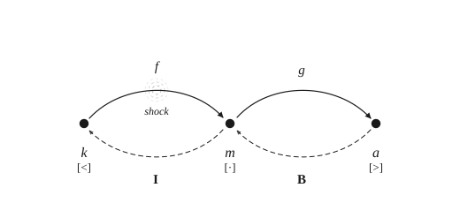

# Stages and perches

> [!summary]
> A stage specifies a decision episode with arrival, decision, and continuation information. We define its transitions, feasible actions, and value evaluation, then distinguish the backward recursion from the forward propagation of distributions. State sufficiency and the required conditional shock laws are assumptions of the representation.

> [!info]- Relationship with other documents
> **Builds on** — [Illustrative example](./02-Illustrative%20example.md) gives the consumption–savings factorization.
> **Used by** — [Fields, functions and types](./04-fields,%20functions%20and%20types.md) develops the fields and functions at each perch; Bellman-SYM's [Appendix C](../Bellman-Sym/appendices/14-appendix-c-syntax-to-semantics.md) states the representation and binding conditions for written equations; [Stages](../Bellman-Sym/01-stage.md) and [Field equations](../Bellman-Sym/03-field-equations.md) give the `.bl` syntax of the stage defined here.

The [illustrative example](./02-Illustrative%20example.md) separates the optimizing decision builder $\mathbb T_\succ$ from the fixed-policy builder $\mathbb T_{\succ,\pi}$. With arrival builder $\mathbb T_\prec$, their stage compositions are $\mathbb T=\mathbb T_\prec\circ\mathbb T_\succ$ and $\mathbb T_\pi=\mathbb T_\prec\circ\mathbb T_{\succ,\pi}$. A **builder** specifies how a value function at one perch determines a value function at an earlier perch.

Section 1 defines the stage's mathematical data and operator types; §2 defines the operators, and §3 states their information requirements. Authored stage declarations and equations use the `.bl` stage syntax of [Bellman-SYM](../wiki/sym.md). The mathematical tuple below describes their interpretation, not a second source file or a retained parsing object.

## 1. The general stage

### 1.1 Basic setup of the symbolic stage

The setup below fixes the mathematical data used in this representation. A **stage** is a tuple

$$
\bigl(\;
\mathsf{X}_\prec,\ \mathsf{X}_\sim,\ \mathsf{X}_\succ;\quad
\mathsf{A},\ \Gamma;\quad
(\mathsf{Z}_\zeta, \mu_\zeta),\ (\mathsf{Z}_\eta, \mu_\eta);\quad
g_{\prec},\ g_{\succ};\quad
G_{\prec},\ G_{\succ}
\;\bigr),
$$

of eleven primitive objects, counting each shock pair as one entry:

- three **state spaces** $\mathsf{X}_\prec, \mathsf{X}_\sim, \mathsf{X}_\succ$, one at each of three indices that we call **perches** (arrival, decision, continuation);
- an **action space** $\mathsf{A}$ with a **feasibility correspondence** $\Gamma : \mathsf{X}_\sim \rightrightarrows \mathsf{A}$ that pins down which choices are admissible at each decision state;
- two **shock pairs** $(\mathsf{Z}_\zeta, \mu_\zeta)$, $(\mathsf{Z}_\eta, \mu_\eta)$, each a measurable shock space with a declared probability law, **pre-decision** ($\zeta$) and **post-decision** ($\eta$), describing within-stage randomness;
- two **forward transition maps** $g_\prec : \mathsf{X}_\prec \times \mathsf{Z}_\zeta \to \mathsf{X}_\sim$ and $g_\succ : \operatorname{Gr}(\Gamma) \times \mathsf{Z}_\eta \to \mathsf{X}_\succ$, the first determining the decision state and the second the continuation state. Each jointly measurable transition map, together with its shock law, induces a **probability kernel**, indexed by an arrival state on the first edge and a feasible state–action pair on the second;
- two **pointwise aggregators** $G_\prec, G_\succ$. Writing $\mathsf{L}$ for the **value line** in which rewards and values take their values — the extended reals $\bar{\mathbb{R}}$ by default, declarable as the reals $\mathbb{R}$ ($\S 1.2$) — and $\operatorname{Gr}(\Gamma) := \{(x, a) \in \mathsf{X}_\sim \times \mathsf{A} : a \in \Gamma(x)\}$ for the graph of the feasibility correspondence, each is a point-level (jointly measurable) map acting on a value *variable*, not a value function,

    $$
    G_\succ : \mathsf{L} \times \operatorname{Gr}(\Gamma) \times \mathsf{Z}_\eta \to \mathsf{L},
    \qquad
    G_\prec : \mathsf{L} \times \mathsf{X}_\prec \times \mathsf{Z}_\zeta \to \mathsf{L}.
    $$

    $G_\succ(w, x, a, \eta)$ aggregates a continuation-value scalar $w$ with the decision pair $(x, a)$ and the realized post-decision shock $\eta$ — in the expected-utility case it contains a specified reward and discount (note below) — and $G_\prec(w, x_\prec, \zeta)$ does the same on the arrival edge, the identity in $w$ when that edge has no reward. The backward *operators* these kernels generate — read on value fields and on value functions — are assembled in $\S 2$.

We use standard Borel state, action, and shock spaces: measurable spaces equivalent to Borel subsets of complete separable metric spaces, including real domains and finite products. The displayed fixed laws describe shocks independent of information at their source perch. This is a specialization used below, not a requirement of the Bellman calculus. More generally, replace them by specified probability kernels $\mu_\zeta(\mathrm dz\mid x_\prec)$ and $\mu_\eta(\mathrm dz\mid x,a)$ on every required source state and feasible state–action pair, retaining their conditioning arguments in every integral. A marginal law alone does not assert independence.

> [!note]- The backward kernel and preferences
> In expected utility, $G_\succ(w,x,a,\eta)=r(x,a,\eta)+\beta w$, where $r$ is the one-stage reward and $0<\beta<1$ is the discount factor. State- or action-dependent discounting can instead be declared explicitly. These maps are affine in $w$: they add a reward to a linear continuation term. Integrating them yields an affine policy-evaluation operator, not the undiscounted Markov expectation operator.
>
> Nonlinear preferences are written with each map placed where it belongs relative to the shock integral. A statement may apply one pointwise map inside the integral and another outside it, and an Epstein–Zin certainty equivalent, whose normalization sits outside the integral, is the case with both maps nonlinear; §2.3a gives the general form. The aggregator entry of the tuple for an edge is read as that pair of maps, the outer map being the identity in the form of §2.2. #todo resolved 12 September 2026: the extension is §2.3a.

#### 1.1.1 What the perches do

A stage constitutes one self-contained decision episode, and its **perches** can be viewed as the decision maker's vantage points, ordered by how much the agent knows:

- **arrival** ($\prec$) — entry to the stage, before any within-stage shock or decision;
- **decision** ($\cdot$) — the point of choice, after the pre-decision shock has been observed and the [arrival-to-decision transition](../wiki/forward_builder.md) $g_\prec$ has occurred
- **continuation** ($\succ$) — exit from the stage, after the action, any post-decision shock and the [decision-to-continuation transition](../wiki/forward_builder.md) $g_\succ$ has occurred.

> Operationally, the sequence of events in the stage runs as follows. Given an initial arrival state $x_{\prec}$, the agent draws an *observable* shock $z_{\zeta} \in \mathsf{Z}_{\zeta}$, and the state transitions to the decision state $x_{\sim} = g_{\prec}(x_{\prec}, z_{\zeta})$. Given a value function $v_\succ$, the agent then selects a feasible action $a \in \Gamma(x_{\sim})$ by applying some criterion to the decision-perch value the backward kernel $G_\succ$ returns — the continuation value carried back to the decision perch, with the post-decision shock integrated out ($\S 2$). Once the action is taken and the unobserved shock is realized, the state transitions to $x_{\succ} = g_{\succ}(x_{\sim}, a, z_{\eta})$.

Which shocks are present pins down the stage's timing, and there are possible configurations:
#ambiguity #perch

| Configuration      | pre-decision $\zeta$ | post-decision $\eta$ | reading                                                                             |
| ------------------ | -------------------- | -------------------- | ----------------------------------------------------------------------------------- |
| pre-decision only  | present              | —                    | observe the shock, then a deterministic choice-to-exit move (the buffer-stock case) |
| post-decision only | —                    | present              | choose first, then the shock resolves                                               |
| both               | present              | present              | the general stage                                                                   |
| deterministic      | —                    | —                    | pure optimization, no risk                                                          |

> [!example] The buffer-stock stage, as a tuple
> The following state spaces, action space, shock laws, transitions, and backward kernels specify the buffer-stock stage.
> - **States.** $\mathsf{X}_\prec = \mathbb{R}_{+}$ (arrival assets $k$), $\mathsf{X}_\sim = \mathbb{R}_{++}$ (market resources $m$), $\mathsf{X}_\succ = \mathbb{R}_{+}$ (end-of-period assets $a$).
> - **Action and feasibility.** $\mathsf{A} = \mathbb{R}_{++}$ (consumption $c$), with $\Gamma(m) = \{\, c \in \mathsf{A} : c \le m \,\} = (0, m]$.
> - **Shock pairs.** The pre-decision pair has $\mathsf{Z}_\zeta \subseteq \mathbb{R}_{++}$ and $\mu_\zeta$ the law of the labor-income draw $y$; the post-decision space $\mathsf{Z}_\eta$ is a one-point space (no post-decision shock).
> - **Transitions.** $g_\prec(k, y) = R\,k + y$; $g_\succ(m, c) = m - c$, deterministic because its shock slot is trivial, so its derived kernel is a point mass.
> - **Backward kernels.** $G_\succ(w, m, c) = u(c) + \beta\, w$ — the expected-utility (affine) kernel of the note above, with nothing integrated since the post-decision edge is deterministic — and $G_\prec(w, k, y) = w$, the identity kernel whose operator integrates the income draw over $\mu_\zeta$.
>
> The sequence of events: arrive holding $k$; observe $y$; have decision state $m = g_\prec(k, y) = R\,k + y$; choose $c \in \Gamma(m)$; exit with the continuation state $a = g_\succ(m, c) = m - c$, which the next stage receives as its arrival state. This is the pre-decision-only configuration of the table above.

> [!note] Relationship to standard MDP
> A standard Markov decision process describes the next-state distribution with a single kernel $\mathrm{P}(\cdot \mid x, a)$, resolved after the choice, with value
>
> $$
> v(x) = \sup_{a \in \Gamma(x)}\bigl\{r(x, a) + \beta\, \mathbb{E}[v(x') \mid x, a]\bigr\}
> $$
>
> A stage makes the timing within an episode explicit. Its decision state includes information observed before choice, and its continuation state follows the action and any post-decision shock. The buffer-stock example has no post-decision shock within the chosen stage, but the next arrival expectation appears in the continuation function. Under a fixed policy the two transition maps compose into one state-transition kernel. The optimizing recursion additionally retains the order in which information is observed and choices are made.
>
> The fully observed Markov decision process interpretation requires the chosen state to determine the relevant payoffs and conditional transition laws. Declaring a decision state does not prove that sufficiency. An observed variable that changes a future shock law must be retained or represented by another sufficient statistic. A partially observed model may instead use a belief state, a conditional distribution over the hidden state, if that state is sufficient. Neither case implies that the current state reconstructs every historical observation (§3).
>
> Two devices make this timing visible. The **perch indices** name arrival, decision and continuation as the nested filtration of $\S 3$; and because the pre-decision shock is observed before the action, the choice falls on a state already carrying the within-period information, with the continuation perch the **post-decision state** of approximate dynamic programming when the post-decision shock is trivial (Powell 2011). #check-details
### 1.2 Wiring the stage

The Bellman calculus stage records compositions through the input and output types of its operators. First, note that intuitively, to use the stage to solve, we read it as an *operator*: hand it a continuation value, and it returns an arrival value,

$$
\mathbb{T}_{\pi}\;\colon\; v_\succ \longmapsto v_\prec,
$$

a *continuation value in, arrival value out* contract that does not refer to the stage's internals nor any of the details of the syntactic declarations. The stages represented here have this input–output form; what changes between applications is the **state space** at each perch, the form of the transitions and their shock distributions, the feasibility correspondence, and the methods used to realize the builders.

**Backward types wiring** For each perch $m \in \{\prec, \sim, \succ\}$ we now add one additional kind of object: the *value functions at perch $m$*, simply written $\mathsf{V}_m$. We can think of these as the space of $\mathsf{L}$-valued functions on $\mathsf{X}_m$, so that evaluating a value function at a state, $v(x) \in \mathsf{L}$, is ordinary function application. The chosen function domains must make the declared operations well-defined and closed under their compositions. Boundedness, continuity, integrability, and equivalence-class conventions are additional mathematical choices, not consequences of a value-domain declaration. The backward builders are named operations between value kinds,

$$
\mathbb{T}_{\succ,\pi} \;\colon\; \mathsf{V}_\succ \to \mathsf{V}_\sim,
\qquad
\mathbb{T}_{\prec} \;\colon\; \mathsf{V}_\sim \to \mathsf{V}_\prec.
$$

The subscript $\pi$ means that the policy is fixed: $\mathbb T_{\succ,\pi}$ is one operator for each $\pi \in \Pi_\Gamma$, and the family $\pi \mapsto \mathbb T_{\succ,\pi}$ is a map $\Pi_\Gamma \to [\mathsf V_\succ \to \mathsf V_\sim]$, which currying, the correspondence between a map of two arguments and a map of the first argument alone whose value is a map of the second, identifies with a map $\Pi_\Gamma \times \mathsf V_\succ \to \mathsf V_\sim$ in the category of sets, the value kinds being sets of functions. The policy is therefore not an input of the value kind and not an argument of the operator at a policy: it names the member of the family, and the semantic graph records it so, the operator at a policy answering the inputs and outputs of that member and the policy typed where the stage text defines it, on the output of the policy builder (see [Operators and builders](./05-Operators%20and%20builders.md) §6). The optimizing builder has the same function-space types but is denoted $\mathbb T_\succ$, without $\pi$. Its stage composite is $\mathbb T=\mathbb T_\prec\circ\mathbb T_\succ$. The undiscounted expectation operators $P_\prec$, $P_{\succ,\pi}$, and $P_\pi$ are defined separately in §2; only these have the plain distribution pairing.

**Forward types and wiring** The forward direction gets the same treatment: adjoin at each perch one further kind $\mathsf{M}_m$, the finite measures over perch-$m$ states. A finite measure is specified by its integrals: for $f$ a measurable real-valued function integrable under $\mu$ on $\mathsf{X}_m$,

$$
\langle \mu,\, f \rangle_m \;=\; \int_{\mathsf{X}_m} f\; d\mu \;\in\; \bar{\mathbb{R}},
$$

Bounded measurable test functions suffice to identify a finite measure: taking indicators of measurable sets recovers its values on measurable sets. A probability distribution is a finite measure of total mass one. The integral is finite for bounded measurable functions. Nonnegative or one-sided-integrable functions may also be used with extended values, provided that no subsequent expression forms an undefined difference of infinities. Finite collections of simulated states and histograms define empirical or discrete finite measures; normalization makes them probability distributions. Their accuracy as approximations to another measure is a numerical question. #check-details

The **forward builders** are named operations between distribution kinds,

$$
\mathbb{M}_\prec \;\colon\; \mathsf{M}_\prec \to \mathsf{M}_\sim,
\qquad
\mathbb{M}_{\succ,\pi} \;\colon\; \mathsf{M}_\sim \to \mathsf{M}_\succ,
$$

the single family letter $\mathbb{M}$ naming both forward edge push-forwards, with the perch subscript marking the edge. The subscript $\pi$ on $\mathbb{M}_{\succ,\pi}$ records a need the transition itself imposes: $g_\succ(x, a, \eta)$ takes an action argument, and pushing a distribution through it requires a *policy function* $\pi$. The arrival push-forward $\mathbb{M}_\prec$ has no policy argument. As on the backward side, $\mathbb M_{\succ,\pi}$ is one push-forward for each $\pi \in \Pi_\Gamma$, and the family $\pi \mapsto \mathbb M_{\succ,\pi}$ is a map $\Pi_\Gamma \to [\mathsf M_\sim \to \mathsf M_\succ]$; the policy is not an input of the distribution kind and not an argument of the push-forward at a policy, and the semantic graph records the push-forward at a policy with the measure it reads and the measure it writes.

### 1.3 The stage as a graph

A stage has a graph of three perches joined by two edges. Each edge has a forward transition and forward builder, and a backward builder. Section 1.2 specifies the domains and codomains of these builders; §2 defines their operations. The nodes represent information sets rather than individual states, and the graph records which operators can be composed.

Mathematical assumptions determine whether their stated domains and compositions are valid; numerical methods must satisfy the assumptions required by those operators. A changed economic model can require different state spaces or methods. [Appendix C](./APPX-C-STAGE-TERM.md) gives the mathematical stage representation; [methodization](../wiki/methodization.md) attaches the numerical schemes.

<figure markdown="span">
  { width="520" }
  <figcaption>One stage: the three perches with forward transitions ($g_\prec$, $g_\succ$) above and backward builders ($\mathbb{T}_{\prec}$, $\mathbb{T}_{\succ,\pi}$) below.</figcaption>
</figure>

Solid arrows run forward, in the direction agents move (the transitions $g_\prec$ and $g_\succ$); dashed arrows run backward, in the direction value propagates (the builders $\mathbb{T}_{\prec}$ and $\mathbb{T}_{\succ,\pi}$). The next section walks these arrows in turn: first backward, then forward.

## 2. Mathematical elaboration
#foundations

The operator types in §1.2 distinguish continuation, decision, and arrival functions. We now define their action. A pointwise aggregator $G$ combines a continuation value with current state, action, and shock arguments. Integrating that expression gives a choice value, and a policy selects an action at each state. The transition, conditional distribution and aggregator at that policy define the fixed-policy builder. A supremum over all feasible actions gives the optimizing decision operator.

### 2.1 Conditional choice values

A **field** is a random variable measurable with respect to the information at its perch. On a probability space $(\Omega,\Sigma,\mathbb P)$, let $\mathrm X=\mathrm X_\sim$ be a decision state and $\mathrm A$ a feasible action measurable at decision information $\mathcal F_\sim$. A continuation field $V_\succ$ is measurable at continuation information $\mathcal F_\succ$; this alone does not place it in $L^2$, the space of square-integrable random variables. If the following local payoff is integrable, its conditional expectation is

$$
\mathrm Q=\mathbb E[G_\succ(\mathrm V_\succ,\mathrm X,\mathrm A,\eta)\mid\mathcal F_\sim].
$$

This defines $\mathrm Q$ along the specified random state and action, up to almost-sure equality. It does not define payoffs under actions that this trajectory never chooses. The arrival field is defined analogously by $\mathbb E[G_\prec(V_\sim,X_\prec,\zeta)\mid\mathcal F_\prec]$. These formulas use the argument order declared in §1.1.

### 2.2 Function representation

Suppose $\mathrm X_\succ=g_\succ(\mathrm X,\mathrm A,\eta)$ and the continuation field has a specified measurable representative $\mathrm V_\succ=v_\succ(\mathrm X_\succ)$ almost surely. This representation requires a version of the field measurable with respect to $\sigma(X_\succ)$: a random variable agreeing with the field almost surely. Measurability with respect to $\mathcal F_\succ$ alone does not ensure such a version. Here $\sigma(X_\succ)$ denotes the information generated by the state. The state must also determine the conditional shock law and the payoff arguments used below. Bellman-SYM's Appendix C, §1.2 and rules R5–R7, states these requirements.

For policy comparisons, specify $v_\succ$ and the transition and shock law pointwise on their declared domains. For each continuation function in the chosen domain, require the following absolute integral to be finite at every feasible pair. Define the induced **choice-value aggregator** on every $(x,a)\in\operatorname{Gr}(\Gamma)$ by

$$
B_\succ(x,a,v_\succ)
:=\int_{\mathsf Z_\eta}
G_\succ\bigl(v_\succ(g_\succ(x,a,\eta)),x,a,\eta\bigr)
\,\mu_\eta(\mathrm d\eta).
$$

Under the fixed conditional law assumed in §1.1 and the integrability conditions above, substituting $(X,A)$ gives

$$
Q=B_\succ(X,A,v_\succ)\quad\text{almost surely}.
$$

The first display defines a function on all feasible pairs. The second relates its evaluation to a conditional expectation along one trajectory. An almost-sure field identity by itself fixes a representative only almost everywhere under that trajectory's law; it cannot supply action values at other states or under policies that assign positive probability to previously null sets. This is why the domain and representative choices remain explicit.

### 2.3 Reward and continuation

When the kernel is *affine in the value*, $G_\succ(w, x, a, \eta) = r(x, a, \eta) + \beta\, w$ (expected utility), the induced aggregator splits into an integrated reward and an expectation,

$$
B_\succ(x, a, v_\succ) = \bar{r}(x, a) + \beta\,(P_\succ\,v_\succ)(x, a),
\qquad
(P_\succ\,v_\succ)(x, a) = \int v_\succ(g_\succ(x, a, \eta))\,\mu_\eta(\mathrm{d}\eta),
$$

with $\bar{r}(x, a) = \int r(x, a, \eta)\,\mu_\eta(\mathrm{d}\eta)$. Here $P_\succ$ is the **Markov expectation operator** of the edge — linear, positive, and mass-preserving ($P_\succ\mathbf{1} = \mathbf{1}$), the pointwise transition expectation for the pair $(x,a)$. The induced $B_\succ$ is **affine, not linear**: the reward sits outside the expectation, and the discounted kernel $\mathrm{K} = \beta\,P_\succ$ (Stachurski's linear-decision-process form $B = r + \mathrm{K}\,v$) is positive linear but mass-preserving only at $\beta = 1$. Under a fixed measurable feasible policy $\pi$, define $P_{\succ,\pi}f(x)=(P_\succ f)(x,\pi(x))$ and $\bar{r}_\pi(x)=\bar{r}(x,\pi(x))$. The policy-evaluation operator is

$$
\mathbb T_{\succ,\pi}f=\bar{r}_\pi+\beta P_{\succ,\pi}f.
$$

It is affine and preserves pointwise order. A nonlinear $G_\succ$ can give a nonlinear integral aggregator of the displayed form. A recursion whose normalization sits outside the integral is the general form of §2.3a.

### 2.3a Aggregation inside and outside the integral

A statement of a backward block may apply one pointwise map to the continuation value before the shock is integrated and another to the result afterwards. For one statement with one expectation the choice-value aggregator therefore has the general form of two maps around one integral,
$$
B_\succ(x,a,v_\succ)
=G^{\mathrm{out}}_\succ\Bigl(\int_{\mathsf Z_\eta}G^{\mathrm{in}}_\succ\bigl(v_\succ(g_\succ(x,a,\eta)),x,a,\eta\bigr)\,\mu_\eta(\mathrm d\eta),\,x,\,a\Bigr),
$$
where $G^{\mathrm{in}}_\succ:\mathsf L\times\operatorname{Gr}(\Gamma)\times\mathsf Z_\eta\to\mathsf L$ is the arithmetic written inside the expectation and $G^{\mathrm{out}}_\succ:\mathsf L\times\operatorname{Gr}(\Gamma)\to\mathsf L$ the arithmetic written outside it. The display of §2.2 is the case $G^{\mathrm{out}}_\succ(w,x,a)=w$. The expected-utility statement written as a reward plus a discounted expectation, $u(c)+\beta\,\mathbb E_\eta[v_\succ(g_\succ(x,a,\eta))]$, is the case $G^{\mathrm{in}}_\succ(w,x,a,\eta)=w$ with $G^{\mathrm{out}}_\succ(w,x,a)=u(c)+\beta\,w$. An Epstein–Zin recursion has both maps nonlinear, $G^{\mathrm{in}}_\succ(w,x,a,\eta)=w^{1-\gamma}$ and $G^{\mathrm{out}}_\succ(w,x,a)=\bigl(u(c)^{1-\rho}+\beta\,w^{(1-\rho)/(1-\gamma)}\bigr)^{1/(1-\rho)}$, and its normalization outside the integral is where $G^{\mathrm{out}}_\succ$ sits. A statement with several expectations, or a block split by `!node` statements into sub-builders, composes further maps and integrals in the order written; the two-map form is what one expectation gives.

The two placements coincide exactly when $G^{\mathrm{out}}_\succ$ is affine in $w$. Then $G^{\mathrm{out}}_\succ$ passes through the integral by linearity, under the finite absolute integral required in §2.2, and the two maps collapse to the one kernel of §2.2; §2.3 is this case with $G^{\mathrm{in}}_\succ$ the identity. When $G^{\mathrm{out}}_\succ$ is nonlinear the placement is part of the specification, and the two forms denote different operators.

Integrability is required of the inner integrand, $\int_{\mathsf Z_\eta}\bigl|G^{\mathrm{in}}_\succ(v_\succ(g_\succ(x,a,\eta)),x,a,\eta)\bigr|\,\mu_\eta(\mathrm d\eta)<\infty$ on every feasible pair, and $G^{\mathrm{out}}_\succ$ must be defined at the resulting values. The induced aggregator preserves pointwise order in $v_\succ$ when $G^{\mathrm{in}}_\succ$ and $G^{\mathrm{out}}_\succ$ are each nondecreasing in their value argument, which is the monotonicity that a recursive decision process requires of its aggregator (Sargent and Stachurski, *Dynamic Programming*, volume 2, the definition of a recursive decision process). The arrival edge has the same two-map form with $G_\prec$, $x_\prec$ and $\zeta$ in place of $G_\succ$, $(x,a)$ and $\eta$.

A nonlinear $G^{\mathrm{out}}_\succ$ can also be written as its own edge: the inner integral is then the arrival builder of an edge that draws the shock, and $G^{\mathrm{out}}_\succ$ is the aggregator of the preceding decision edge, whose law of motion is deterministic. This re-timing exposes the intermediate information set as a perch. It is a modeling choice, not a requirement.

### 2.4 The arrival kernel

The arrival aggregator defines the arrival builder by

$$
(\mathbb T_\prec v)(x_\prec)
=B_\prec(x_\prec,v)
=\int G_\prec\bigl(v(g_\prec(x_\prec,\zeta)),x_\prec,\zeta\bigr)\,\mu_\zeta(\mathrm d\zeta).
$$

Define the undiscounted transition expectation by

$$
(P_\prec f)(x_\prec)=\int f(g_\prec(x_\prec,\zeta))\,\mu_\zeta(\mathrm d\zeta).
$$

When $G_\prec(w,x_\prec,\zeta)=w$, the builder equals $P_\prec$. This is the buffer-stock case. An arrival reward or nonlinear arrival aggregator must remain in $\mathbb T_\prec$ and does not belong to $P_\prec$.

### 2.5 The policy

The selection is a **separate layer**, acting on the induced aggregator, not part of the backward kernel. Abstractly,

$$
(\mathbb T_\succ\,v_\succ)(x) \;=\; \sup_{a \in \Gamma(x)} B_\succ(x, a, v_\succ),
$$

We write a supremum because attainment is an assumption. If it is attained and a measurable feasible selection $\pi(x)\in\operatorname*{argmax}_{a\in\Gamma(x)}B_\succ(x,a,v_\succ)$ exists, then

$$
(\mathbb T_{\succ,\pi}v_\succ)(x)=B_\succ(x,\pi(x),v_\succ)
=(\mathbb T_\succ v_\succ)(x).
$$

Rule R7 of Bellman-SYM's Appendix C gives sufficient measurable-selection conditions. For arbitrary continuation functions we additionally require that the resulting decision function belongs to the chosen value-function domain. First-order conditions or an endogenous-grid inversion select an optimum only under the relevant sufficiency, feasibility, and coverage conditions; a numerical method does not establish those conditions.

> [!note] The selection is an assumption
> A maximizer set need not be nonempty or admit a measurable selection without further hypotheses. Different selections from that set have the same current choice value but can induce different continuation distributions. A different nonoptimizing selection gives policy evaluation without the equality to the supremum. #check-details-aas

### 2.6 Intermediate expressions

A backward block can contain several intermediate expressions. The following is mathematical notation, not a stage-file fragment:

$$
\mathrm W=\beta\,\mathrm V_\succ,\qquad
\mathrm Q=\mathbb E[u(\mathrm A)+\mathrm W\mid\mathcal F_\sim],\qquad
\mathrm V_\sim=\mathrm Q.
$$

Here $\mathrm A$ is a specified feasible decision action, $\mathrm W$ is the discounted continuation field, and the conditional expectation defines the decision value. The individual expressions have different roles: pointwise scaling, expectation, and assignment. The `.bl` declarations and named blocks that express such equations are described in Bellman-SYM's Field equations page. Their operator decomposition is developed in [Operators and builders](./05-Operators%20and%20builders.md). #todo The earlier request to explain how numerical methods target intermediate operations remains open; current authoring rules are defined in the syntax documentation.

> [!note]- Remark — where the expectation sits (the two forms)
> A pre-decision shock is observed before choice, while a post-decision shock is not. Moving a physical shock between those information sets changes the decision problem. The [illustrative example](./02-Illustrative%20example.md) instead changes the boundary of the recursion while preserving when income is observed: it forms the next arrival expectation as a continuation function before the current choice. Such factorization must retain the relevant state and conditional law. With nonlinear aggregation the order of evaluation also matters; expectation may not be moved through it without an argument. [Semi-conjugacy](./10-semi-conjugacy.md) discusses alternative recursions. The post-decision terminology depends on the timing convention.[^postdec]

### 2.7 The forward builders

The forward builders map finite measures on one state space to finite measures on the next. Fix a measurable feasible policy $\pi$, and write $g_{\succ,\pi}(x,\eta)=g_\succ(x,\pi(x),\eta)$. Define

$$
P_\pi=P_\prec\circ P_{\succ,\pi},
\qquad
\mathbb M_\pi=\mathbb M_{\succ,\pi}\circ\mathbb M_\prec.
$$

For bounded measurable test functions $f$, $P_\prec f$, $P_{\succ,\pi}f$, and $P_\pi f$ are bounded measurable functions at arrival, decision, and arrival respectively. Their forward counterparts are defined by

$$
\langle\mathbb M_\prec\mu_\prec,f\rangle_\sim
=\langle\mu_\prec,P_\prec f\rangle_\prec,
\qquad
\langle\mathbb M_{\succ,\pi}\mu,f\rangle_\succ
=\langle\mu,P_{\succ,\pi}f\rangle_\sim.
$$

Under the fixed conditional laws of §1.1 these are the image measures

$$
\mathbb M_\prec\mu_\prec=(g_\prec)_\#(\mu_\prec\otimes\mu_\zeta),
\qquad
\mathbb M_{\succ,\pi}\mu=(g_{\succ,\pi})_\#(\mu\otimes\mu_\eta),
$$

where $\otimes$ is the product of independent probability laws and $g_\#$ denotes the distribution induced by applying $g$. For state-dependent conditional shock laws the corresponding joint law is formed from the state measure and its conditional kernel, not a product of marginals. When a shock is deterministic, its measure is a point mass; the buffer-stock continuation law is the image under $m\mapsto m-\pi(m)$.

The composition gives

$$
\langle\mathbb M_\pi\mu_\prec,f\rangle_\succ
=\langle\mu_\prec,P_\pi f\rangle_\prec.
$$

The identities follow by integrating the same transition first conditionally on the source state and then over its distribution. They extend to absolutely integrable evaluations. At an identity connection between stages, the continuation law of the first is the arrival law of the second. A connection expressed as a renaming uses the corresponding identification of state coordinates; see [Stage composition](./07-stage-composition.md).

> [!note]- Transition pairing and value recursion
> The pairing is with undiscounted $P$, even under a fixed policy. For expected utility and the identity arrival aggregator,
>
> $$
> \mathbb T_\pi f=P_\prec\bar{r}_\pi+\beta P_\pi f.
> $$
>
> Thus the reward-bearing Bellman operator is not the transpose of $\mathbb M_\pi$. Taking $f=0$ gives zero in the transition pairing, while a nonzero reward can give a nonzero Bellman update. Optimization and nonlinear preference aggregation are further operations with their own assumptions. Numerical implementations must approximate the declared laws consistently; the mathematical identity does not guarantee agreement between arbitrary implementations.

### 2.8 Breaking down builders into primitive operators
#operator

The continuation-to-decision builder combines simpler operators: pullback along the law of motion, expectation, reward aggregation, and, for optimization, selection. **Pullback along the law of motion** evaluates a continuation function at the state the transition determines. With additive expected utility and constant discount, the induced choice value is the expected reward plus the discounted expected continuation value (§2). Selection chooses a policy; that policy indexes the pullback, aggregation or conditional distribution of the fixed-policy builder. Exact Evaluation remains an identity on its function or feasible-policy set and makes no selection. An attained supremum is obtained only if the policy is a maximizer.

A **handler** is a numerical routine attached to an operator. A maximizing search and a first-order inversion may implement the same selection when their mathematical assumptions hold; they are not interchangeable without those assumptions. [Operators and builders](./05-Operators%20and%20builders.md) develops the decomposition, and [Fields, functions and types](./04-fields,%20functions%20and%20types.md) states the types of its inputs and outputs. The mathematical stage signature is described in [Appendix C](./APPX-C-STAGE-TERM.md).

## 3. An information view

A **perch** represents an information set, formalized as a $\sigma$-algebra. It records *what the agent knows* at that point, and therefore *what a policy may condition on*. As a stage proceeds the agent only ever learns more, so the three information sets are nested,

$$
\text{arrival information} \ \subseteq\ \text{decision information}
\ \subseteq\ \text{continuation information};
$$

Thus the arrival/decision/continuation split is not three times on a clock nor do the perches represent operators, they are three states of knowledge.

> [!note]- The information-set reading, formally
> On $(\Omega,\Sigma,\mathbb P)$ the perches form a **filtration**, a nested family $\mathcal F_\prec\subseteq\mathcal F_\sim\subseteq\mathcal F_\succ$ of information sets. A state $X_p$ measurable at perch $p$ satisfies $\sigma(X_p)\subseteq\mathcal F_p$. **State sufficiency** means that the relevant payoffs and conditional future laws can be expressed using that state. It does not imply equality of these information sets: the agent may remember an old shock that no longer affects any payoff or transition.
>
> A real-valued field $Z$ has a measurable representation $Z=z(X_p)$ almost surely when it is measurable with respect to $\sigma(X_p)$. Measurability with respect to the larger $\mathcal F_p$ alone is insufficient. Its representative is determined only almost everywhere under the law of $X_p$, unless a pointwise domain-defined function is supplied. The precise representation requirements are in Bellman-SYM's Appendix C, §1.2 and rule R5.
>
> In a history-based construction, observed pre-decision shocks enlarge arrival information, and post-decision shocks enlarge decision information. A deterministic measurable policy action adds no information to the decision state on which it depends. Randomized policies require their additional randomization and its timing to be specified. #check-details-aas

In the surface syntax the perches are tagged `[<]`, *unmarked*, and `[>]`; an arrival variable is written `m[<]`, a decision variable `m`, a continuation variable `a[>]`. The tags say what is known where: `m[<]` asserts "$m$ is settled on arrival," a declared control `c` is chosen at decision information, `a[>]` asserts "$a$ is determined by the time we continue."

[Next → 04. Fields, functions and types](./04-fields,%20functions%20and%20types.md)

[^postdec]: When the post-decision shock is trivial, as in the buffer-stock example, the continuation perch is the *post-decision state* of approximate dynamic programming (Powell 2011) and the *afterstate* of Sutton and Barto (1998). Hull (2015) studied post-decision-state value functions as a solution method for economic models, and Carroll's *Solving MicroDSOPs* works with the same object as the end-of-period (Gothic) value function. For that example, in Powell's timing, the decision perch is his pre-decision state, and a stage's arrival perch is the previous stage's post-decision state carried across the boundary. Hull, I. (2015). Approximate dynamic programming with post-decision states as a solution method for dynamic economic models. *Journal of Economic Dynamics and Control* 55, 57–70.
