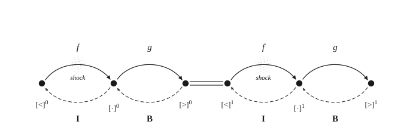

# Stage composition

> [!summary]
> These unfinished notes describe composition of stages through compatible boundary fields. A connector selects a continuation-to-arrival field pair without renaming either field; a transformation must be specified by an equation.

> [!info]- Relationship with other documents
> **Builds on** — [Stages and perches](./03-Stages%20and%20perches.md) defines the stage operators.
> **See also** — [Periods and the trellis](./08-periods-and-trellis.md) discusses joins across dates.
> **Used by** — [Period Syntax](../Bellman-Sym/06-period.md) defines the YAML outer composition whose joins this chapter describes.

> [!note] Not yet drafted — stub notes only
> Structural outline only; the within-period composition chapter is not yet written.

Consider a period whose stage dependencies form a chain, indexed in forward economic order by $k=1,\ldots,K$. The continuation fields of stage $\mathbb{S}_k$ and the arrival fields of $\mathbb{S}_{k+1}$ have separate stage-local identities. Selected pairs relate their eligible uses; an authored **connector** states a pair explicitly. If the ordered state coordinates form a compatible complete route and the stage operators are well defined on the required function spaces, the backward period operator for this chain is the composite $\mathbb{T}_{\text{period}} = \mathbb{T}_{\mathbb{S}_1} \circ \ldots \circ \mathbb{T}_{\mathbb{S}_K}$, where each $\mathbb T_{\mathbb S_k}$ is that stage's backward value operator. This conditional display is not a general composition theorem for all period shapes.

## 1. Connectors

A **connector** pairs an eligible continuation state field of one stage occurrence with an eligible arrival state field of another. It does not change either stage's field name or equations. *(Placeholder.)* A simple pairing is $a'\mapsto a$ when the two fields have compatible declared sets and the author establishes their common economic meaning, units and boundary information. When a route pairs whole ordered state tuples, the induced coordinate map reads the destination coordinates from those of the source; a crossed pairing can therefore be a permutation without an inverse state transition. A nonidentity economic transformation must appear in an authored stage equation. Equal names or domains alone do not identify arbitrary fields.

## 2. Composing stages into periods

The input-to-output signature is also the rule for joining stages. A **period** is
a collection of stage occurrences (uses of stage modules) with selected connections. In the chain considered here, joining compatible boundary fields pairs the continuation state coordinates of one stage with the arrival state coordinates of its successor. The successor's arrival value then supplies the predecessor's continuation value under that coordinate map, provided the required value components and domains agree. Separate marginal shock laws do not establish the joint forward law needed for a complete route.

<figure markdown="span">
  { width="700" }
  <figcaption>Two stages composed into a period; the double line in the center identifies the shared boundary perch $\succ^{0} = \prec^{1}$.</figcaption>
</figure>

The double line denotes the boundary identification in this example. Operators compose right to left in the backward calculation, provided their domains and codomains agree after that identification. The equations, feasible sets and conditional laws retain their stage-specific assumptions.

Changing the order of names in a period's YAML list does not change the economic dependencies. Reordering the economic stages or changing a successor can instead change information, feasibility or rewards, and requires the model to be checked again. A stage can be reused with a compatible continuation problem; the composition rule is not a general invariance theorem for arbitrary swaps. Branch-specific successors require their explicit routes, as in [Branching](./09-branching.md).

## 3. Intra-period vs inter-period connectors

This file covers **intra-period** wiring (stage-to-stage within one period). Inter-period wiring (period-to-period, with occurrence-specific boundary identifications) is covered in [Periods and the trellis](./08-periods-and-trellis.md).

## 4. Related documents

- **Across:** [Fields, functions and types](./04-fields,%20functions%20and%20types.md), [Periods and the trellis](./08-periods-and-trellis.md), [Ingredients](./ingredients.md)

[Next → 8. Periods and trellis](./08-periods-and-trellis.md)
