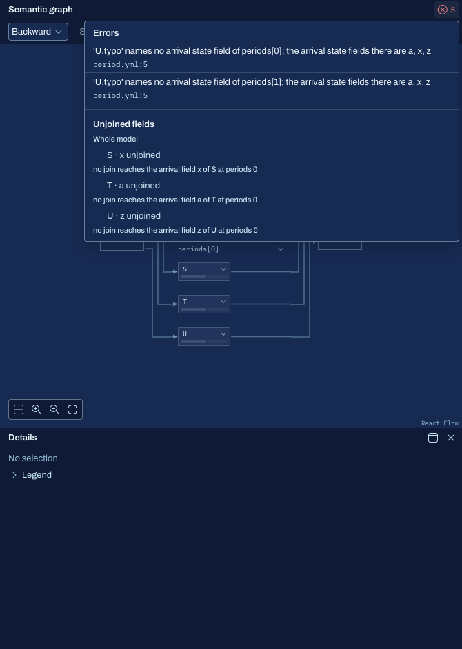

# Bellman Workbench

> [!summary]
> Bellman Workbench is a browser editor for Bellman-SYM with a live semantic view. It opens on a model folder, shows the open stage file beside the graph the elaborator makes of it, and redraws that graph at every pause of the typing, so that a file and its meaning are read as one object. Nothing in the graph is drawn by hand: every box came from a line of the file, a click on a box of a stage's graph takes you to that line, and a line the language refuses is marked at its line and column, its sentence in the package's own words standing in the page's one list of refusals, while the last good graph stays, dimmed. A folder with a recipe or a trellis file opens on its trellis, each period a frame holding its stage occurrences, with the recipe in the panel under the editor while the recipe is open, whose entries take the folder's calibration, methods and settings files; a double click on an occurrence opens its stage file as the trellis binds it there, and a step back returns to the trellis. In the forward trellis graph, a connection dragged from one stage to another, a stage dropped on a period and a period added each type a line into a file, and the graph is then drawn from the file (§8). The Workbench solves nothing, keeps nothing you did not type apart from the records and saved copies of what you asked Matsya for (§5), and stores nothing outside the model folder but the views of the trellis's stages and the bound trellis, which it writes to the user's cache folder (§7), the service's session identifier for the folder, which it writes under the user's configuration folder (§5), and the sizes and folds of the window's regions and the choice `high contrast`, which the browser keeps (§1); git is the only history of the files.

> [!info]- Relationship with other documents
> The content of the graph pane, element by element, is on [The view in Model Explorer](../Bellman-Sym/API/stage/10-model-explorer.md). The workflow the Workbench sits in is on [Workflow](06-workflow.md), and the language it edits on [The Bellman-SYM language](03-language.md). The card and the kernel Details prints for a box are those of [A piece](../Bellman-Sym/API/stage/05-piece.md), the kernel of a box of one [branch](../Bellman-Sym/05-branching.md) holding that branch's part of the law of motion alone, and a builder's signature that of [A builder](../Bellman-Sym/API/stage/04-builder.md).

## 1 Starting it

Follow [Install Bellman Workbench](00-install.md) to install the Python packages and choose the browser or desktop version. In the desktop application, **File → Open Project…** opens a model folder. **File → Open File…** opens a stage or recipe. **File → Welcome** returns to the list of recent projects. Both versions use the same editor and diagrams.

With the Python environment active, start the browser version on a model folder from a terminal:

```bash
bellman-workbench applications/portfolio-choice
```

A page opens in the browser at `http://localhost:8765/`, on the folder's trellis where the folder holds a recipe or a trellis file, and otherwise on its first stage file; in a model folder these files stand under `declaration/`, the subfolder that holds every file the language reads ([Model directory layout](../Bellman-Sym/reference/model-directory-layout.md)). The page's graph files, fonts and interface files are installed with the Workbench and served from your machine, and a folder holding no stage file shows `No stage file.` The window has a main bar across its top and four columns under it. The **main bar** holds, at its left, the project's mark, a link to this page, the icon buttons `Back` and `Forward` (§7), and the toggles `Files` and `Inspector`, which close and open the regions of those names at the window's left and middle; in its middle, the **path** that names what the window shows and how you reached it, `durables › spec.yml › periods[3] › tenure`, its last two parts the selected [occurrence](../wiki/stage.md) where one is selected (§7), its hover the whole path, and the path cut at its left where the bar is too narrow for it; and, at its right, the icon `Go to`, which opens Goto Anything (§3), and the toggles `Details` and `Matsya`, which close and open the two columns at the window's right. The first column holds the folder's files under the head `Files`, each with git's letter for its state and the word `unsaved` for a file whose text in the page differs from the file on disk. The second holds the open file in a code editor, under the row of its tabs, over the **Inspector**, the panel that shows what the open file declares or binds: a stage file's fields with their sets and roles, and its parameters, settings and methods as the recipe gives them (§2), or the stage rows of the recipe the trellis is read under (§7). The third holds the graph the elaborator makes of the file, the **Semantic graph**, under the bar that names it, over the panel **Details**, which describes what you select in the graph (§3). The fourth holds the column of Matsya, the service that reads the project's documentation, theory and examples; the column asks it questions, searches its sources, asks it for jobs that write and check the model's files and adopts the files a job returns (§5). The Problems button at the right end of the graph's bar lists current errors and model checks (§3). The status line runs along the foot of the first three columns (§4). Opening another file in the tree adds a tab for it above the text and shows it, and shows its graph where the file is a stage file, a recipe or a trellis file; each tab keeps the unsaved text of its file until it is saved or reloaded, and the folder stays. Lesson 01 of the tutorials reads the same file of the portfolio model in a notebook. In the Files tree, use the arrow keys to move, expand or collapse a folder. Home and End go to the first and last visible rows. Enter opens a file.

Each column takes its width from a handle on its edge, which you drag: the handle at the right of the tree sets the folder's width, the one between the text and the graph the widths of both, and the one on Matsya's left edge Matsya's width; the handles on the top edges of the Inspector and of Details set their heights. A drag stops where a region would become narrower or shorter than its least size, the size at which it stays readable, and a double click on a handle returns its region to its default size. The four toggles of the main bar, each at the end of the bar on the side where its region opens, close and open the regions, each drawn as its region's icon with the region's name as its hover: a stack of sheets for `Files`, a window with a panel at its foot for `Inspector`, the semantic brackets ⟦·⟧ for `Details` and a speech bubble holding Υ for `Matsya`. The toggle of an open region is drawn in full ink with a blue line under it, and that of a closed region in a fainter ink. `Files` folds the folder to a narrow strip, which shows the folder's name and the open file's path reading upward; `Inspector` closes and opens the panel under the editor, and is drawn faint and does nothing while the open file gives it nothing to show, as a trellis file or a period file, its hover then naming the file, `Nothing to inspect in trellis.yml`; `Details` closes and opens Details, which also closes by the `×` at the right end of its head; and `Matsya` folds Matsya's column, which then takes no width, as the button at the top of that column also does. Details has a head: its name, what it shows, then an icon that shows the panel in a wide panel over the window, which `×` or Escape closes, and its `×`. The Inspector has no head and no `×`; its strip holds its tabs, the open file's name, whose hover is the file's path, and the same icon, whose second click, like Escape, returns the panel to its place under the editor. The browser keeps the sizes and the folds for the model folder, so that the folder opened again shows its regions as you left them; none of them is written in the model folder. When the window narrows, Matsya narrows first and then the graph, each to its least width, and then the folder folds to its strip, while the text keeps its width as long as the window allows; a fold made in this way is not kept. In a narrow window, choose **Files**, **Source**, **Graph** or **Matsya** to give that area the full width. **Problems** opens the graph's list of errors and checks. Following a source link shows the editor. Widen the window to see the columns together. After a drag or a double click changes the pane's size, a graph whose view has not changed since it opened opens again at the new size, and any other graph is fitted to its pane.

<figure markdown="span">
  ![The Workbench at 1600 by 1000 pixels on cons.bl of the portfolio model, bound as its first occurrence: the breadcrumb reads portfolio-choice › spec.yml › cons (in 6 periods), with the icon go to and the quiet error mark at its right end. The first column holds the folder's buttons and tree and, under them, the occurrence line periods[0] / cons with its choice of 6 positions, and the recipe, open under its head recipe spec.yml, one block per stage with a line for each binding; the second, under the tabs spec.yml and cons.bl, the text, whose first line draws the stage's name large, with the minimap at its right edge and the three tables of the tab Fields under it; the third, under the switch between the stage's graph and the trellis with the stage's graph marked, the backward builders graph on navy, with Details under it, nothing selected, over the stage's sheets, the row periods 0–5 and the folded legend; and the fourth, Matsya's column. The status line at the foot reads constructed 08c03d3 · 0 refused · indent 4 · BellmanSym.](img/workbench-01-opened.png)
  <figcaption>The Workbench as it stood on 8 October 2026, before the main bar replaced the breadcrumb and the occurrence line under the tree, the Inspector replaced the recipe under the tree and the panel of types, and the cards of stage occurrences, the cables and the view tabs `Stage` and `Trellis` were added and the controls took their present words.</figcaption>
</figure>

## 2 The two panes

The **editor** holds the open file under a row of tabs, one for each file opened, in the order opened, the first row of its column under the main bar. A tab reads `unsaved` while its text differs from the file on disk, and its `×` closes it; while the text is unsaved, `×` does nothing and its hover reads `Save the file first.` At the right end of the row stand the toggles `Types` and `Notes` and the button `Save`. The text is colored by the language's grammar: perch and role tags, sets, numbers, the block's id in its header, and the annotation of a statement, `:: [id=util]`, each in their own color. The stage's name on its `@stage` line is drawn large, and an annotation stands at the right end of its statement's line, or under the statement where the pane is too narrow for both. Lines wrap at column 78, where the language keeps them, and a wrapped line is indented by four characters. A narrow strip at the editor's right edge, the minimap, draws each line of the file as a short mark whose length follows the line's, the block headers brighter and the stage's name in blue; a click on a mark moves the editor to that line. The toggle `Types`, pressed while the editor shows the bracketed entries of headers and annotations, the types, draws every header and annotation as its name alone, `[arvl_to_dcsn]`, when it is released, and in full again when it is pressed; the file is never changed by it. The quoted explanation in an annotation, a **note** such as `:: ["discount factor"]`, `:: [id=marginal_tax, "the marginal tax rate, …"]` or a bare quoted annotation, `:: "…"`, is drawn as a small note glyph in place of the quoted text, the annotation's other entries standing as written. Resting the pointer on the glyph for a moment, or reaching it from the text by Escape and then Tab, shows the explanation in a floating preview, formatted as Markdown, its mathematics between `\(` and `\)` or `\[` and `\]` typeset; the preview stays while the pointer is over it and closes on Escape or when the pointer leaves both. Enter or a click on the glyph shows the line as written, for editing, until the cursor leaves the line, and a line that holds the cursor or a refusal is always drawn as written; the toggle `Notes`, which is not pressed when the page opens, draws every note as written while it is pressed. None of this changes the file or marks it `unsaved`; a `#` comment and an annotation's other entries are drawn as before. The button `Save` writes the buffer to disk, and besides it only the choice `Save` of a build and `Replace model files` in Matsya's column write a model file (§5); before every save the file on disk is compared with the one the page remembers, and a file that another tool or another tab changed meets the choice `Compare`, `Overwrite` or `Reload`, framed in orange while the list under the Problems button holds `the file changed on disk` (§3), and is overwritten by nothing on its own.

Under the text of a stage file the **Inspector** shows the stage's types. Its strip, its only head, holds its four tabs, `Fields`, `Parameters`, `Settings` and `Methods`, each with a hover that says what it lists, then at its right the open file's name, whose hover is the file's path, and the icon that shows the panel wide (§1); the panel keeps one height on every tab, a tab's rows scroll within it, and the tab chosen stays chosen when you open another stage file and return. Over the recipe the trellis is read under, the same panel shows the tab `Recipe` alone (§7), and over any other file it does not appear. The tab `Fields` holds three tables side by side, headed `≺ Arrival`, `∼ Decision` and `≻ Continuation`, the [perches](../wiki/perch.md) in their order, with the columns `Field`, `Set` and `Role`, each listing the [fields](../wiki/field.md) at that perch with the declared set as the stage's fields table prints it ([The stage](../Bellman-Sym/API/stage/01-the-stage.md) §5) and the role word (`!ctrl` or `!vlu`, defined on [Stages](../Bellman-Sym/01-stage.md) §2, or `state` where the field carries none), eight rows before the table scrolls. A field's name is a button: a click on it, or Enter, moves the editor to the header that first lists the field, and selects the field's box where an initial diagram is shown. The rows are read from the text as it now stands at every pause. Where the elaborated stage was read from that text, the rows are the stage's; while a reading is under way, or where the construction refused the text (the state `parsed, refused`, §4), they are read from the text's parse, and the last stage that elaborated gives only what the text alone does not. A field that stage does not hold is printed as text, with no link to a box, and the row of a field a refusal names is drawn in orange, the package's sentence its hover, until the stage is constructed again. While the text does not parse (the state `not parsed`), the tables of the last text that parsed stand dimmed, and no cell, field's button or box acts. A set typed in a cell, with Enter, or a role chosen, is written where a header declares the field, in every header that repeats the declaration, as one edit the editor can undo; the box `add field`, a table's last row, whose entries read `New field` and `Set` and whose button is the icon `+`, writes a new field's declaration into the header that takes it, and a new state of the decision table also by its name alone into the inputs of the block joining `dcsn` and `cntn`, which reads it; a field the file declares elsewhere is read there and left there. A change the table refuses leaves the text as it was: its cell, or the box `add field`, is marked in orange, and its sentence, such as `the set of V[>] is empty`, stands in the list under the Problems button (§3). In a [branching](../Bellman-Sym/05-branching.md) stage the continuation table holds one group for each branch, headed by the control that selects the branch and the branch's label, `cntn · d = keep`, or by the label alone where nature draws the branch, `cntn · survive`, with that branch's fields and the values defined on them, and then the group `cntn · all branches`, which holds a field every branch holds and a value the stage places on no single branch. Each group has its own box `add field`: a state added in a branch's group is written into that branch's block, and one added under `all branches` into the block of every branch, which the group then names under its table, `x : ℝ₊ written to lines 23 and 28` in the durables model's `tenure.bl`; a set or a role entered in a branch's group changes that branch alone, and under `all branches` every branch at once. The language refuses a field that two branches write, so that a state added under `all branches` makes the text refused: the elaborator names, in the list under the Problems button, the branches that write the field and proposes a new name for one of them, `x_adjust`. A set cell and the editor expand on Tab the Unicode shortcuts of the VS Code extension, the project's add-on to the code editor VS Code, which colors the text of stage files and replaces short typed prefixes by the language's symbols: `\StrictlyPositiveReals` gives `ℝ₊₊`. Through this tab the file on disk changes by `Save` alone.

The tabs `Parameters`, `Settings` and `Methods` show the stage as the page's recipe binds it at the occurrence the head names (§7), and each names above its rows the file it writes, `writes declaration/calibration/durables.yml`, which is the last of the recipe's files of that kind for the occurrence. `Parameters` lists the parameters the stage declares, each with the set it is declared in and its value at the occurrence as the calibration file that sets it writes it, `R` with `1.045` in the durables model, or `unvalued` where no file the recipe lists values it, as where the recipe lists a slot alone, since the page loads the recipe with no keyword (§6). `Settings` lists the settings the stage's methods file declares, each with the set it is declared in and its value at the occurrence as the settings file that values it writes it, or `unvalued` where no file the recipe lists values it, as `stage.settings` prints them ([Parameters and settings](../Bellman-Sym/API/stage/06-par-and-settings.md) §2). `Methods` lists the places at which the methods file types a method, in the order `stage.methods` prints them, each with the word the entry writes and what is typed there, the word with its grid or the handler alone, and a list of the words the package admits at a place of that kind, `admitted_methods`, which replaces the word and keeps its keyword arguments; no list stands where the stage file itself types the word. Where the package refuses an entry, as it refuses `!monte_carlo` written without its keyword argument `n_paths`, that row alone is marked in orange, the package's sentence its hover and in the list under the Problems button, and the other rows show what their entries type; the rows of a branching stage offer their words as any other's do. Where the package refuses to list the places of a stage, its sentence stands once in the list under the Problems button (§3) and not in the tab. A row's name is a button that opens the file that writes the row's value or method at its line. Like `Fields`, the three tabs act while the text parses, a refused construction included, and stand dimmed and locked while it does not.

A value typed in a row of `Parameters` or `Settings`, with Enter, is written to the file that writes it (§7), and a word chosen in `Methods` into the methods file that types the place, in place of the word written there with its keyword arguments kept, or at the end of the last methods file of the occurrence's list where none types it: only the characters of that value change, and the file's comments, layout and other entries stay as written. A parameter shown `unvalued` is added to the file the tab names, at the end of its calibration, `Y: 1.0`. Values typed one after another are written in turn, each once, and each stays in its input from its Enter, the status line reading `elaborating` until it is written; the tree then marks the file changed, and the loop binds the stage again. A parameter's value is written whatever it reads as, a number, a text, a list or a matrix, `[ [0.9, 0.1], [0.1, 0.9] ]`, and the package checks it against the set the parameter is declared in when it binds the stage: a value outside that set, such as `1e-5`, which reads as text, or a matrix for a parameter declared in ℝ, is refused in the package's sentence, which stands in the list under the Problems button (§3) and as the hover of the row's input, marked in orange. A list or a matrix is added for a parameter that no file values; in place of a value a file writes, the package's writer refuses it, since it writes no list in place of a value. A setting's value is written whatever it reads as, and the package checks it against the set the methods file declares the setting in when it binds the stage again: a value outside that set, `-1` for a bound declared in `ℝ₊`, is refused under `setting-outside-set`, and the refusal stands in the list under the Problems button. A text that does not read as a value, and any write to a file that holds unsaved text in the editor, `declaration/calibration/durables.yml holds unsaved text`, are refused, and the file is left as it was: the row's input or choice is marked in orange, and the sentence stands in the list under the Problems button with the file and, where the row has one, its line. A recipe that lists no file of a kind for the occurrence, as the portfolio model's recipe lists no settings file for `disc`, leaves that tab with no file and with the words `the recipe lists no settings source for disc`; that binding is skipped, which is no refusal, so the list under the Problems button holds no line for it; `Parameters` still lists the declarations. A stage shown without a recipe shows on the three tabs the words `no recipe values them`.

The **Semantic graph** shows the [semgraph](../wiki/semgraph.md), the semantic graph constructed from the stage file. Its bar, the column's first row and its only head, holds the words `Semantic graph`, two selects and two view tabs; in the trellis view, the select of the restriction (§7) and, over the forward trellis graph, the button `Stages` (§8); and at its right end the Problems button (§3). The select `Graph`, in a stage's view and in the trellis view alike, shows `Operator`, the [builders](../wiki/builder.md) and their operators, or `Initial`, the fields grouped by perch with the blocks between them, and in the trellis the fields of every stage occurrence shown, each connection drawn as a wire from the field it reads to the field it supplies; the select `Direction` shows `Backward` or `Forward`; and the view tabs `Stage` and `Trellis` show the graph of the stage file open in the editor or the periods and their stage occurrences (§7), the tab of the graph shown selected. A **layer** is a frame that contains boxes, such as a builder, a [sub-builder](../wiki/sub_builder.md), a perch, a [period](../wiki/period.md) or a stage occurrence. Its toggle, a chevron pointing right, opens it, and the same toggle, then pointing down, closes it to one box.

In the forward **Operator** view of a stage, **Input measure** and **Output measures** show the measures over the stage's state spaces. Each measure covers the state fields jointly. An output branch can carry its own measure. In the **Trellis** view, the operator wires carry the measures. Inspect a connector's matched state coordinates in Details. To edit the matches, drag between stage frames to open the pairing list or edit the connector file. A closed stage card also offers its field ports for dragging. In the forward **Initial** trellis, each route between displayed stages has one cable. The short lines inside an open stage show which fields it connects. Hover the cable to read the field pairs. A shared segment is drawn once, and its hover lists the routes that use it. [Distribution propagation](../bellman-calculus/04-fields,%20functions%20and%20types.md#42-distribution-propagation)

At the foot of the graph, four icon buttons change its layout direction, zoom in, zoom out and fit the whole graph. Their hovers read `Lay out from left to right` or `Lay out from top to bottom`, naming the next layout direction, then `Zoom in`, `Zoom out` and `Fit`. Every graph opens laid out from top to bottom; the direction chosen with the first button holds for every graph of every stage and of the trellis while the page is open, and the browser remembers it for the next start. In a stage's view, `Perch overlays` adds or removes a straight line between the boxes at each end of a wire, colored by the wire's perch. Beside it, `Operative builders` switches the builders the graph and Details show between the declared builders, the operators the blocks of the stage file denote, and the operative builders, which hold the lines a solution method of the methods file brings ([Methodization](../Bellman-Sym/04-methodization.md) §5); the page opens on the declared builders, and the button does nothing where no method brings lines or while an initial diagram is shown. The wheel zooms, and dragging the navy background pans. Tab and Shift+Tab reach the boxes in order, bringing a box into view before it takes focus. Enter selects the focused box. Escape clears the selection in the graph, editor and panels. A trellis graph that can be read whole opens fitted to the pane. Otherwise it opens on its terminal period, at the largest scale, no larger than the ordinary size and no smaller than the least scale at which labels remain legible, at which that period's frame fills the width of the pane, moved toward the nearer end of the graph so that the markers of the data that enter or leave the graph (§8) stand beside the frame where the pane has room, the frame's top just under the top of the pane where the frame is taller than the pane. A stage's graph opens at the largest scale within the same bounds at which its width fits the pane, whole where it fits and otherwise from its beginning. `Fit` shows the whole graph without enlarging its labels above their ordinary size.

An operator's box prints its symbol, `𝑉≻ ∘ 𝑔≻`, and the tag of a method bound within it, `𝑉(m_d) · !Linear`. Its kind, such as `Pullback`, stands in Details (§3). A field's box also prints its declared set. The selected box and the wires that enter or leave it are marked in ultramarine, a bright blue. On the navy background, a period's frame has no fill of its own, and stage occurrences, builders and sub-builders have successively lighter blue fills. A builder's output has a bright blue border. Orange marks a refusal and, on a stage occurrence's card, the segment of the builder that joins the continuation perch (§8).

The legend stands last in Details, folded under `Legend` whether or not anything is selected. It names the version drawn and the levels present, with swatches matching their appearance on navy: `period`, `stage occurrence`, `builder`, `sub-builder`, `primitive operator` and `builder's output`, or `perch`, `field` and `block` in an initial diagram. It lists each typed method's word and place, such as `!egm  policy` and `!Linear  cntn_to_dcsn:Evaluation`, and names the marks the graph holds: `· !tag` means `bound method`, `at 𝑐` means `at a policy`, and `𝑔≺, 𝑔≻` means `law of motion`. With `Perch overlays` on, the legend also shows arrival in pale blue, decision in periwinkle, a light blue-violet, and continuation in bright blue. In an initial diagram it lists each role and its fields, such as `value  V≻, V, V≺`. The position of a box carries no meaning.

## 3 Typing and selecting

At every pause of the typing the file is elaborated again, and two seconds after the typing stops the graph agrees with the text again. When the text elaborates, the graph is redrawn and the view keeps the layers that were open and the box that was selected. When it is refused, the refusal is underlined at its line and column, with the elaborator's sentence on hover, and marked in the gutter; Details marks it by its place and its rule, `refused at declaration/stages/cons/cons.bl:18:15 · rule syntax`, the sentence stands in the list under the Problems button, and the graph keeps the last state that elaborated, dimmed, with the digest of the text it was made from above it, `last constructed 08c03d3`, until the text elaborates again. Where the elaborator constructs one direction of a stage and refuses the other, the constructed graph is drawn and the refused one is a single node that names it with its rule, `forward builders graph refused (not-constructed)`; Details names its line and its rule, and its button `Item` moves the editor to that line.

Every refusal of the page stands in one place, the list under the Problems button at the right end of the graph's bar, with one exception: a form's refusal stands in the form alone, where you answer it, except git's refusal of a commit, which the list holds too (§6). Four hovers repeat a sentence that the list holds: the hover of a refusal's underline in the editor, that of the orange row of a field a refusal names in the tab `Fields`, that of the orange input of a parameter whose value the package refuses in `Parameters`, and that of the orange list of an entry the package refuses in `Methods` (§2). The button shows a cross in a circle and the count, in orange, while an error stands, a triangle and the count, in orange, while only checks remain, and the circle alone, faint and with no count, when none are reported; a click on it opens the list over the regions, and another click closes it. Each line of the list is the refusal's sentence, as the package, the Workbench or git writes it, with nothing added and each file path in it printed relative to the model folder, the newest first, followed by its file and line where the refusal names both, `declaration/stages/cons/cons.bl:18`, a link that opens the file at that line, by its file alone where it names no line, and by nothing where it names no file, as for git's answer or a restriction. Binding refusals link to the supplied source files and their recipe entries where available. With nothing reported the list reads `No problems reported`. The list holds the refusal of the open text and of a builders graph; the refusal of a reading of the trellis, and of a graph of the trellis the package could not draw; each binding of a calibration, methods or settings source that the package refused; the package's refusal to list the places of the stage shown at which methods are bound (§2); a change the tab `Fields` refused, a value or a method the other three tabs refused to write, and a save that met a changed file (§2); a change the tab `Recipe` refused, and a restriction the view refused (§7); and git's refusal of a commit or a push, and a refused export (§6). Each refusal stands once, and only while the last reading of what it refuses gives it, so that a line leaves the list once the next reading no longer finds its refusal: a binding the package refuses for the stage shown and for the trellis alike stands as the trellis's line, which names the stage occurrence, `Stage occurrence: periods[0].stages['shocks']`. A binding skipped, as while every source of its kind is a slot (§7) or a file that binds nothing, is no refusal and gives no line. An exception the package raises where a refusal is due, as `KeyError: "unresolved semantic input … at dcsn_to_cntn.contributions"`, stands as Python prints it, under the rule `package-exception`, in the file whose text raised it and, where its message names an address of that text, the line of that address, whether the stage's own reading or the trellis's reading met it; the Workbench also writes it with its traceback to its log, the standard error of the command that started it, so that it can be reported against the package. What was refused keeps a mark in orange in its own place, and no sentence: the line of Details, `refused at …` or `refused in …`, with the rule, the cell or the input refused, the select or the button `New file` of an entry of the tab `Recipe`, the restriction's select, the button of git's line whose command was refused, and the frame of a save's three choices.

<figure markdown="span">
  
  <figcaption>The Workbench as it stood on 8 October 2026, before its controls took their present words.</figcaption>
</figure>

Selecting a box in the graph lists it in Details under a head that prints its symbol, its kind and the direction, and under them its identifier with the perches its builder joins, `cntn_to_dcsn:Pullback  ≻ → ∼`; then come the rows `at`, `method` and `lines`, the rule as a block of its own, `reads` and `writes`, its inputs and outputs each with its perch and its role, the kernel as a block of its own, `source`, the lines of the file its card quotes, and `uses`, the definitions it references, each line and definition a link that moves the editor there. Every value wraps and is never cut. The editor moves to the header of the block the box was born at. Selecting a builder lists its signature, its parameters with their declared sets and its settings, and the button `Card` copies the printed card of either. Selecting a field of a field diagram lists its perch, role and set and moves the editor to the header that first lists it. Moving the cursor into a block selects that block's first box in the graph and lists in Details the block's own record beside its builder's rows, the boxes born in the block, and apart the boxes whose kernels read the line under the cursor. With nothing selected, Details reads `No selection` and offers the stage's sheets: the inventory, the definitions, the fields, the obligations and the diagnostics; under them it lists where the stage file is used (§7). Every term Details and the status line print carries a short definition on hover.

While the graph shown is the construction of the file's saved text and no refusal stands, Details offers with a selected box the button `Paper`, which writes, where none exists, `paper/<stage>.md` beside `declaration/`, holding the printed card of each of the stage's builders and a footnote with the SHA-256 digest of the stage file and of each file the stage was bound from, and beside it `paper/<stage>.svg`, the drawing of the backward builders graph, to which the Markdown links. The status line then reads `paper/cons.md written with paper/cons.svg`. The two files are the author's from then on, the start of a paper's model section that names the exact text it came from: nothing rewrites them, and the button is not offered again for that stage. No PDF is written; a journal's LaTeX is made from the Markdown with Pandoc.

<figure markdown="span">
  
  <figcaption>The Workbench as it stood on 8 October 2026, before its controls took their present words.</figcaption>
</figure>

**Goto Anything** opens over the text by Command+P on macOS or Ctrl+P on Windows and Linux, or by the icon `Go to` in the main bar. The first character typed chooses what it lists, each result with its kind and its address: after `@`, the blocks of the text as it now stands and the boxes of the graph shown, `@cntn` listing `cntn_to_dcsn` first; after `:`, a line, `:20`; after `#`, the lines that hold a text, `#argmax`; and after `>`, the commands `save`, `hide types` or `show types`, `fold folder`, `fold Matsya`, `high contrast`, `notebook`, `new trellis`, `new variant`, `add stage` and `add period`, each offered where it acts. Text typed with no prefix is read as after `@`. The arrow keys move through the results, and the current result is shown at once, its line marked in the editor or its box selected in the graph, without moving the cursor; Enter goes there, or runs the command, and Escape closes the list and leaves the editor, the graph, the selection and the focus as they were. While a refusal stands, no box of the dimmed graph is offered. The command `high contrast` switches the editor's line numbers between their faint ink and full ink, and the browser keeps the choice.

## 4 The states of a reading and the status line

Each reading of the text ends in one of four states, which the status line names. `not parsed`: the parser refused the text, so no term exists; the refusal is underlined at its line and column, its sentence stands in the list under the Problems button (§3), and the last graph stays, dimmed. `parsed, refused`: the text parsed, and the construction refused it; the status line counts the term's blocks, and the last graph stays, dimmed. `constructed, forward refused` or `constructed, backward refused`: the stage object exists, and the construction refused one of its builders graphs, drawn in the view as a single node (§3). `constructed`: the stage object exists, with both of its builders graphs. Construction is the language's check of the text, not a verification of the economics, as the hover of `constructed` on the status line says.

The status line runs along the foot of the first three columns. It names the place of the cursor, line and column, `8:33`, the file, and the stage or the occurrence it is bound as; then a mark, a tick in a mint circle while the text is constructed and an empty circle otherwise, the state of the last reading with the first seven characters of the digest of the text it read, `constructed 08c03d3`, the count of refusals, `0 refused`, the indentation, `indent 4`, and the language, `BellmanSym`. After `paper` or `notebook` writes its file, the line names the file written (§3, §6). The arrow `More` at its end shows two lines more, and the same arrow, then named `Less`, hides them. The first names the file and whether it is the saved file or an unsaved buffer, the count of refusals when there are any, the state, the version (`symbolic`, or `bound` where the page's recipe binds the file, §7), the counts of the object (blocks by direction, builders and wires), the seconds the reading took and the first seven characters of the digest of the text and of each bound source:

```
declaration/stages/cons/cons.bl (file) · constructed · bound · 5 blocks (3 backward, 2 forward), 5 builders, 20 wires · loop 0.45 s · text 08c03d3 · calibration 6bf1961 · methods 083801e · settings 9662384
```

The second line is git's count of the folder's changed tracked files, `git: 3 modified`, or `git: not a repository` outside a repository, with the buttons `commit`, `push` and `export view` where they act (§6).

## 5 Asking Matsya

Matsya's column stands at the right of the window, headed `Matsya` with its symbol Υ in periwinkle, and holds a conversation with Matsya, a service that reads the project's documentation, theory and examples: in it you ask questions, search the sources Matsya reads, and ask for **jobs**, each of which writes the files of a model at the level you choose, a stage, a period, a trellis or a recipe, and checks them ([Matsya in three parts](../matsya/user-guide/index.md) defines the service's sessions, jobs and turns). The column opens unfolded; the icon button `Fold Matsya` at the right end of its head folds it, and the toggle `Matsya` at the right of the main bar folds and opens it (§1). The **composer** at the column's foot is one bordered box. Above its text area stands the context of the next request, each item with an icon and a hover that names its kind: `Source`, the recipe or trellis file the window reads or, in a folder that holds none, the open stage file, with `saved`, or `unsaved` while a file it reads holds unsaved text in the editor; `Session`, the folder's project session by the folder's name, or `not connected`; `Job discussed`, the job the conversation discusses, once you have chosen one; and `Service and configuration`, the service's address, or `unknown` where the client's settings name none, with `default`, the service's default configuration. The field reads `Matsya query?` while it is empty. The row at the foot of the box holds the kind of request, `Ask`, `Search sources` or `Build declaration`; for a search, the collection searched, `All collections` or one of `repository`, `literature`, `articles`, `hark` and `buffer_stock` ([Collections and weights](../matsya/user-guide/07-collections-and-weights.md)); for a build, the output level, `Stage`, `Period`, `Trellis` or `Recipe`, which its list describes by its files, `one .bl file`, `stages, period.yml`, `periods, trellis.yml` and `calibration, settings, methods`; and last the send control, a paper plane in a circle, whose hover reads `Send the question to Matsya (Enter)` for a question and names the kind of request otherwise, as `Search sources (Enter)`. Enter in the field sends as the control does, and Shift+Enter begins a new line; the field grows with its text to eight lines and then scrolls, and the box's top edge is a handle that sets the field's height, which a double click on it releases; Escape returns the focus to the conversation. While Matsya answers a question or a search, the line `Answering` stands under it, and while a build is prepared, the line `Preparing`; until then nothing more is sent, the field keeping its text, and the rest of the page stays in use. The conversation stays in the column until the page is closed; opening another folder, as `New trellis` does (§6), empties it.

An answer stands as plain text under its question, which stands in a faintly bounded box, followed by one row for each citation the answer rests on, with an icon of its kind: a sheet for a file, a book for a passage and a slashed circle for a destination the column cannot find. A file of the model folder opens in the editor at the line cited; a file that a job returned opens the saved copy that holds it (below); a passage of Matsya's sources opens its quotation under its row, with its path and its page where it has one; and a destination that cannot be found is named, followed by `unavailable`, or by `not downloaded` for a returned file whose copy the folder does not hold. Where Matsya needs more before it answers, its questions stand in place of the answer. A folder is **connected** to Matsya when its `.bellman-matsya/project.json` names a session of the service, the folder's **project session**, which the client's commands also use in that folder ([Working on a project folder](../matsya/user-guide/03-working-on-a-project-folder.md)). In a connected folder each question is a turn of that session, the service's answering of one question: the service keeps the question and its answer as entries of the session, and the answer reads the outputs of the job the conversation discusses or, where you have chosen none, of the session's latest job that holds a record, was not cancelled and ran while you added no entry to the session ([Matsya in three parts](../matsya/user-guide/index.md) §3). In a folder not connected, the questions asked in one model folder form one conversation of the service, named by the first twelve characters of the SHA-256 digest of the folder's path, not by the folder's name. The service keeps that conversation: it reads the conversation's earlier questions and answers with each new question, and stores them as session records on the server.

`Search sources` lists, under the line `Search sources · <collection>`, the passages of Matsya's sources that best match the text typed; it starts no turn and no job and writes nothing. Each passage is named by its path and heading, and a click opens its quotation under its row, with its collection, path and page, and the text button `Discuss`, which puts the quotation and the passage's name in the field as the start of a question and sets the kind of request to `Ask`.

A folder not connected opens its conversation with the text button `Connect this folder to Matsya` and, under it, one line that names what the connection sends and where: the folder's name, `economics.md` where the folder holds one, and the service's address. The button runs the client's `bellman-matsya project init` on the folder, which creates the folder's project session on the service, named after the folder, appends to it the text of `economics.md`, and writes `.bellman-matsya/project.json`, which names the session and the service, `.bellman-matsya/README.md` and, where the folder holds none, `AGENTS.md`, a paragraph for an assistant; the context then names the session, and a refusal stands under the button in the client's words.

`Build declaration` asks, in a connected folder, for a job that writes the files of the model at the output level chosen, from the recipe or trellis file the window reads; in a folder not connected it is refused with `this folder is not connected to Matsya`, and in a folder that holds no recipe and no trellis file with `this folder holds no recipe and no trellis file to build from`. A build takes two steps. Sending the request appends its text to the project session as your entry and then prepares the job's inputs in the folder, which sends nothing more. Where a file that the recipe or trellis file reads holds unsaved text in the editor, the build lists it with `unsaved` and waits for one of three choices: `Save` writes the editor's text to disk through the page's save, which first compares the file on disk with the text the page last read (§2), and sends it; `Saved version` sends the file as it stands on disk; and `Displayed text` sends the editor's text and leaves the disk as it is. The prepared inputs then stand under the request: `Build declaration · <level>`; the file built from with its number of files, `<file> · <n> files`; the service, `<service> · default`; the text button `Files`, which shows and hides the list of the files to be sent, each by its path with its **fingerprint**, the first twelve characters of the SHA-256 digest of the text to be sent; and the one action `Build declaration`. That action sends the prepared inputs as they stand, by the client's `bellman-matsya job submit-prepared`, with the number of your entry, so that the service fixes the session's text through that entry when it accepts the job and the job reads no later entry ([Reaching the service by HTTP](../matsya/user-guide/04-the-service-by-http.md) §6); should the session have received a later entry, the service refuses the job with a sentence that names that entry, which stands under the build, and nothing is created.

The job then stands in the conversation as a message of its own: `job <n>` with its state as the service names it, and the line `iteration <k> · revision <r> · configuration <c>`, the iterations it has run, the version of the session's text it read and the first twelve characters of its configuration's identifier. The column reads each job that has not ended from the service every five seconds, for at most an hour, and draws its message again when the service's answer changes; reading a job writes nothing. When the page opens a connected folder, the column lists the jobs that the folder's request records name (below), each read from the service. Once a job holds a result, its message gives the result in five parts apart: `Semantic convergence`, `converged` or `not converged` as the service's last comparison of the objects the elaborator makes of two successive declarations found them equivalent or not, the first difference under `not converged`, or `unavailable` where no comparison was completed; `Comments on the prose`, the number of comments that the job's checks and judges made on its model prose, or `none`, each comment under it; `Unresolved assumptions`, the number of the job's questions, with `writer's note unresolved` where the writer's note leaves something open, or `none`; `Construction and binding`, `not downloaded` until the returned files are saved, then `constructed` or `refused` as the package constructs and binds the saved copy as a model of its own, with each file the copy lacks and each sentence of a refusal; and `Numerical checks`, `not run`, since the Workbench runs no model.

Under the parts stand the actions. `Discuss` makes the job the session's selected job, whose outputs later questions read, and the context names it. `Download returned files` writes one new **saved copy** of the job's model folder under `bellman-matsya-output/`, as the client's `bellman-matsya job files` writes it, named by the job's number, the iterations it ran, the revision it read and the start of its configuration's identifier, `job-<n>-iteration-<k>-revision-<r>-configuration-<c>`; the copy is written once and is read-only. `Discuss` and `Download returned files` first check that the job belongs to the folder's project session on the service that the client's settings name now, and are otherwise refused with a sentence that says why. `Open returned files` opens the copy as a model of its own, with its own recipe, so that you read its graph and Details before you change the model; an edit within the copy is refused, and while the editor holds unsaved text the button does nothing. `Replace model files…` shows the plan of the **adoption**, the replacement of model files by the copy's, before anything is written: each file of the copy's `declaration/` that the language reads, a stage file or a YAML file, and that differs from the model's file at the same path or that the model does not hold, with the path it is written to and the line differences, and the difference of the editor's unsaved text where the editor holds some for that path; a plan that cannot be adopted gives its reasons, a destination with unsaved text among them, and one in which no file differs reads `no file differs`. The plan's `Replace model files` checks again that each file of the copy holds the text reviewed, that each destination stands as it was reviewed and that the editor holds no unsaved text for it; it then writes the adoption's record, keeps the original of each file it replaces, and writes each file through the page's save, recording each write. `Cancel` closes the plan. The message then lists the files written, and `Commit…` opens the form `commit` (§6) with the message `Adopt the returned files of <copy>`, `<copy>` the saved copy's folder, and every other change unticked; nothing is committed until you press `commit`.

In a connected folder the column writes three kinds of record under `.bellman-matsya/`, the folder of the client's `project.json`, which the tree hides. A record of each request stands under `.bellman-matsya/workbench/requests/`, written before the client sends the request and replaced when the client answers: it names the session, the request's delivery identifier, the question or the text of a build's request, the identifier of what the service accepted, and the client's messages, in which the client masks the Matsya token and the key. For each build, the prepared inputs and the Workbench's record of them stand under `.bellman-matsya/workbench/prepared/`, which names every file sent with the SHA-256 digest of its text and whether that text came from the disk or the editor. For each adoption, its record and the original text of each file it replaced stand under `.bellman-matsya/adoptions/<id>/`. The saved copies stand in the tree under `bellman-matsya-output/`. No record holds the answers to your questions, which stay in the column for the page's life, nor the Matsya token or an Anthropic key. What leaves the machine is what you send: a question, and in a folder not connected the digest that names its conversation; the folder's name and `economics.md`, when you connect it; a build's request and the files listed under `Files`; and the text of a search. No model file's contents are sent otherwise unless you paste them into a question. The Workbench keeps no token of its own; for a folder not connected it writes the service's session identifier under `~/.config/bellman-matsya/workbench-sessions/`, outside the model folder.

Install the Bellman client in the Python environment that runs the Workbench. From a Bellman checkout, use `venv/bin/python -m pip install -e packages/bellman-matsya-client` and `venv/bin/bellman-matsya configure` on macOS or Linux, or the corresponding executables in `venv\Scripts\` on Windows. Enter the private Matsya token supplied by the administrator; do not put the token in a model file or chat. The client saves the token in `~/.config/bellman-matsya/config.toml` and takes the service's address from the environment variable `BELLMAN_MATSYA_SERVER` where it is set, else from that file, else its own default ([The command reference](../matsya/user-guide/05-the-command-reference.md) §2.2). The earlier HARK ask-your-project Matsya client and its token do not configure this Bellman client. The Workbench looks for `bellman-matsya` beside the Python interpreter that runs it, in that environment, and then on its command search path. If it is in neither place, set `BELLMAN_WORKBENCH_MATSYA` to the full path of that command before starting the Workbench. With no command available, the column reads `Bellman Matsya's client bellman-matsya was not found`; when the service does not answer, it reads `Bellman Matsya did not answer` or the client's own sentence.

An installation from which nothing may leave the machine starts the Workbench with `BELLMAN_WORKBENCH_MATSYA=off`: the window then has three columns, the folder, the text and the graph, and no client is run. The setting is read when the server starts and is offered on no control of the page.

## 6 Creating a model and keeping it in git

Choose **New trellis** in Files or in the empty Source pane to write a new model folder beside the open one. Its form asks for the folder's name, the number of periods, the parent folder, the label of its period, and the stages of the period, each chosen from the templates of the application corpus: the four stage files of the portfolio model, with the calibration, settings and methods files the portfolio-consumption application binds them with, and the four stage files of the pension model. Each template is listed on one line with the name of its model's folder and the parameters its calibration must give, its model's title and the files it brings, by their paths from its own folder, in its hover, and is copied under a key you may change, which the copy's `@stage:` line then names. A stage chosen stands in `Every period` unless you press `Terminal period` on its row, as for a bequest: the trellis file then writes the terminal period out with that stage, before the repeated period. A template whose stage file the package refuses keeps its place in the list, with its key, the name of its model's folder and `refused` with the rule, the package's sentence in its hover; it cannot be chosen, and the other templates are offered. A file corrected on disk is read again the next time the form opens, with no restart. No template need be chosen: the folder is then written with no stage, and `New stage` fills it. The parent folder holds the folder that holds the open model folder until you type another, a full path or one from `~`; a model folder, one whose `declaration/` the factory reads, and a folder inside one are refused, so that a new model never stands inside another. The line under the form's name says where the folder is written, `writes models/<name>/ beside durables`, and outside a repository the form also asks for the push destination of the repository made for the new folder. `Write the folder` waits for a name and a parent folder, and its hover names what it waits for. Every form is one panel: its name and icon on one line with the icon button `Close`, which closes it as `Cancel` does, the line saying what it writes under them, a refusal on one line under the field it concerns, and `Cancel` and the button that writes at its foot on the right; Escape presses `Cancel`, and Command+Enter on macOS or Ctrl+Enter elsewhere presses the button that writes.

The folder holds, under `declaration/`, each stage file in a folder of its own, `stages/<key>/<key>.bl`, with the methods file its template brings, `methods.bl` beside it, an addition to the stage file ([Methodization](../Bellman-Sym/04-methodization.md)), the calibration and settings files under `calibration/` and `settings/`, the period file `period.yml`, the trellis file `trellis.yml`, which repeats the period, and the recipe `spec.yml`, in which the calibration and the settings of every stage are slots such as `$cons_calibration` and the methods list names the stage's own `methods.bl`, or is empty for a stage without one; every [connector](../wiki/connector.md) mapping is empty, for you to type or to fill by a drag in the trellis graph (§8), and `answers.yml`, at the folder's top beside `README.md`, records the form's answers. The page opens the new folder with its recipe in the editor. With no templates selected, choose **Write first stage** in the recipe. In a folder created from templates, the Workbench offers the first Git commit.

**New stage** asks for a key and a period file. It opens the new file `declaration/stages/<key>/<key>.bl` and adds its row to the recipe. If you choose a period file, the stage appears in every period that uses it. You can also write the stage first and place it later. The [stage guide](../Bellman-Sym/01-stage.md) explains what to write in its blocks. In the recipe, the **New file** action beside an unfilled source can create a calibration or settings file, or for the methods the empty addition `methods.bl` holding `@methods: <key>`, and open it for editing.

A stage or a period is added to a folder from its trellis graph (§8), the recipe, the period file, the trellis file and `answers.yml` being edited as text, so that their comments and layout stay.

`New variant` copies the selected recipe and gives the variant its own trellis and period files. A name such as `high-curvature` gives the variant the recipe `declaration/spec.high-curvature.yml`. Choose **Share binding files** to use the same calibration, numerical settings and method assignments in both recipes. **Copy binding files for this variant** is selected by default and lets you edit those files independently. If several stages use one file, those stages use one copy within the variant. Binding files inherited through `parent` and registry files, such as the file that assigns period ages, are copied in the independent mode; a methods file is copied as text, as `methods.<variant>.bl` beside the stage file, and the variant's recipe names the copy. Both modes share the stage files. Save any changes to the files the form copies before creating the variant.

The **Problems** button at the upper right of the graph opens one list of errors and checks. It shows a cross in a circle when a construction, binding or authored connection has an error, and a triangle when only checks remain, each with the count in orange. The count includes both kinds; the button's accessible name states their separate counts. Each diagnostic retains the package's wording and links to its available source files and lines. Problems checks the whole model even when the graph shows only selected periods. The entry-field count covers internal arrival fields, or decision fields for a stage without arrival fields. A separate review item names an open continuation field on a branch before the terminal period. Check these open fields against the intended model. Enter opens the list, Escape closes it and returns focus to the button, and each source link is keyboard accessible. If a connection cycle prevents drawing the graph, the newly constructed model and its problems remain available; Details explains why the graph is unavailable. Correcting the source restores the drawing.

<figure markdown="span">
  
  <figcaption>The Problems list as it stood on 8 October 2026, before the count was drawn in orange and the button's icon followed the state, a cross in a circle for an error and a triangle for checks alone.</figcaption>
</figure>

The `Notebook` button in the Files heading writes an inspection notebook for the selected recipe. The main recipe uses `notebooks/<folder>.ipynb`. A variant uses `notebooks/<folder>.<recipe filename>.ipynb`. For a standalone trellis file, the notebook uses `notebooks/<folder>.ipynb`. The Workbench preserves existing notebooks and reports the new filename in the status line.

Run the notebook to assemble the trellis and inspect each stage occurrence. Its first cell names the recipe or trellis file. The remaining cells print each stage's `view()`, abbreviated SHA-256 digests of its declaration and binding files, and its bound methods. Numerical solution runs separately.

Git's line, under `More` at the foot of the window (§4), holds `commit` and `push` where a repository holds the folder, and `export view` while a stage or a trellis is shown. `commit` lists the files of the folder git reports changed, deleted or new, a renamed file by both its names, each with a box you untick to leave it out, names the current branch beside its name, and commits the files you leave ticked with your message; other work staged in the repository stays staged, and a commit git refuses keeps the form open with git's sentence, which the list under the Problems button holds too (§3). `push` pushes the current branch with the credentials git already holds, through your credential helper or ssh agent, and shows git's own sentence: on git's line where the push succeeded, and, where it failed, in the list under the Problems button, the button `push` marked in orange; the page asks for no credential, and a push that would ask for one fails at once. `export view` writes the shown view under `model-explorer/`, which git ignores, with a record of the digests of its inputs, the occurrence, the graph shown, the versions of the packages and the commit, marked where an input was unsaved or uncommitted. For a trellis it writes the whole trellis, whatever restriction the view is drawn under, with a record of the recipe or trellis file, the restriction, the graph shown, each file the reading read with its digest, the versions of the packages and the commit, marked where a file was uncommitted.

## 7 The trellis and the recipe

A folder whose [recipe](../wiki/spec_factory.md), `declaration/spec.yml`, or trellis file names the stages of a model opens on its [trellis](../wiki/trellis.md). The Workbench reads a folder's recipes in its `declaration/` alone: a folder that holds its recipe `spec.yml` at its top and none in `declaration/` opens on no trellis, and the list under the Problems button says where the Workbench reads a recipe, `spec.yml stands at the folder's top, not at declaration/spec.yml; the Workbench reads a recipe at declaration/spec.yml`. Where the folder opened is a model's `declaration/`, the list says instead to open the model folder above, `this folder is the declaration/ of portfolio-choice; open portfolio-choice`, and the button `open portfolio-choice` beside the note opens it. The view tab `Trellis` shows the trellis of the recipe the open stage file is bound through, with the file's occurrence selected, and the view tab `Stage` shows the graph of the stage file open in the editor; `Stage` does not act while the editor holds no stage file, its hover then reading `No stage file open`. Each choice is a step that `Back` and `Forward` retrace, while a choice of `Graph` or `Direction` is none. The package reads the folder's recipe, or the trellis file clicked in the tree, and elaborates each stage file once. It binds every stage occurrence, one use of a stage file at one position of the trellis, `periods[1] / cons`, with its [calibration](../wiki/calibration.md), [methods](../wiki/methodization.md) and [settings](../wiki/settings.md). Each [period](../wiki/period.md), one date of the model, is drawn as a frame holding its stage occurrences, its name, `periods[2]`, small and faint at the frame's top left. Each occurrence is drawn as a card that prints its name, the stage's key as the recipe writes it, `keeper_cons`, larger and brighter than the period's name, in the same monospace face and upright, cut with an ellipsis only on a card too narrow for it, whose hover then holds the whole name; under the name a thin strip has one segment for each of its builders, shaded by the pair of perches the builder joins; the segment's hover names the builder, and a click on it opens the builder. A field that no join reaches is printed on the card by name, the fields of one branch on one row after the branch's name, `keep: w_kp, h_kp`. A card's connections stand at its ports, one for the state it reads and one for each of its continuation branches (§8); a port's hover names what its cables carry, the measure `μ_keep≻` in the forward graph and the value functions in the backward graph, `𝑉_kp`, each with the derivatives it carries by statement, `D_{w_kp}𝑉_kp, D_{h_kp}𝑉_kp`, and the fields a connection joins stand in Details when its cable is selected. A click on a card prints every field and the name of each builder. Where no occurrence names a calibration, a methods or a settings source, that binding is skipped, and where the package refuses one, the trellis stays as the bindings before it made it; the list under the Problems button names each such binding (§3), `no occurrence names a settings source`. The pension model's recipe writes slots for its calibration and its methods, which the page binds by no keyword, and names no settings, so its trellis is shown symbolic. In the forward graph the periods stand in economic time from left to right and the stages of a period in the forward order computed from their joins; in the backward graph the terminal period stands at the left and the stages of a period in the reverse of that order; while nothing is selected, Details reads `No selection`. Each selected join connects a continuation field of one occurrence to an arrival field of another, through an authored [connector](../wiki/connector.md) or a unique compatible equal-name match. The joins from one continuation branch of an occurrence into another occurrence form one route, which is drawn as one cable (§8), with the count of its wires at its plug where it carries more than one, and the branch's name, `keep`, first in its hover text; where the cables from several stages of one period reach one stage of the next, they share one piece of their path. In the backward graph the cables carry the values from one stage to the stage before it, the fields a stage file marks `!vlu` ([Stages](../Bellman-Sym/01-stage.md) §2), and no state field, and the hover of a cable's port names those functions and the derivatives each carries by statement, `𝑉_kp` with `D_{w_kp}𝑉_kp, D_{h_kp}𝑉_kp` where `tenure` reads them from `keeper_cons`. In the forward graph joins, stages and periods are also added, and joins removed or moved, by the gestures of §8. Selecting a box lists, on the port where each joined wire meets it, the join and, in the backward graph, the rule that paired a value with the one that supplies it, `declared coordinate`, `one wire per role` or `equal name` ([The view in Model Explorer](../Bellman-Sym/API/stage/10-model-explorer.md) §5). Details also links each line its card quotes, and its button `Open at the block` opens the occurrence's stage file at the header of the block the box was born at. Where no rule pairs a value, as in the pension model, the backward graph is one node, which, selected, lists in Details each such join, with a link to the line of the stage file that declares the wire and to the connector that makes the join, while the package's sentence stands in the list under the Problems button.

Saving any file the trellis reads, a stage file, the recipe, the trellis file or a period file, a calibration, methods or settings file, reads the trellis again. Where only stage files or calibration, methods or settings files changed, the occurrences whose stage text or sources changed are constructed and bound again alone, and every other occurrence is kept as it stands, so that a value typed for one stage of a long trellis is read in seconds; where the recipe, the trellis file or a period file changed, the whole trellis is bound again, a changed stage file constructed once and every occurrence of it replaced, and the other occurrences copied. The status line names the recipe or the trellis file, the bindings applied, `calibrated, methodized, configured`, or `symbolic`, the counts of periods and occurrences, the occurrences the last reading constructed or bound again, and the seconds the reading took, followed by the stages it bound alone, `loop 4.43 s for renter_cons`. The view of each stage of the trellis is kept between runs of the Workbench in the folder `$XDG_CACHE_HOME/bellman-workbench/views/`, `XDG_CACHE_HOME` being the environment variable that names the user's folder of cached files, or in `~/.cache/bellman-workbench/views/` where that variable is not set; the folder can be removed at any time, at no cost but that each stage's view is computed again the first time the stage is drawn. The trellis as the package binds it is kept beside the views, in `bellman-workbench/bindings/` under the same cache folder, and a later start of the Workbench on the same files reads it there in place of binding the trellis again. A change of any file the trellis reads, or of the code of the package or of the Workbench, binds the trellis again, and deleting the folder loses nothing but the time of the next binding. An unresolved authored endpoint stays in its source, and the inspectable trellis shows the package's diagnostic at that entry without confirming the connection. Its file, address and rule appear in Details and the list under the Problems button. A refusal that prevents construction keeps the preceding graph dimmed; `Open at the address` opens the source that needs correction.

A model of many periods is read in part. The select above the graph prints the restriction the view is drawn under, `periods 0–2`, or `all` for the whole trellis, and a click opens its list: the ranges from the terminal period, `0–2`, `0–5`, `0–10` and `0–20`, those the trellis holds, and `all` with the number of periods; then each stage key with a check, a key unticked leaving its occurrences out of the view; and at the foot a field in which any restriction is typed, `periods 0–2`, `stages cons, port` or both, `periods 0–1, stages cons`, and applied by Enter. The view then shows those occurrences alone, and a join that leaves them ends at a square that names the occurrence outside, `periods[3]/keeper_cons`, its hover `Outside periods 0–2` (§8). A restriction to one period, `periods 40`, opens that period with its stage occurrences open, at a size at which their words can be read, its name at the view's top left where the period is wider than the view. The status line names the restriction and the occurrences shown, and, where the restriction names periods and no stages, the number of periods of the whole trellis, as in `shown periods 0–2 of 51 (10 occurrences)`. A text the field cannot read, `periods 3–1`, or a selection the trellis does not hold, is refused: the select prints the text in orange, and its sentence, ``the range `3–1` runs from 3 down to 1``, stands in the list under the Problems button. The view then stays as the restriction the package last accepted for the trellis draws it, or shows the whole trellis where it accepted none, and each reading after a save is drawn the same way while the refusal stands. The restriction is written nowhere. Where the select reads `all`, a trellis of more than six periods opens on its terminal period and the two before it, the select reading `periods 0–2`; `all` with every key ticked, or the field emptied and Enter, shows the whole trellis.

**The recipe in the Inspector.** With the recipe the trellis is read under open in the editor, `declaration/spec.yml` or a variant, the Inspector shows it as its one tab, `Recipe`: a table with the trellis file's select at its top, then the column heads `Stage`, `Calibration`, `Settings`, `Methods` and `Periods`, each with a hover that says what the column holds, `Parameter values`, `Numerical choices` and `Numerical routines for the stage's operations` for the three bindings, and then one row per stage. A stage's row is text until you open it: it begins with the stage's key, its stage file's name and the trash icon that removes the stage from this recipe, on one line; each binding column prints one line for each entry of each list the recipe writes for the stage, one under another, a slot in the fainter ink, a range list's periods at the left of its first entry, and `—` where the recipe writes no list; and the last column prints the stage's periods, `All` where the recipe writes none. A click on the row, or Enter or Space while it has the focus, opens it, and one row is open at a time: the open row, marked by a bar at its left edge, shows a select in place of each name and a field in place of the periods, and Escape, a click on another row or a click elsewhere on the page closes it; opening and closing change nothing. Each path is printed without the kind's folder or the stage's own folder, `durables` for `calibration/durables`, and stands whole in the hover of its text and in the open row's select, `Replace calibration/durables`. A `$` entry, such as `$fill`, is a slot, a place for values supplied by the keyword of the same name when the recipe is loaded. In the open row's selects you choose another file of the folder of its kind, or a slot, to write its name in place of the entry, and a slot whose own file does not exist has the icon `New file` beside its select, whose hover names the file it writes, `Write declaration/calibration/tenure.yml`, and which writes that file empty and its name in the slot's place; and in a stage's periods you type the periods it holds for, `0–0`, which Enter writes as `periods: [0, 0]`, an empty field taking the key out. Each change is typed into the recipe's text in the editor as one edit, which one undo takes back and the save writes. The trash icon's hover names the recipe it acts in, `Remove tenure from this recipe` (§8), and `Stage` under the rows opens the stage list beside itself to add a stage (§8). The tab stands while the recipe's own file is open in the editor, as after a click on the recipe in the tree or on its tab.

The **head** is the one occurrence the page treats as chosen, `periods[1] / keeper_cons`: in a stage's view the occurrence the open stage file is bound as, and in the trellis the one made the head, none until one is. The main bar names it: in the trellis, as the last two parts of the path, `durables › spec.yml › periods[1] › keeper_cons`; in a stage's view opened from the trellis, in the same way; and in a stage's view opened from the tree, by the stage's key followed by its period, `durables › spec.yml › keeper_cons › periods[0]`. Selecting an occurrence's frame in the trellis lists its rows in Details, under its two controls of removal (§8), with two buttons, `Head`, which makes it the head, and `Open the stage`, which opens its stage file bound as that occurrence. Where the folder's `declaration/` holds several recipes, `spec.yml` and its variants `spec.<name>.yml`, a click on one in the tree shows its trellis and its tab. The recipe the trellis is read under, or the trellis file shown in a folder that holds no recipe, is the page's recipe: the trellis view, the head, the binding of a stage file, the path in the main bar and the tabs `Parameters`, `Settings` and `Methods` of the Inspector (§2) all read through it until you choose another.

A select lists the files of the matching folder of `declaration/`, `calibration/` or `settings/`, and for the methods the additions beside the stage files, `methods.bl` and `methods.<variant>.bl`, each by its name, one the package cannot read listed with its sentence; then the slots the recipe writes in that kind, for the calibration and the settings alone, since a methods list takes no slot; the stage file's select lists the stage files, and the trellis file's the folder's trellis files. Choosing a file writes its name in place of that entry by its path from the recipe's folder, `stages/cons/methods.bl` in `declaration/spec.yml`, keeping the recipe's comments, its layout and its other entries, and once the trellis is read again the stage's view and the trellis show the method, the values or the settings it binds. The stage file is not touched. A change the page refuses, as where the recipe's text no longer writes the entry the table showed, writes nothing, marks the control in orange and puts its sentence in the list under the Problems button, with the entry's file and line. Problems (§3) lists the empty connectors that `answers.yml` marks required; an unfilled slot is not a problem.

A double click on an occurrence in the trellis view, `periods[3]/tenure` of the durables model, opens its stage file in the editor as `Open the stage` does, bound as the page's recipe binds it at that position: the head is `periods[3] / tenure`, the status line's version `bound` (§4), and the Semantic graph shows that occurrence's stage. A double click on a box or a builder inside an occurrence opens the file at the header of its block, as `Open at the block` does; a single click still selects. The path in the main bar names the path that led there, `durables › spec.yml › periods[3] › tenure`, and its folder, recipe and period are links: the folder to what the folder opens on, where the window does not show it already, the recipe to its trellis, and the period to that trellis with the period's frame open. Alt+← steps back and Alt+→ steps forward through the places the page has shown, a place being the view and its graph, the recipe, the restriction, the occurrence and the open file, with the box selected there: back from a stage opened by a double click shows the trellis again under the same restriction, with what was double-clicked selected and the occurrence's frame open, and forward opens the stage again. The buttons `Back` and `Forward`, after the mark at the main bar's left, do the same, and are drawn faint and do nothing where no place lies behind or ahead. In the editor and in an input the two keys keep the meaning the field gives them on macOS, the movement of the cursor by a word; on Windows and Linux they do nothing there, since the browser would read Alt+← as a step back in its own history and leave the page. Selecting a box records no place. The places are kept until the page is closed or another folder is opened, as `New trellis` opens one (§6), and none is written in the model folder.

A stage file clicked in the tree is bound as its first occurrence in the page's recipe, and the path then names that occurrence by the stage's key and its period, `durables › spec.yml › tenure › periods[0]`. Where the recipe holds the file at several positions, a list after the path offers them, `51 positions`, and the one chosen binds the file there, as a double click does. Where the page's recipe holds no occurrence of the file, as `spec.two-stages.yml` holds none of `tenure.bl`, the words after the path say so, `declaration/spec.two-stages.yml holds no occurrence of this file`, and name, after `held by`, each recipe of the folder that holds the file, a click on which makes that recipe the page's and binds the file at its first occurrence there; the path then names the file alone, `durables › tenure.bl`. In a folder none of whose recipes or trellis files holds the file, the words read `no recipe holds this file`. With nothing selected in a stage's view, Details lists under `periods` the periods at which the page's recipe holds the open file and under `also` each other recipe of the folder that holds it with its periods, each a range and a link that shows that recipe's trellis with an occurrence of the file selected and its frame open: the occurrence the file is bound as where that recipe holds it, else that recipe's first. Where the restriction leaves that occurrence out, such a link, like the period in the path, shows that period alone, the restriction's select then reading `periods 3`, and a step back restores the restriction.

In a stage's view, with the cursor on a name of the stage file, Details lists the name's occurrences, its declaration first, the line of the calibration that sets it for the occurrence shown, which opens that file there, and the boxes that depend on it: a box whose [kernel](../Bellman-Sym/API/stage/05-piece.md) reads or writes the name, a box one of whose wires carries it, and a box whose record rests on one of the name's definitions, directly or through the definitions those use.

<figure markdown="span">
  ![The portfolio model's backward trellis restricted to periods 0–1, chosen in the restriction's select, after two presses of the button that zooms in: the enlarged view shows the stage occurrence cons with its builders, between an occurrence cut at the left edge and port, the rest of the graph beyond the pane, and the switch between the stage's graph and the trellis has the trellis marked and the stage dimmed. Matsya is folded and the graph takes its width, the symbol Υ at the right end of the graph's bar. The breadcrumb reads portfolio-choice › spec.yml and the recipe is open in the editor. Under the tree stands the recipe, open under its head recipe spec.yml, with no occurrence named above it; Details, nothing selected, stands over the folded legend. The status line names the restriction, shown periods 0–1 of 6 (6 occurrences).](img/workbench-04-trellis.png)
  <figcaption>The Workbench as it stood on 8 October 2026, before the main bar, the Inspector, the cards of stage occurrences, the cables, the markers of the data that enter and leave the graph and the view tabs `Stage` and `Trellis` were added and the controls took their present words.</figcaption>
</figure>

## 8 Growing a model from the graph

In the forward trellis graph a model is extended by gestures, each of which changes the text of a file and does nothing else: a cable dragged from one stage to another writes the pairs of fields it joins as one [connector](../wiki/connector.md) entry, a stage dropped on a period, or chosen from its `+ stage`, writes the stage into that period's list, a `+ period` control adds a period, a selected stage is removed from its period, and a selected join is removed or moved. The text goes into the file's unsaved text in the page, and the package reads the model again from it, as after any edit; the graph then drawn is the package's answer, and the graph draws no wire of its own. No gesture acts in the backward graph, in a stage's graph or in an initial diagram.

**Cables and ports.** A connection between two stages is drawn as one cable, a thin line at the weight of a wire in a stage's graph, from a plug of the writing stage into a socket of the reading stage, the way a cord runs from a plug into its socket, so the cable carries no arrowhead. In a stage's graph a value is one wire, drawn with the arrowhead a wire of that graph keeps, and the hover of each of its two ports lists the derivatives the value carries by statement; a measure, a control or a field keeps a line of its own. Details of a selected card shows the stated derivative at the Evaluation, under the row that writes the value, with its source line and the obligation by name; and the list under the Problems button shows `derivative-missing` where a block reads a derivative that no route supplies, naming the stage, the value and the coordinate. Every port of the trellis and of a stage's graph is one small square of one size: a plug is the square filled, a socket the square hollow, and a stage's card carries one plug centered on its right edge for each of its continuation branches, filled whenever a cable leaves by it and hollow where none does, and one socket centered on its left edge for the state it reads; a [field](../wiki/field.md) that no join reaches is listed as a row on the card. A card shows its name, a chevron that opens the occurrence with its builders, and under the name a strip of one segment per builder in the color of the perch its signature joins, orange for the builder that joins the continuation perch, mint for the one that joins the arrival perch and a tint of ice for the policy; selected, the card unfolds to a band that names each builder by the signs of its perches and its id, and each segment opens that builder. A cable that carries more than one wire has a short slash across it near its plug with the number of its wires beside the slash, above the cable, or below it for the lower cable of a stage that carries two plugs; a cable of one wire has none. Details of a selected card lists, after the occurrence's fields, its `Inputs`, the arrival fields with their sets, its `Outputs`, the continuation fields by branch, and its `Policies`, the controls, `c ℝ₊₊` for `keeper_cons`. Hovering a cable lights it and draws no label: its hover text begins with its branch's name, `keep`, where it has one, and the count stands at the plug; the ordered wires, each continuation field and the arrival field it becomes, stand in Details with their sets and their origin, `inferred` or the entry that writes them; a cable of the backward graph, selected, lists its route, its status and its wires in the same way, and no gesture acts there (in the backward graph each route is one cable, which carries the values the reading stage takes from the writing one, so that a stage whose routes reach two stages of the earlier period carries two plugs): Backspace or Delete on it removes nothing, and the list under the Problems button says `Backspace acts in the forward trellis view`. The trellis graph draws no boxes `Inputs` and `Outputs` at its ends, though an occurrence opened in full keeps its own. Where the model's data enter or leave the periods drawn, a round marker stands at the end of a short line with its label, a word for its role followed by the label of what it carries: in the forward graph, `starting data μ≺` where the first occurrence's arrival measure enters and `terminal` before the measure that leaves the last, `terminal μ` in the durables model; in the backward graph, `terminal condition` before the terminal value that enters, `terminal condition 𝑉≻()` in the durables model, and `result` before the value that leaves the earliest period, where that period is drawn. Selected, a marker is named in Details by its label, with the port it reaches. A connection to an occurrence outside the drawn periods ends, after a dashed stub, at the port of the stage not drawn, a socket where that stage reads and a plug where it writes, labeled with the occurrence it reaches, `periods[3]/keeper_cons`, its hover naming the periods drawn, `Outside periods 0–2`; one such port stands for each occurrence reached. While a file the trellis reads holds an edit that the trellis has not yet read, the ports and the drops are withdrawn until the next reading.

**Moving a whole cable.** Dragging a cable's arrival port, or a branch's writing port, to the arrival port of another stage in the same period or the next in time opens a list with one row for each arrival field the destination requires and, in each row, a select of the branch's continuation fields; a row is pre-filled where the package would pair the fields on its own, by an equal name, and the line `2 of 3 fields paired` counts the rows paired. `join` writes every ticked pair as one entry of the connectors list or the inter-period mapping, releases every pair the cable held, whether an entry wrote it or equal names made it, and does not rename a field. A list left incomplete writes the ticked pairs and leaves a draft, which the package reports under Problems with the route it could not certify; nothing partial, ambiguous or incompatible is certified. A branch's cable is never split across two destinations by a move: where the package would pair a field the list left unpaired with the stage the cable leaves, by its equal name, the move is refused in one sentence under Problems and nothing is written. A cable dropped on the stage it already reaches, to pair a field the list adds, keeps the pairs the list leaves unpaired, since they stand on that one destination. A drag from the writing port of a branch no cable leaves by writes a new cable through the same list.

**A connection within a period**, `port`'s `m_next` paired with `cons`'s `m` in the list of a cable dragged from `port` to `cons`, makes the source field the coordinate read at the destination. It changes neither stage's field names nor its equations. Any passage of time, shock or discounting belongs inside a stage. The connection orders `port` before `cons`; the package refuses a cycle of stages. The writer uses the compact mapping `{m_next: m}` when each endpoint is unique. An ambiguous endpoint receives its stage prefix, as in `{port.m_next: cons.m}` when both endpoints need qualification. A second connection between the same stages extends their existing mapping; an existing keyed mapping keeps its form. The edit applies to every period that reads that source entry and is checked in each of them.

**A connection between periods**, `disc`'s `a` in `periods[h]` paired with `port`'s `k` in `periods[h−1]` in the list of a cable dragged from the one to the other, connects the savings leaving one date to the capital read at the next. The return and discount factor remain in their stages. The compact entry is `disc.a: k` where another stage also has a continuation field `a`; it is `a: k` where the source is unique. The entry goes into the relevant `inter_connectors` mapping. A standing mapping is resolved and checked separately for every adjacent pair it reaches. A source accepted at one pair but ambiguous or incompatible at another is not accepted for them all.

**Reordering a period.** The stages are ordered by their connections. To change that order, remove or move a written connection and connect the newly adjacent stages; moving either end of a connection the package inferred writes an authored replacement without renaming the fields. Both ends of a proposed move are checked in the complete edited source. Crossed pairs of fields, `{S.a: T.b, S.b: T.a}`, still put `S` before `T`: exchanging coordinates is not a cycle of stages. A stage added without a unique compatible automatic connection stays present and unconnected.

**The two ends and a second branch.** No join reaches the arrival fields of the earliest period, the state the household begins with, and none reads the continuation fields of the terminal period, what it holds at the end. Both end at the graph's markers, `starting data` and `terminal` in the forward graph, their ports staying hollow; no drag joins them in a complete model, and neither is counted: the status line, `3 unjoined fields`, and Problems (§6) count by one rule, each arrival field that no join reaches outside the earliest period, once for each stage and field. Where two [branches](../Bellman-Sym/05-branching.md) continue to one state, as the keeper's `a_nxt_kp` and the adjuster's `a_nxt_adj` in the durables model both become the next period's `a`, each branch's cable is joined to the next period's `tenure`, with `a_nxt_kp` and `a_nxt_adj` each paired with `a` in its list, since an arrival field may take several sources, and the second join adds its key to the mapping that holds the first; a continuation field joins one arrival field, so that a drag from a branch's port that a cable already leaves moves that cable, as in **Moving a whole cable** above, and writes no second cable.

**A stage dropped on a period.** The button `Stages`, in the bar above the forward trellis graph, opens a list of the folder's stages, under the heading `this folder's stages`, and of the templates of the application corpus, under the heading `templates`; for a trellis file that writes its stages as records, the list offers the folder's stages alone. Each item is one line, the stage's key and the name of its model's folder; the model's title and the parameters the stage expects stand in the item's hover, and for a variant's recipe the folder's stages carry the recipe's name in place of the title (§6). A template whose stage file the package refuses is not listed. Each period's frame carries the control `+ stage` at the right of its name, which opens the same list for that period, headed by the period's name, a stage the period already lists dimmed with the word `listed`; a click or Enter on another item writes it into the period's list, as a drop there does. Either list opens beside the button that opened it, its top-left corner at the button's bottom-left corner, above the button where the graph has no room below it and moved to the left where it would pass the graph's right edge; the button is drawn pressed while its list is open, an item under the pointer is drawn on a lighter ground, the item that holds the keyboard's focus is outlined, and the item last chosen is marked when the list opens again. The button `Stage` under the rows of the Recipe tab (§7) opens the same list beside itself, with a select `Period file` at its head where the trellis file names more than one period file; an item chosen there is written into that file's list as a drop on its first period writes it. A stage dragged from the list onto a period's frame is written into that period's list of stages, and the frames of every period that list writes are marked during the drag. A template is copied into the folder as a new stage: its stage file and the files it brings are written to disk, and its row is added to the recipe; where the recipe already holds its key, the form `Add stage` opens for another key. The last item of a recipe's list, `from a folder…`, opens the form `Add stage` on a folder of your disk, in which you choose a stage folder of another project, or its `.bl` file, and its stage file with the calibration, settings and methods files beside it is copied as a template is, under a key you may change; where the folder holds `answers.yml`, it records the path you gave and the SHA-256 digest of each file copied. Where in the frame a stage is dropped carries no meaning, since the order of a period's stages is computed from its joins. A new stage remains unconnected unless the package selects a unique compatible inferred pair or an authored entry resolves to it. If adding the stage makes a bare authored endpoint ambiguous, the source entry remains with its diagnostic; qualify the endpoint to choose the intended stage. Where an existing entry resolves to the added stage, the status line names that entry and its selected pairs; where the package selects no pair for it, the status line ends with the stage's key and `unconnected`, `port unconnected`, and its card is drawn with no wire. By keyboard, Enter on an item of the list, then the arrow keys and Enter on a period, sends the item there, and Escape returns to the graph.

**A library of stages.** A library is a folder outside every model folder that holds the stages you reuse in several models. The Workbench reads the folders the environment variable `BELLMAN_STAGE_LIBRARY` names, one full path or several joined by the path separator, `:` on macOS and Linux, each written from `/` or from `~`; where the variable is not set or is empty, it reads `~/.bellman/library/` if that folder exists. Each folder of a library that holds one stage file is a stage of the library, keyed by the folder's name, with its calibration, settings and methods files beside the stage file, as a model folder's `declaration/stages/<key>/` holds them, and, where you write one, a `README.md` whose `title` the stage's item shows in its hover. The stage list and each period's `+ stage` list show the library's stages under the heading `library`, after the templates, and the form of `from a folder…` opens on the library's first folder. A stage of the library is added as a template is: its stage file and the files beside it are copied into the model folder, and `answers.yml`, where the folder holds it, records the stage's folder in the library and the SHA-256 digest of each file copied. The copy is the model's own: editing it changes nothing in the library, a later change in the library changes nothing in the model, and the Workbench writes nothing in the library. A stage added to the library is listed from the next reading of the trellis.

**A period added.** A control `+ period` stands at the earliest end of the periods and in the gap between each two adjacent periods, and none stands at the terminal end. A stage dropped on a control, a click on it or Enter on it, the control being reached by Tab, opens the form `Add period`, headed by its place, `before periods[5]` or `between periods[3] and periods[2]`, with the dropped stage chosen; you type the period's label, and the form's button writes the period file `period.<label>.yml` and its entry in the trellis file. In a trellis file that writes its stages as records, the control inserts an entry that copies the neighboring period's stages, and no form opens. A period added between two periods raises by one the index of every period on its earlier side: a repeated entry is split around the new period, and the recipe's ranges of periods and the range keys of its binding lists are raised with it and named on the status line. A calibration schedule keyed by period index, such as one that states that `periods[h]` is a certain age, is not read by the gesture and is yours to check. A period after the terminal one is not added from the graph, since it would change what the model ends with and move every period's index; such a period is yours to type at the head of `periods`, and selecting the terminal period's frame lists in Details, under `moved by a period typed first`, the ranges and keys of the recipe it would move. The new entry stands above the comment lines over the entry after it, so that each comment stays over the entry it describes. Where the trellis file writes one inter-period mapping for every pair, that mapping is kept where its fields leave the new period's earlier neighbor and arrive at the new period, and leave the new period and arrive at its later neighbor, as the package checks a mapping that stands for every pair; where they do not, the list is expanded to one mapping for each pair, every existing pair receiving a copy and each new pair an empty mapping, and from then on a drag between two periods fills that pair's mapping alone. `answers.yml`, where the folder holds it, records the expansion, and while that record stands Problems lists each mapping that differs from the others.

**Removing and moving a join.** A click selects a cable, a join that a connector or an inter-period mapping writes or that equal names make, and names it in Details: first its route, `branch keep`, `periods[2]/tenure ≻ → periods[2]/keeper_cons ≺`, its status in the package's words, `certified` or `not certified` with the obligations that withhold the certificate, and one row per wire with its set and its origin, a link to the entry's line where an entry writes it; then the rows of the entry, the periods and the fields as before. Backspace or Delete, while the graph holds the focus, or the button `Remove` in Details, takes the entry out of the file's unsaved text. A join that equal names make, which no entry writes, is selected too: Details prints `joined by the names` under `written` and offers `Rename` in place of `Remove`, and Backspace or Delete removes nothing. `Rename` writes the name you type in place of the arrival field you choose in the select, at every place the reading stage's file writes that field, the header that lists it and the lines that read it, and the status line names the file and the lines, `allocation.bl, lines 22–23: w_c renamed to w_in`. The change stands in the stage file's unsaved text; once the file is saved and the model read again, the two fields are drawn unjoined, and a drag joins them through a connector, or joins either of them to another stage. Both authored and inferred joins can be moved. A selected cable rings its plug and its socket, the two ends that move, in blue. Dragging that end to the port of another stage in the same period or the adjacent one proposes a replacement through the cable's list. Moving an inferred join writes a compact authored arrow, which takes precedence over the former inference; it does not rename a field. Undo restores the former source and selection, and saving and reopening preserves the authored replacement. Details lists the package's compatibility result and any outstanding conditions for a complete connection. Matching names alone do not establish compatibility. A join that one entry writes takes the new entry in place of the old. A join that several entries write, such as the three fields `a_nxt_kp`, `h_nxt_kp` and `z_nxt_kp` that `keeper_cons` passes to the next period's `tenure` in the durables model, opens the cable's list, one row for each arrival field of the stage it is dropped on with a select of the branch's continuation fields, pre-filled where the package would pair the fields on its own. Before you press `join`, a line names the pairs the move takes from the stage the end leaves, `periods[0]/bequest_pa loses a_s: a_bq, h_s: h_bq`; `join` takes out the entries of every pair of the cable and types the new ones. Where the joins of two stages into one stage of the next period are drawn as one line between the two periods, that line moves by its reading end alone. A removal or a move is one change of the file's text: the editor's undo reverses it where the file was open, and in a file the gesture opened, which takes the change as its text and not into its undo history, Command+Z or Ctrl+Z takes the gesture back as for a gesture of several files. The trellis left with fields that no join reaches is drawn, not refused, those fields marked on their boxes and listed under Problems.

**Removing a stage from a period.** A click selects a stage's card. Backspace or Delete, while the graph holds the focus, or the button `Remove from periods 0–5` in Details of the selected occurrence, takes the stage's key out of the list that writes its period, in every period that list writes, and with it each entry of a connector or an inter-period mapping that joins the stage and that would name no field once the stage is gone, since no other stage of the period declares the field the entry names. The key and those entries go in one change of the file's text, so that the model is still read, and the status line names the file, the list and those periods, then each entry removed: `trellis.cons-port.yml, periods[0].stages: port removed, periods 0–5; trellis.cons-port.yml, periods[0].connectors[0]: {disc.a: k} removed, periods 0–5; trellis.cons-port.yml, inter_connectors[0]: m_next: m removed, periods 0–5`. An entry that another stage of the period still takes by the same field name is kept, and a join by equal names, which no entry writes, goes with the stage. Where that list is the last that holds the stage, the stage's row leaves the recipe in the same change, since the package refuses a recipe that names a stage no period holds, and one undo restores the row and the key: `trellis.yml, periods[0].stages: bequest removed, periods 0; spec.yml, stages: bequest removed; trellis.yml, periods[0].connectors[0]: {a_nxt_kp: a_bq, …} removed, periods 0`. The stage's files stay on disk, and the tree offers its folder for removal. Backspace removes nothing in the backward graph, and the list under the Problems button then says `Backspace acts in the forward trellis view`. A stage is moved to another period by removing it from one and adding it to the other with `+ stage`; while a reading of the model stands refused, `+ stage` and the button `Stages` still open the list on the last graph drawn, and a stage added there is written into the files' text as any stage added is.

**Removing a stage, a period or a file from the model.** For a trellis read from a recipe, the trash can in a stage's row of the Recipe tab, whose hover reads `Remove tenure from this recipe`, and the button `Remove stage` in Details of any of its stage occurrences, take the stage out of the model. Details of a selected occurrence offers its two removals in its first row, each naming its scope in its hover: `Remove from periods 0–5`, `Takes port out of period.yml, which writes periods 0–5`, and `Remove stage`, `Removes port from spec.yml and every period; its files are deleted on save unless another recipe names them`. A removal of the stage takes it out of the model: its row leaves the recipe, its key leaves every period's list that holds it, in the trellis file and the period files, each connector entry that joins it and that would name no field once it is gone leaves with it, and `answers.yml` loses its records of the stage where the folder holds that file. The button `Remove period` in Details of a selected period takes the trellis file's entry of that period out, or lowers its `repeat` by one where the entry writes several periods, and lowers the recipe's ranges and range keys above it, the inverse of adding a period. Each is one change of the files' unsaved text and one undo, and the status line names each file and address, as for the stage `port` of the portfolio model: `spec.yml, stages: port removed; period.yml, stages: port removed, periods 0–5; period.yml, connectors[0]: {m_next: m} removed, periods 0–5; trellis.yml, inter_connectors[0]: disc.a: k removed, periods 0–5; deleted on save: stages/port/, settings/port.yml`. Nothing is deleted from disk by the gesture: the stage's folder, `stages/<key>/`, the calibration, settings and methods files that no other row of any recipe of the folder names, and the period file of an entry taken out that no other entry names, are listed `deleted on save` and deleted when the file that named them is saved, the save's note naming them again, `deleted: stages/port/`; the undo of the gesture withdraws them. A file that a variant's recipe or another row still names is never listed. In the tree, a period file that no trellis file names and a stage folder within which no recipe names a file stand beside the icon button `Remove`, a trash can, which marks them to be deleted on the next save; a marked row is drawn dimmed with `deleted on save`, and its button `Keep` withdraws the mark. The page deletes a file that git tracks from the working tree alone, and stages nothing.

**Saving.** After a drag, a drop, a removal or a rename, the file the gesture edited opens in the editor at the edited line, selected, while the graph keeps the focus, and the status line names the file, the address and the periods the line reaches, `trellis.yml, periods[0].connectors[0]: {m_next: m} written, flat, periods 0–5`. Only a new file, a template's stage file with the files it brings or a new period file, is written to disk; every other edit stands in the file's unsaved text, which the tree marks `unsaved`. A drop or a form may edit several files, the recipe, a period file, the trellis file and `answers.yml`, and since `Save` writes the open file alone, you open and save each file the tree marks `unsaved`. Such a gesture is one undo in each file it edited, and so is a gesture that edited one file the editor did not hold open: Command+Z on macOS, Ctrl+Z elsewhere, in the tab of any of those files takes the gesture back in every one of them that still holds the text it wrote, and one undo never takes back two gestures. The status line keeps the note of the last gesture in a stage's view as in the trellis view. A line the package refuses stands in the list under the Problems button in the package's own sentence, linked to the typed line; the button `take the line out` at that line restores the text before the gesture while the file still holds the text the gesture made, and the last graph stays, dimmed.

## 9 What it does not do

It reads no model file with a parser of its own; the only parser of the language is the package's. It runs no numerical method and solves nothing. It stores no layout in the model folder, and the graph draws nothing by hand: its only edits are the gestures of §8, each of which changes the text of a file. It commits nothing on its own, resolves no conflict, holds no credential, and reformats no file.

Its editor shows one file at a time, with a tab for each file opened, and it binds a stage file that the page's recipe holds as one occurrence at a time: the occurrence you opened it as, by a double click, by `Open the stage` or from the head's list of positions, and otherwise, as when you click it in the tree, its first. It writes none of the following in the model folder: the trellis a stage was opened from and the places of the steps back and forward, which stay in the open page, and the sizes and folds of the regions and the choice `high contrast`, which stay in the browser's storage. A file a trellis reads outside the folder, as a stage file of `applications/portfolio-choice/` that the trellis files of `applications/cons-port/` read, opens in the editor under its path relative to the folder, `../portfolio-choice/declaration/stages/cons/cons.bl`, and the tree and git's letters cover the folder alone.
