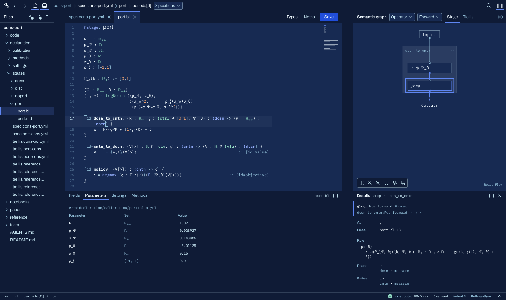

# Quickstart

Open the supplied portfolio model, find the portfolio decision in its source, and trace one of its operations in the diagram. You need a [Workbench installation](../overview/00-install.md) and a Bellman checkout containing the example.

## 1 Open the example

In the desktop app, choose **File → Open Project…** and open `applications/cons-port` inside the Bellman checkout. For the browser version, activate the Python environment used to install Workbench and run this command from the checkout:

```sh
bellman-workbench applications/cons-port
```

The **Trellis** view opens on `spec.cons-port.yml`, the recipe with consumption before portfolio choice. A **stage** describes one part of the problem, such as allocating wealth to assets. A **trellis** arranges the stages across periods and connects the quantities they exchange.

## 2 Open a stage

1. In **Files**, expand `declaration/stages/port` and select `port.bl`. If the file tree is folded, select **Files** in the top bar.
2. Choose **Stage** above the diagram if the **Trellis** view is still selected. The editor shows the portfolio stage alongside its diagram.
3. Select **Forward** under **Direction** and **Operator** under **Graph**. In the `dcsn_to_cntn` frame, select `𝑔≻∗μ`, the operation that applies the law of motion to a distribution. Use **Fit** at the foot of the graph if the frame is out of view.
4. In **Details**, follow the source link to the law of motion for `w`, the resources carried forward after returns and income. Open **Parameters** under the editor to find the gross safe return `R` and the calibration file that supplies it.

The path at the top identifies the recipe and the period you are reading. In this model, `periods[0]` is the terminal period.

[](../_assets/workbench/portfolio-stage.png)

## 3 Check the reading

Use **Problems** above the diagram to see what Workbench could not read or connect. Select a problem to locate the source when a location is available. The model’s [equations](../Bellman-Sym/03-field-equations.md) specify the economic problem. Seeing its diagram confirms that Workbench can display a reading of those equations. A numerical solution is a separate step in the [modelling workflow](../overview/06-workflow.md).

Continue with [Inspect a model](03-inspect-a-model.md) to read a stage in a particular period or [Create and connect stages](05-create-and-connect.md) to start your own project.
