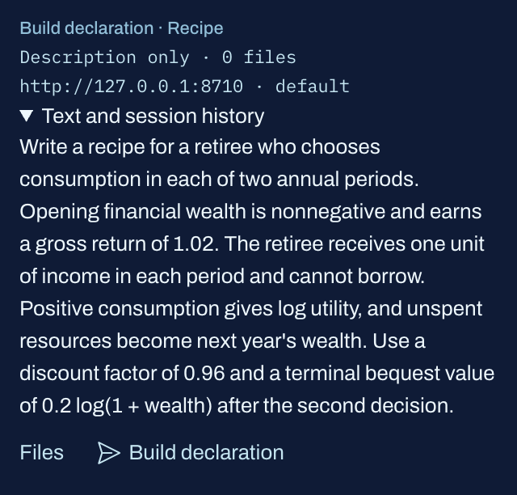
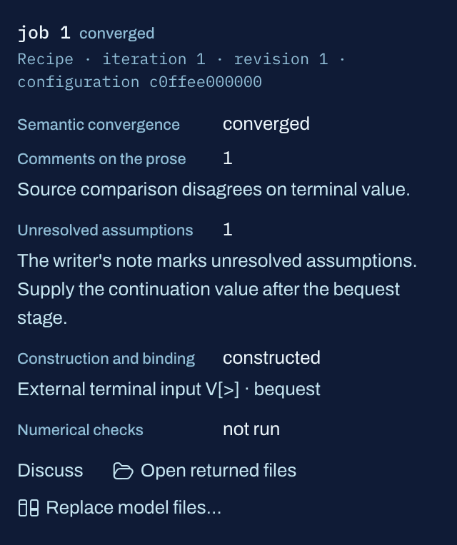

# Build a model with Matsya

Start with an empty project folder and a description of a model. You’ll review what Workbench sends to Matsya, inspect the returned [Bellman-SYM](../wiki/sym.md) files, and choose whether to keep them.

Before you start, [install Workbench](../overview/00-install.md) and [set up the Matsya client](../matsya/user-guide/02-working-from-the-command-line.md) §1 in the Python environment Workbench uses.

This walkthrough uses the Workbench build that offers **Prepare build** after you select **Build declaration** in the composer. If the composer button itself says **Build declaration**, first open a recipe or trellis. In that interface, the composer sends your text to the session and then shows the files for review. Use the review card's **Build declaration** button to start the job. To start from prose alone on that installation, use [the Matsya command line](../matsya/user-guide/02-working-from-the-command-line.md) §2.

## 1 Connect a project

1. Open your project folder in Workbench.
2. Open the **Matsya** column and select **Connect this folder to Matsya**.

The connection creates a **session** on the service shown in the panel. A session keeps the conversation and builds for one project. If the folder contains an `economics.md` file, connecting also sends its contents.

## 2 Prepare and start a build

1. In the Matsya composer, select **Build declaration** for **Kind of request** and **Recipe** for **Output level**. A recipe brings together the stages, periods, and inputs such as parameter values.
2. Enter your model description. For a first build, try this example:

    ```text
    Write a recipe for a retiree who chooses consumption in each of two annual periods.
    Opening financial wealth is nonnegative and earns a gross return of 1.02.
    The retiree receives one unit of income in each period and cannot borrow.
    Positive consumption gives log utility, and unspent resources become next year's wealth.
    Use a discount factor of 0.96 and a terminal bequest value of 0.2 log(1 + wealth)
    after the second decision.
    ```

3. Select **Prepare build**, then open **Text and session history** to check the request and the earlier entries. If you’re revising an existing recipe, open **Files** to check which files will be sent. Workbench asks which version to use if a selected file has unsaved edits.

    { width="440" }

4. Select **Build declaration** on the review card. This sends the reviewed request and starts a **job**, one attempt to write and check the model files.

Use **Ask** to discuss assumptions before building. Put the assumptions you want Matsya to use in the build request. If Workbench says the session changed, select **Prepare again** to review the updated history.

Reopen the project to see a job again. When an interrupted request offers **Resume submission**, select it to retry the same request.

## 3 Inspect the result

1. On the job card, read **Comments on the prose** and **Unresolved assumptions**. **Semantic convergence** means successive declarations agree under Matsya’s comparison. Check that the files also match your description. If Matsya stops with a question, see [Replying to a job’s questions](../matsya/user-guide/02-working-from-the-command-line.md) §3.
2. Select **Download returned files**. Check **Construction and binding** for problems reading the model or supplying its inputs. The build with **Prepare build** lists external terminal value functions on the card. In the other interface, [inspect the terminal period](03-inspect-a-model.md#4-check-what-the-model-still-needs). Solving the model is a separate step.

    { width="440" }

    *Example result after download. The model still requires a continuation value after the bequest stage.*

3. If the job returned a declaration, select **Open returned files** to inspect the copy. This switches the active folder. Review the files there and keep any edits for your original project after adoption. The saved copy is protected from writes.

## 4 Keep the files

1. If you opened the returned copy, return to the original project. In the browser, reload the project page. In the desktop app, choose **File → Open Project…** and select the original folder.
2. On the job card, select **Replace model files…** and check the proposed file changes and destinations.
3. Select **Adopt first declaration** for an empty project or **Replace model files** for a revision.
4. Check the destination in **Files**. If the tree still shows the earlier contents, reload the browser page or close and reopen the desktop project. Include any unresolved assumptions when you [hand over the draft](07-share-and-troubleshoot.md#4-hand-the-model-to-a-colleague).

## 5 Ask a question or find a source

| To | Choose | What you get |
|---|---|---|
| Discuss an assumption or ask about Bellman-SYM | **Ask** | An answer with citations. A selected file in the editor is not attached to an ordinary question. |
| Find passages on a topic | **Search sources** | Matching passages from the collection you choose. Select a passage to read the quotation. |
| Ask about a particular result | **Discuss** on its job card | The job becomes the one discussed in later questions in that session. |

Select a citation to read the passage or open the source location when Workbench has the file. In source search, **Discuss** beside a passage puts the quotation in the composer so you can add your question. If you work in a local-only environment, start Workbench with `BELLMAN_WORKBENCH_MATSYA=off` to hide the Matsya column.

If you explicitly ask Matsya to build in chat, it can start a job from the session. In the Workbench build with **Prepare build**, the chat-started job appears in the panel. Use the reviewed build flow when Matsya should also read your selected local declaration files.

Use [the cited material and the model files](../matsya/user-guide/01-the-roles-and-the-work-of-a-job.md) to check the answer before relying on it.
