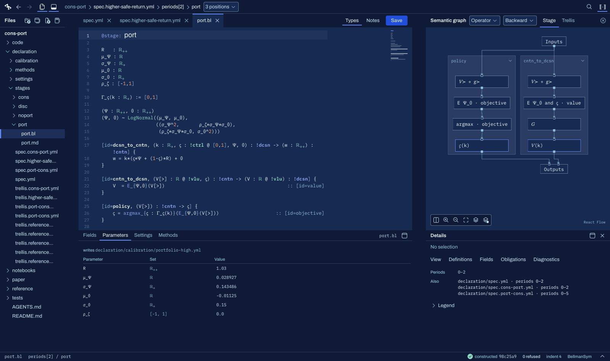

# Manage recipes and variants

A **recipe** names the trellis file, the stage declarations, and the sources that supply parameter values, numerical settings, and method assignments. Each use of a stage in a period is a **stage occurrence**, with the sources the recipe selects for that period. The base recipe is `declaration/spec.yml`. [The Bellman factory](../Bellman-Sym/08-bellman-factory.md).

## 1 Select a recipe and inspect a stage

1. Open the model folder containing `declaration/`. In **Files**, choose `spec.yml` or a variant such as `spec.high-risk.yml`. The editor opens the file, **Trellis** shows that recipe's periods, and the path at the top names the active recipe.
2. Open **Inspector** to see **Recipe** under the editor. The top control names the trellis file. Each stage row shows the stage key, its file, and entries under **Calibration**, **Settings**, **Methods**, and **Periods**.
3. To see the values used at a particular occurrence, double-click its card in **Trellis**, or select the card and choose **Open the stage** in **Details**. The stage file opens with that occurrence's bindings. Use **Parameters**, **Settings**, or **Methods** in the Inspector. The position control in the top path lets you select another occurrence when the file is used more than once. If opening a stage from **Files** shows it without values, select the intended recipe and open the stage from its trellis card.

The period selector above the graph filters what you see. Choose **all** or a period range, untick stage keys to hide their occurrences, or type a restriction such as `periods 0–2`, `stages cons, port`, or `periods 0–1, stages cons` and press Enter. The restriction affects the view. To change the periods in which a stage occurs, edit its recipe row as described below.

## 2 Change the files a recipe uses

1. Open the recipe and click a stage row in **Recipe**, or focus the row and press Enter or Space. The open row shows selectors for its stage file and its existing source entries. Use the trellis selector above the table to choose a different trellis file.
2. Choose a file of the matching kind. **Calibration** supplies parameter values, **Settings** supplies numerical choices such as grid sizes, and **Methods** names the routines attached to named targets in the stage. A source list is read in order, with later entries overriding assignments to the same name. Sources listed for a period range apply after the common `all` list. To add a source entry or range list, edit the recipe text.
3. An entry such as `$cons_calibration` is a **slot**, a place for a mapping passed when loading the recipe in Python. An unfilled slot contributes no assignments. To use a saved source in the Workbench, replace the slot with a matching file in the selector. Where **New file** is offered beside a slot, it creates a starter source, replaces the slot with its path, and opens the file for editing.
4. To restrict a stage to certain periods, enter a range such as `0–0` in its **Periods** cell and press Enter. This writes `periods: [0, 0]` and leaves the stage active only in the terminal period if the period lists it. Clearing the cell removes the recipe's restriction. This is separate from a source range, which changes the assignments a stage receives in periods where it is already active.
5. Inspect the recipe's edited text and save it. If **New file** opened a source, fill and save that file, then return to the recipe and save its changed reference. Reopen an occurrence to check the applied bindings. **Problems** links to any binding refusal and the source it names.

See [Source order, slots and period ranges](../Bellman-Sym/08-bellman-factory.md#32-the-source-lists-and-the-merge) for the rules on merging sources.

In a [modular model](../bellman-calculus/APPX-H-MODULARITY.md), repeated declarations keep their calibration sources. A fixed table or function gives an age profile, read at an age field supplied through the model. The recipe still permits positional calibration; methods and settings can vary independently of modularity.

To change an existing table or matrix, follow its parameter-name source link in **Parameters**, edit the YAML in the source file, and save it. The value-entry control can add a missing list or matrix, but refuses to replace an existing entry with a list. Reopen the occurrence to inspect the bound result.

## 3 Create a variant

1. In **Files**, choose **New variant**. It starts from `declaration/spec.yml`, even if another recipe is open. Save pending changes to the recipe, its trellis file, or a period template it uses before copying.
2. Enter a **Name** such as `high-risk`, using letters, digits, and hyphens, and choose **Write the variant**. The Workbench creates `spec.high-risk.yml`, `trellis.high-risk.yml`, and copies of the period templates the base trellis names. It opens the new recipe and shows its trellis.
3. Edit period lists or connectors through the variant's files. To vary a calibration, setting, or method independently, give the variant its own source file and choose that file in the variant recipe. To vary an equation, copy the stage declaration to a separate stage folder and point the variant's stage row to it.

The copy shares the original stage files and the calibration, settings, methods, and registry sources they reference until you change those paths. Editing a shared source affects every recipe that names it. The **New variant** form lists the registry sources the copy keeps, such as an age-profile table. Check its domain and the terminal data you supply if the variant changes the ages its recurrence reaches. [Variants in the model directory](../Bellman-Sym/reference/model-directory-layout.md#3-variants).

## 4 Give a variant its own calibration

Change the safe return in a disposable copy of `applications/cons-port`:

1. Before opening the copy, duplicate `declaration/spec.cons-port.yml` as `declaration/spec.yml`. This gives **New variant** the base recipe it expects.
2. Open the copy and create a variant named `higher-safe-return`. With your file manager or editor, copy `declaration/calibration/portfolio.yml` to `declaration/calibration/portfolio-high.yml`. Save any Workbench edits before reloading or reopening the project to list the new file.
3. Open `spec.higher-safe-return.yml`. In **Recipe**, expand the `port` row and select `portfolio-high` under **Calibration**. Check the new path in the recipe, then save it.
4. Open period 2’s `port` card from the variant’s trellis. In **Parameters**, check that the source is `portfolio-high.yml`, then enter `1.03` for `R` and press **Enter**.
5. Reopen the base recipe and the same period’s `port` card. Verify that the base still uses `portfolio.yml` and `R = 1.02`. To export the comparison, reopen each saved occurrence and [keep the export sets separately](07-share-and-troubleshoot.md#2-export-a-diagram). Compare solved portfolio choices in your numerical workflow.

